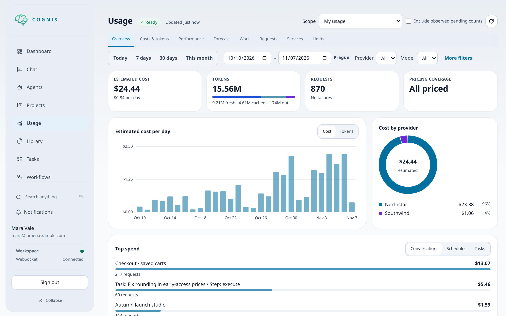
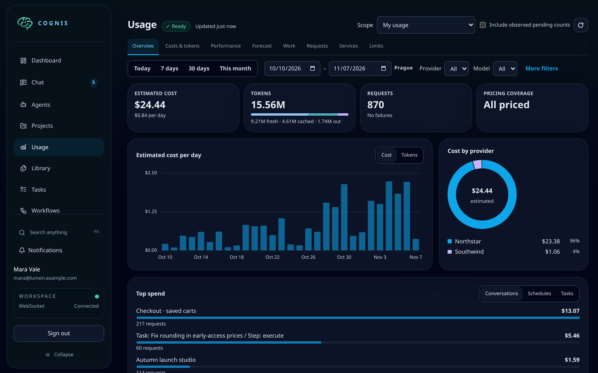
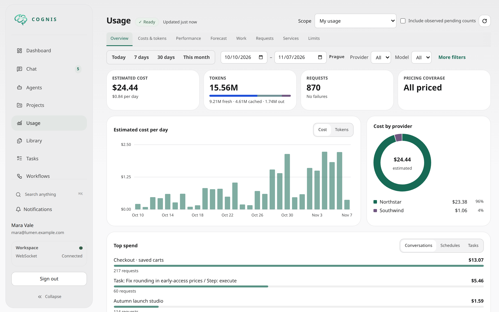
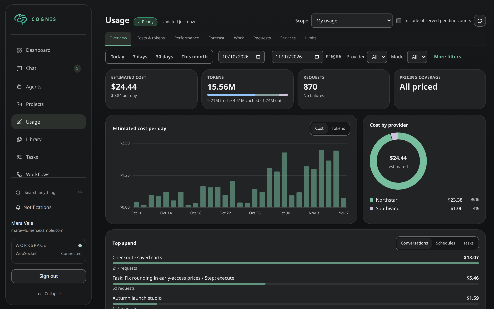
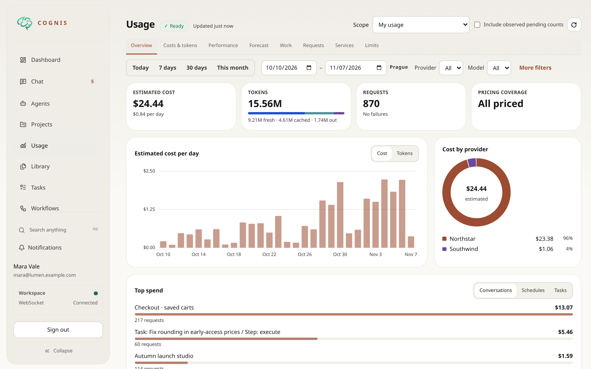
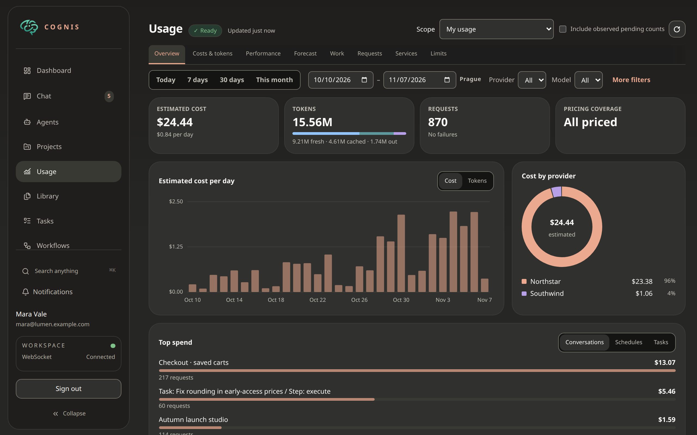

# Appearance

Cognis includes four appearance families: **Classic** (the default),
**Porcelain**, **Gruvbox**, and **Paper**. Every family supports **System**,
**Light**, and **Dark** appearance. System follows
the operating system, including changes while Cognis is open. An explicit
choice stays fixed until you change it. Appearance updates in place without
reloading conversations or resetting drafts.

Choose **Settings → Display** to select a family and its mode independently.
Changing family preserves your mode; selecting System follows the operating
system within that family, not a different family.
The semantic palette applies across application navigation, forms, dialogs,
chat, tools, documents and settings, rather than only changing the page canvas.

The existing account preferences own this setting. It follows the verified
account and server profile, including preference resets and failed-save
rollback. A device-local cosmetic hint keeps loading and expired-session pages
consistent while verified preferences are unavailable. Explicit logout removes
that hint and returns to Classic/System.

## Bundled families

| Family | Character |
|---|---|
| Porcelain | Neutral white and soft charcoal paired surfaces with restrained jade accents and shared geometry. |
| Classic | The default Cognis family. Dark colors are source-restored from the pre-theming UI; semantic roles consolidate some former alpha layers, so this is not a claim of exact historical pixel parity. |
| Gruvbox | The original warm palette, including yellow `#fbf1c7` Light surfaces, brown-gray text and earth-tone accents. |
| Paper | Claude-inspired warm neutral Light/Dark surfaces with compact chat typography. |

Application and chat text default to 14px; Paper uses 15px. Editing controls on
coarse-pointer devices may remain 16px to prevent automatic iOS input zoom.
Family selection does not change chat layout, message identity or saved content.

## Appearance gallery

The same Usage data from the fictional Lumen demo workspace is shown in each
view. These figures are not actual inference or billing. Classic remains the default;
Porcelain Light is used for the documentation examples.

| Family | Light | Dark |
|---|---|---|
| Classic |  |  |
| Porcelain |  |  |
| Paper |  |  |

Gruvbox is also available in both modes.

Gruvbox preserves its original colors rather than recoloring them to pass a
uniform contrast threshold. Some UI status/muted tones and decorative
boundaries have lower contrast. The six syntax foreground roles are deepened
to reach at least 4.5:1 against the actual code background while preserving the
original Light surfaces. Choose another family if secondary UI tones are hard
to read. Do not rely on syntax color alone to understand code or status.

## Startup and native surfaces

Before account verification, a small device-local cosmetic hint supplies the
loading screen and browser chrome appearance. It contains only the resolved
family, mode and palette, never account data or permissions. Missing account
preferences do not overwrite this hint with Classic defaults while loading.
Without a valid hint, startup uses Classic with the operating system's mode.
The verified account's cached or freshly loaded preferences remain authoritative.

Apple launch images can follow only the operating system, not the verified
account's family or mode. Their backgrounds are Classic Dark (`#07111A`) and
Classic Light (`#D4DCE5`), with the same centered jade mark. A custom family
therefore appears after the OS launch screen when the cosmetic hint or verified
account preferences are applied. The
static web manifest uses Classic Light for both `theme_color` and
`background_color`, matching the page's default metadata; runtime browser/native
chrome continues to follow the resolved account appearance.

Regenerate launch images alone with
`uv run scripts/generate_brand_assets.py --splash-only`. The full canonical
generator remains available without that flag. Launch filenames, dimensions,
OS-qualified media selectors and application icon contracts do not change.
Check the generated artwork and full generator parity with
`uv run scripts/test_brand_launch_assets.py`; this uses the generator's isolated
CairoSVG/Pillow tooling plus the existing pytest framework, not backend dependencies.

Loading and recovery screens have self-contained light/dark styles so they
remain readable when application assets fail to load. The jade logo is unchanged.
The existing native appearance bridge receives the resolved mode and opaque
chrome color. Changing family refreshes that chrome even when Light/Dark stays
the same. Native rail documents remain transparent; appearance does not
change safe-area, keyboard, rail or window geometry.

## Semantic styling contract

The root publishes `data-theme-family="porcelain|classic|gruvbox|paper"`,
`data-resolved-theme="light|dark"` and a synchronized `.dark`
class. Components must consume semantic roles rather than invert colors or
redefine Tailwind's Slate palette. Each color is an RGB channel custom property
`--color-<role>` and a Tailwind color of the same name. Opacity modifiers work:
`bg-chrome/90`, `border-separator/60`, `hover:bg-surface-hover`.

| Purpose | Roles |
|---|---|
| Surfaces | `canvas`, `chrome`, `surface`, `inset`, `elevated`, `surface-hover` |
| Text | `foreground`, `secondary`, `muted` |
| Boundaries | `separator`, `control-border`, `border-strong` |
| Interaction | `accent`, `accent-hover`, `accent-subtle`, `on-accent` |
| Status | `success`, `warning`, `danger`, `info`, each with `-subtle` and `-border` |
| Categories | `violet`, `cyan`, `pink`, `orange`, `indigo`, `teal`, `lime`, `purple`, `blue`, `fuchsia`, each with `-tone`, `-subtle`, `-border` |
| Syntax | `syntax-keyword`, `syntax-string`, `syntax-number`, `syntax-comment`, `syntax-title`, `syntax-punctuation` |
| Overlay | `scrim` (use an explicit opacity, e.g. `bg-scrim/60`) |

Examples: `text-violet-tone bg-violet-subtle border-violet-border`,
`text-danger bg-danger-subtle border-danger-border`.

Use `bg-accent text-on-accent` for filled primary controls, with
`hover:bg-accent-hover`. Do not use white text unconditionally: the dark
theme's bright accent needs dark text. Likewise, use opaque tone foregrounds
for small category labels; lowering text opacity can remove accessible contrast.
Keep labels/icons as well as color for status distinctions.

`separator` is decorative. Use `control-border` or `border-strong` when a
boundary is needed to recognize a control. Standard Tailwind hover, active,
focus-visible, disabled and selection variants work with all roles. Disabled
controls should use actual disabled semantics, not only a color change.

`shadow-card` and `shadow-overlay` adapt to appearance. `material-chrome` is
opt-in for navigation/tool chrome only, with an opaque fallback when blur is
unsupported or reduced transparency/greater contrast is requested. Content
surfaces stay opaque. No appearance crossfade is added; existing reduced-motion
behavior remains. Forced-colors mode uses system canvas, text, link and focus
colors, drops decorative shadows and preserves native rail transparency.

Global prose (including legacy `prose-invert`) and JSON/highlight.js syntax
follow application roles. Outgoing Markdown inherits the foreground paired
with its bubble's fill, including headings, links and inline code.

## Rich documents and standalone viewers

Embedded rich documents follow the application family. The viewer's
**App** mode follows the resolved application theme; explicit **Light** and
**Dark** override the mode without changing family. **System** still means the operating system, not the
application preference. Existing explicit System choices keep that meaning.
Use the viewer's theme control to cycle between these modes.

Standalone shared and exported HTML viewers do not require application
preferences. Their default is System; an App choice also falls back to the
operating system outside the application. Explicit Light/Dark viewer choices
remain available. Viewer choices are stored separately from account appearance.
Standalone viewers do not depend on an authenticated application's family.

Rich documents keep their own `--rich-*` tokens and resolved viewer boundary;
do not replace them with application utilities or let global app styling
override an explicit viewer choice. Charts, diagrams and image-viewer controls
use the viewer's resolved appearance. Standalone image viewers tolerate missing
application safe-area variables through a local fallback. Printed documents
hide viewer controls rather than printing interactive chrome.

## Intentional color exceptions

- Images, video and other authored media retain their original colors. Do not
  invert them to simulate a theme.
- Project identity, agent/category identity, chart series and authored rich
  content may retain intentional colors. Use accessible semantic tone text
  for small application labels; identity color is not a substitute for a
  readable label or a focus indicator.
- ANSI terminal output preserves the terminal's color meaning and dedicated
  output surface. Do not mechanically replace ANSI colors with application
  status roles.
- The jade logo and other brand artwork remain unchanged. Neutral surrounding
  surfaces and controls still follow the application or viewer theme.

## Extending semantic appearance

For a new component, reuse the role table above and choose roles by purpose.
Keep foreground/fill pairs together, including hover, selected, disabled and
focus states. Use category tone families rather than pale literal hue text
on light surfaces. Do not add `dark:` duplicates when semantic roles already
express the behavior.

For a genuinely new semantic role, add RGB channel values to all eight variants in
`ui/src/lib/theme/tokens.css`, register its opacity-compatible Tailwind color in
`ui/tailwind.config.ts`, and add contrast/pairing coverage to the existing theme
tests. Keep aliases and prose/syntax consumers consistent. Appearance resolution
belongs to `startAppearance()`; account persistence belongs to the preference
store, not individual components.

### Adding a bundled family

`ui/src/lib/theme/catalog.ts` owns the supported family IDs and their displayed
names and descriptions through `THEME_FAMILIES`. The preference contract stores
`display.theme_family` separately from `display.theme`. Existing preference JSON
without the key, or with an invalid stored family, uses Classic; no SQL migration
is required. All explicitly saved valid families and modes are preserved,
including Porcelain saved while it was the default. Existing JSON cannot
distinguish that former implicit default from an intentional choice.

During rollout, a legacy preferences PUT with an explicit `display` object
that omits `theme_family` preserves the stored family. An explicit family wins;
invalid family IDs return HTTP 422. Omitting `display`, or sending a top-level
`{}`, retains the existing default/reset behavior. This is a narrow rollout
rule, not a generic partial-merge API.

Define each family's Light/Dark role values once in
the palette modules imported by `ui/src/lib/theme/tokens.css`. The same
definitions apply to any `[data-theme-family][data-resolved-theme]` boundary,
including the document root and opt-in embedded reader boundaries. The
selectors are not restricted to `:root` or a required `.theme-palette` class.
Dependent default aliases deliberately use zero-specificity `:where()` selectors
so they cannot override a scoped reader's family values.
Embedded readers use this boundary so their explicit mode can differ from the
application while preserving its family. Do not copy palette values into
component CSS, reader templates, native code or settings options.

There is no theme plugin registry. Adding a family requires catalog,
preference validation, complete Light/Dark tokens and tests; adding CSS alone
does not create a supported user setting. Preserve System semantics,
account-reset behavior, startup safety, browser/native chrome synchronization
and the independent rich-viewer override contract.

Validate new styling in light and dark modes, including opacity modifiers,
keyboard focus, reduced motion/transparency, increased contrast and forced
colors. Check both application prose and explicit rich-viewer overrides, then
capture representative screenshots with the existing browser tooling.

### Migration mapping

- `bg-slate-950` → `bg-canvas`; shell/header backgrounds → `bg-chrome`.
- Slate-900 content → `bg-surface`; recessed sections → `bg-inset`;
  popovers → `bg-elevated`.
- Slate-50/100/200 text → `text-foreground`; Slate-300 →
  `text-secondary`; Slate-400/500 → `text-muted`.
- Decorative borders → `border-separator`; control outlines →
  `border-control-border`.
- Interactive sky text/rings → `text-accent` / `ring-accent`;
  selected tint → `bg-accent-subtle`.
- Small literal hue labels → `text-<hue>-tone`, paired with that hue's
  subtle fill/border if needed.

Choose by purpose, not a global shade replacement. Keep literal brand, image
and data-series colors when they encode authored content. Existing
`--theme-*` variables remain semantic aliases for migrated consumers.
