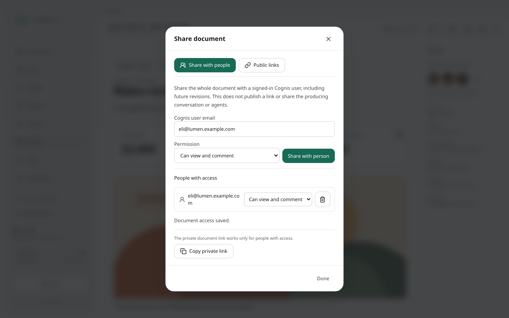

# Content and Temporary Sharing

## Document headers

Document headers use one **Share** control. Choose **Private** in the expiration
selector to copy the internal Library link without creating a public link or
granting anyone access. Choose a duration or custom expiration to create a
public link. Private is the default when an internal link is available.

The star beside the document name toggles the same favorite state used by
Library. Saved favorites also show a filled star in Work and project activity
lists, without needing to open the document.

## Conversation Work

The conversation **Work** sidebar lists agent-produced artifacts and deliverables,
not uploaded user attachments. **All workstreams** includes historical backing
sessions and descendant work; select a child workstream to narrow the list.
Search matches output names and deliverable preview text as well as workstream
and agent names. Filtered lists continue loading older pages, so a search is not
limited to the first page. Time filters preserve the selected tab.

Output rows show a relative creation or revision time and a revision label such
as **v4**. Artifact rows also identify the latest live revision when the listed
reference is older. The listed file remains the exact revision produced or
attached at that point; it is not silently replaced by newer content.

## Library

### Create and edit files

Use **New artifact** to upload a file (up to 20 MiB) or write text (up to 1 MiB).
The filename is editable and starts with the uploaded filename. Select agents
to grant explicit access, or leave the artifact private. Creation from a project
Resources browser also shares the document with that project.

Artifact owners can choose **Edit** for eligible text files. The existing source
pane becomes editable in place. **Save** creates a new immutable revision;
**Cancel** discards the edit. JSON is validated while editing and on the server.
The eye button previews eligible JSON, HTML, and Markdown drafts without saving.
HTML previews are sandboxed. Invalid JSON cannot be saved, and a concurrent
revision returns a conflict instead of overwriting another change. Old revisions
remain readable. New drafts and unsaved edits warn before navigation or reload.

### Share documents

The example uses fictional local accounts. It shows the owner's sharing
controls, not a verified reviewer or anonymous-access test.

Artifacts and deliverables use the same preview-header controls in chat and
Library. Next to **Download**, **Copy internal link** copies the authenticated
Library address, and **Share public link** opens a separate dialog.

- **Agent access:** the details sidebar shows owner and recipient avatars.
  Use **+** to open the agent picker and select explicit recipients. The same
  picker is available in **New artifact**. Existing documents offer **Read** or
  **Read + write** for each explicit recipient. Project, producer, and other
  inherited access is labeled separately and cannot be removed by clearing an
  explicit selection. Explicit changes apply to the document's existing revision
  history; new revisions inherit these grants. Explicit grants work independently
  of project membership and remain until revoked. Agents assigned to the
  document's project inherit read + write automatically. The picker shows both
  sources; removing an explicit grant does not remove inherited project access.
  A document grant never grants project browsing or access to its source chat,
  task, or other documents.
- **Public link:** choose **View in browser** or **Download file**, then select
  an expiry or custom expiration. Previewable formats default to View; unsupported
  formats default to Download. HTML View links open the standalone page.
  Links always open the latest version of the document: a link created from any
  revision serves the newest live revision when it is opened, and public viewers
  get no revision history. Comments made through a link stay on the revision they
  were written against.

Anyone with a public link can use it until expiration. These are signed,
stateless links: there is no individual-link revocation, and removing an agent
grant does not invalidate a public link already issued. Editing and sharing
and grant-management controls are owner-only. Agent write access permits only a
new revision, not deletion, resharing, or changing the lineage's owner/project.
Each revision records its author separately from the owner; revision history
and Library details show that author.

Agents use `artifact_share` to inspect or change sharing. Its `grant` action
defaults to `permission: "read"`; use `"write"` explicitly to allow revisions.
The `set` action accepts `agent_ids` and its `write_agent_ids` subset.
Both `artifact_write` and `write_deliverable` require the exact revision last
read as `supersedes` when continuing a lineage. If another write has moved the
head, the server rejects the write with the current head. Re-read it and decide
what to write; the server never merges or retries. This also applies to two
writes from one session and explicit revisions from the same workflow step.
Revoking or downgrading write takes effect at the next publication transaction,
including in running sessions. It does not cancel already committed revisions.

JSON is pretty-printed and highlighted in the shared source and code readers,
including artifact previews, chat attachments, knowledge documents, and rich
JSON code blocks. Formatting does not modify stored bytes or downloads.

### Browse documents

Open **Library** in the main navigation to find work without knowing which
conversation or agent produced it. **Deliverables** shows documents; **Files**
shows persistent uploaded and generated files. Project **Resources** uses the
same browser, scoped to that project.

- Search matches titles and filenames, not document bodies.
- Filter by project, agent, ownership, format, creation dates, and file source.
  Upload and agent icons distinguish **User uploads** from **Agent outputs**.
- Choose **List**, **By project**, **By conversation / task**, or the nested
  **Project / conversation / task tree**. Readable task outputs, including files
  from specialist sessions, appear under **Task: title**. Folders load on expansion; counts cover all
  matching accessible items, not just the first page.
- Sorting applies to both documents and folders. **Recently updated** orders
  each folder by its most recently updated matching document; **Recently created**
  uses its newest matching document's creation time, including nested folders.
- Lists show the current eligible revision of each document. Open an item in a modal to
  read it, view revision history, download it, and copy its internal link.
  Existing sharing controls appear where permitted.
- Artifact previews use the same renderer in chat and Library. Markdown,
  CSV/TSV tables, and Mermaid diagrams open rendered immediately; code and JSON
  stay highlighted, PDFs have page and zoom controls, and HTML stays sandboxed.
  **Edit** opens the original text source; **Preview** shows the draft.
- Use the **star** beside a document or in its preview header to add or remove a
  personal favorite. In chat, open an attachment preview or image lightbox to
  favorite it; message attachment rows and thumbnails stay free of stars.
  The same control is available in task deliverables.
  **Favorites** in Library filters both list and grouped views. Favorites follow
  new revisions, are private to your account, and never override content access.
- Click the backdrop to close a modal. A dialog with unsaved edits ignores that
  accidental dismissal; save or explicitly cancel the changes first.
- Filters and view choices live in the URL and persist per user and browser,
  separately for Library and each project. Explicit URL filters take precedence.
  Closing a modal preserves loaded pages and folder state. Resource links work
  independently of recent activity and can still open as standalone pages.

The Library includes your content and readable project documents. It does not
grant agents additional access. Sharing a document does not expose its private
source conversation or task metadata. Retained documents remain readable after
their source conversation is deleted. Expired/deleted files, temporary uploads,
avatars, and internal tool-output caches are excluded.

Cognis keeps content and the URL used to share it as separate concerns. An
artifact can remain available to its authorized owner after a temporary sharing
link has expired.

> Cognis temporary sharing is not web hosting. A signed URL is a bearer link:
> anyone who has it can use it until it expires.

## Feedback and revocable commenting links

**Feedback** opens source-bound threads beside a document or in a narrow-screen
sheet. Comments retain their exact revision or recorded event. Missing historical
locations are reported, not silently moved to a newer revision. Thread
resolution, delivery and agent work status are separate.

Saving does not dispatch work. In chat, review and explicitly include prepared
feedback in the composer. Outside chat, choose an authorized destination: an
origin, preferred follow-up, fresh conversation or eligible task reopen. A task
reopen requires confirmation of the target, downstream invalidation and
side-effect warning. Changing the selection or destination invalidates that
confirmation.

Review freezes exact entry versions and minimum parent context. Outside-chat
sends are saved before dispatch. After reload or response loss, **Check saved
send** reconciles the same creation key. A new review requires a known accepted
or rejected delivery.

In **Access**, feedback read, comment, moderation, dispatch and disclosure are
independent permissions. Viewing content alone does not grant these powers.
Revocable commenting links are separate from ordinary stateless public links.
They pin one document revision and enable comments explicitly. **Own comments
only** is the default; shared discussion is an explicit alternative. Owners can
disable commenting or revoke a link.

Guest names are unverified labels, not account identities. Guests have no agent
send control or owner-session fallback, even in a signed-in browser. The public
viewer exchanges and removes the raw URL token, then uses bounded public
capabilities rather than private URLs or owner cookies. Guest recovery is
tab-scoped. Offline exports remain read-only.

Public outcomes show only an owner-published disposition and reason, never
private packet text, task IDs or conversation links. Authorized internal history
can inspect the immutable packet and exact results. Dashboard documents expose
their preferred follow-up and explicitly linked result revisions.

## Content lifecycle

| Use case | Stored as | Retention | Sharing behavior |
|---|---|---|---|
| A user uploads an image, PDF, or file for an agent | Temporary artifact | Upload records expire after 24 hours | Use it in the conversation while it is retained; do not rely on it as durable storage |
| An agent generates an image | Attached artifact | Retained until deletion or an applicable storage cleanup policy | Rendered in web chat; a new temporary URL can be generated when needed |
| An agent generates a PDF or other document | Local executor output, then a published artifact when delivered | Published artifacts are retained until deletion or cleanup policy | Share the published artifact with a signed download URL |
| An agent generates a self-contained HTML page | `text/html` artifact | Retained until deletion or cleanup policy | Share an inline-view signed URL; this is a one-shot page, not a hosted site |
| An agent writes a rich deliverable | Durable deliverable record with fallback content | Managed as a deliverable, separately from file artifacts | Rendered in Cognis; a standalone temporary link can be generated from the Share action |

Retention is not a promise of permanent storage. Administrators may apply
storage cleanup policies and users can delete their content.

## Artifacts

Artifacts are the binary or file-like objects Cognis persists: uploads,
generated images, PDFs, data files, and published HTML. Artifact IDs can be
used with artifact-aware tools and references.

### Temporary signed links

`artifact_get_url` mints a signed URL for an existing artifact:

- Minimum TTL: 60 seconds.
- Maximum TTL: 7 days.
- Default TTL: 1 hour.
- `mode="download"` prompts a download.
- `mode="view"` serves supported content inline. HTML viewing requires
  `text/html`.

The link expiry does **not** delete the artifact. An owner or another
authorized Cognis user can mint a replacement link while the artifact still
exists. A recipient who only has the old bearer URL cannot refresh it.

The returned `public_url` or `signed_url` is a temporary capability URL, not a
permanent public URL.

### Self-contained HTML

Publishing a `text/html` artifact is useful for a disposable, single-page
report or micro-experience. Inline viewing deliberately uses a restrictive
content-security policy: make the page self-contained, using inline
JavaScript/CSS and `data:` or `blob:` assets. Do not depend on external network
requests.

This feature is intentionally not a replacement for application hosting. A
future micro-app/public-hosting capability will have separate publication,
routing, versioning, and revocation semantics.

### Revisions and stable IDs

Artifacts use the same revision model as deliverables. Every revision is its
own immutable artifact with its own `art_` ID, so an existing ID, attachment,
or `$artifact:<id>.*` reference always means the same bytes. The first
revision's ID is the document's stable `lineage_id`.

- `artifact_write` saves text (for example JSON configuration or state)
  without an executor file. `artifact_publish` uploads an executor file. Both
  accept `supersedes` (the `art_` ID you last read) to create the next
  revision.
- Only the latest revision can be superseded. A stale write fails with
  `supersedes_not_latest` and `latest_artifact_id`; re-read and retry. A JSON
  MIME type must contain valid JSON. A rejected write stores nothing.
- `artifact_get_content` returns exact text, or parsed JSON, plus revision
  facts. An ID returns that exact revision; `latest: true` returns the newest
  revision of the document. It also accepts `dlv_` IDs.
- `artifact_get_metadata` adds `lineage_id`, `revision`,
  `latest_artifact_id` (or `latest_deliverable_id`), `is_latest`, and the
  revisions the caller may read.
- Search and listing return only the latest revision of each document.
- `artifact_write` is silent: nothing is attached to the reply and nobody is
  notified. Present a file explicitly with `attach_artifact`.

Typical deterministic state loop (for example a scheduled price watcher):

1. Store the checkpoint's stable `lineage_id` in the configuration.
2. `artifact_get_content(<lineage_id>, latest=true)` and keep the returned
   `artifact_id`.
3. Run the search. With no new results, finish silently.
4. Write the report as a deliverable, then
   `artifact_write(supersedes=<artifact_id read>)` with the new checkpoint.
5. A `supersedes_not_latest` conflict means another run advanced the
   checkpoint; re-read and stop or retry.

The checkpoint records that the report was persisted, not that a notification
was delivered.

### Project documents

Artifacts and deliverables store their project. A document written in project
work that is shared with the project (a project-visible chat or task, or an
agent's default project) joins that project automatically. Private chats and
tasks inside a project produce private documents. A new document created
outside project work may name `project_id` explicitly. Every revision keeps its
document's project.

Documents follow their chat. When a chat is added to a project, moved to
another project, removed from a project, or switched between shared and
private, the documents that started in that chat move with it, including every
revision. A document placed explicitly in another project, or started in
another chat or a task, keeps its project.

- People with a project role can read project documents; writing a revision
  needs a role that can use the project.
- An agent can read its own artifacts and deliverables across chats without
  project assignment, provided the acting person owns that content and still
  has project read access, including when working in another project.
  Reading other agents' project documents or writing project revisions still
  requires assignment to and usability in that project for the acting person,
  and the work must not be running in another project.
  Membership never opens the owner's private artifacts.
- `artifact_search` and `artifact_list_recent` include the current project's
  documents and accept `project_id` (or `"current"`). Task deliverables are
  included as well.
- `GET /api/v1/artifacts/{id}/revisions` lists readable revisions.

## Documents and PDFs

`document_generate` turns Markdown or HTML into a PDF on an executor. The
generated local file becomes a shareable chat attachment only after it is
published as a Cognis artifact.

Use documents when the desired output is a conventional portable file: a
proposal, invoice, report, or print-ready document. Use a rich deliverable
when the primary experience is an interactive Cognis-native page.

## Expired deliverable links

Expiration revokes anonymous bearer access. An anonymous visitor cannot open an
expired deliverable link. If you open it while authenticated as the deliverable's
owner, Cognis redirects to the owner view and shows **Shared link expired**.
Other authenticated users do not gain access through this recovery path.

To share it again, open the deliverable in Library and create a new public link
from **Share public link**. Recovering owner access does not extend the old
link's lifetime. This recovery applies to deliverable view links, not to every
artifact download or temporary URL.

## Related guides

- [Rich Deliverables](rich-deliverables.md)
- [Rich Deliverable Composition](rich-deliverable-composition.md)
- [Tools and Skills](tools-and-skills.md)
