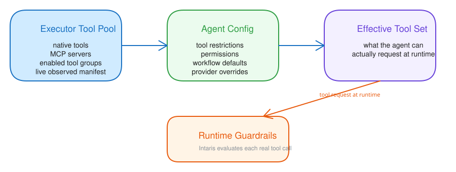

# Creating Agents

For event-driven customization, see [Agent hooks](agent-hooks.md). Hooks inject
instructions or run independent background work for an owned agent.

Open `Agents` to create or edit agents. An agent defines how Cognis should behave, what tools it can use, which model it prefers, and which workflows it may run.

## Editor tabs and saving

Agent settings use one tab bar: **Identity**, **Providers & models**, **Tools**,
**Access & delegation**, **Profiles**, **Workflows**, **Hooks**, and
**Collaboration**. Tabs depend on the agent type and your permissions.
**Collaboration** contains project assignments and sharing; **Identity**
contains availability and system-agent actions. A shared agent's personal
executor settings are under **Access & delegation**.

Configuration changes remain drafts when switching tabs. **Save changes**
(or **Save overrides** for system agents) saves configuration across all tabs.
The save bar indicates whether configuration has unsaved changes.

The following actions save separately and show a success notification when complete:

- Hook assignments, toggles, removal, and **Save parameters**.
- Secondary-agent binding toggles under **Workflows**.
- Sharing, share executor-scope changes, and revocation.
- Activation, suspension, system enable/disable, and personality sync.
- A shared agent's **Save executor** action.

These actions preserve unsaved configuration. Personality sync uses saved
personality, so save configuration before syncing. **Reset overrides** is an
explicit exception: it asks for confirmation before discarding saved overrides
and unsaved configuration. Project assignments are managed from each project's
**Agents** tab and apply there, not through the agent configuration save.

Panels mount on first visit and retain their state afterward. Tool catalogs,
hooks, and collaboration data load when their tabs are first opened.

Under **Providers & models**, memory and guardrails have separate groups.
With **Intaris** selected, **Advanced evaluation controls** contains outcome
overrides and the escalation timeout. This group opens automatically when an
override is configured; safety warnings remain visible even when the group is
collapsed. With **None**, evaluation and approval controls are hidden; the backend
selector and **Session analytics** toggle remain available.

**Session analytics** (`capabilities.analytics_enabled`, default `true`) controls
Intaris summaries and behavioral analytics independently of the guardrails
backend. Turning it off does not remove session events or tool audit records.
With guardrails **None**, ordinary evaluation and proactive intention/alignment
work are disabled; explicit mandatory evaluation still runs. All four
guardrails/analytics combinations are supported.

| Guardrails | Session analytics | Effect |
|---|---|---|
| Intaris | On | Preventive tool evaluation plus retrospective session and behavioral analysis. Usual baseline for personal assistants and autonomous or public-facing agents handling untrusted input. |
| Intaris | Off | Preventive evaluation and recording remain, without retrospective analytics. Useful for trusted, lower-risk automation where analytics are not needed. |
| None | On | Retrospective monitoring without ordinary preventive guardrail evaluation. Analytics can identify patterns later; they do not block the action being analyzed. |
| None | Off | No Intaris guardrail or analytics LLM calls on the normal Cognis path. Session storage and audit remain; this is not a promise of zero total inference cost. |

For isolated coding agents, turn analytics off when its additional monitoring is
not useful. Consider **None** only when filesystem/network isolation, scoped tools,
and the task's risk provide adequate containment. Guardrails are not a replacement
for that isolation. For personal assistants and autonomous or public-facing agents,
keep both controls on as the usual baseline. For trusted lower-risk automation,
keep guardrails on and choose analytics according to monitoring needs.

These choices do not change defaults or automatically update existing agents.

Owner root primary agents can also manage guardrails with `manage_agents`:
`settings_update` accepts `guardrails_backend`, `intaris_evaluation`,
`approval_mode`, `minimum_outcome`, and `maximum_outcome`. The same fields are
available on `create`, and `settings_get` returns their effective defaults.
Supplied settings patch existing capabilities; nullable outcome bounds clear
with `null`. Switching guardrails to `none` requires clearing outcome bounds
and restoring approval mode to `ask` in the same update.

`tools_get`, `tools_set`, `tools_add`, and `tools_remove` cover builtin and
caller-assignable MCP tool IDs, `disabled_tools`, `disabled_mcp_servers`,
`intaris_mcp_servers`, and legacy `mcp_servers` configuration. `tools_set`
replaces supplied lists and preserves omitted lists; add/remove apply list
deltas. Legacy inline MCP configuration does not provision a runtime connection:
manage connections on executors. Removing a server from the disabled list
enables its otherwise assigned tools.

An owner can grant a user-scoped credential to any owned agent, even when
another agent originally requested it. The credential's originating `agent_id`
does not restrict user scope; agent-scoped credentials remain restricted to
their designated agent. Use `credentials_get` and its fresh `updated_at` for
`credentials_grant` or `credentials_revoke`.

Existing history is retained; analytics eligibility for sessions follows the
effective configuration rather than deleting earlier analysis. Delegated work
inherits the parent's effective configuration. Managed conversations instead use
the target agent's configuration, including when the target is the same agent.

Cognis generates new automatic conversation titles separately through
`auxiliary_generation`, regardless of either toggle. Optional vector search can
also require embedding inference. See [Guardrails, analytics, and cost](security-and-privacy.md#guardrails-analytics-and-cost)
for the separate evaluation and analytics lifecycles.

Speech has its own **TTS provider**, **TTS model**, and **Provider voice** controls
in this tab, independent of the chat model. Leave the provider inherited to use
the system `text_to_speech` route. Model options are filtered for synthesis, and
voice options follow the selected provider/model. See [Speech and audio](speech.md).



## Key sections

### Identity

- agent ID
- name / display name
- description
- avatar URL

These fields make the agent recognizable in the UI and help you distinguish between general-purpose, specialist, and background agents.

### Chat quick-switch profiles

Repeated profile switches before the next message update one persistent system
notice in place. The last successful selection remains after reload; admission
of the next message freezes that notice. Individual switches remain in the
session audit log. The settings control is hidden while a turn is running.
An exclamation mark on the selected thumb indicates a session override to the
model, thinking effort, or fast mode. The popover lists the overrides; selecting
the same profile again or **Restore profile settings** clears them.

Assign `quick_switch_color` to a profile to accent its selected switcher fill and active
desktop chip: `neutral` (default), `blue`, `teal`, `amber`, `violet`, or `rose`.
The editor and `manage_agents` profile CRUD support the same palette.
Click or use the keyboard to animate between levels. Drag across the track to
preview a level, then release to apply it once. Canceling the gesture leaves the
profile unchanged. Animations respect reduced-motion preferences.

In **Profiles**, enable **Show in chat quick switcher** for the runtime profiles
you want available beside the chat composer. Set **Quick-switch position** to a
non-negative integer; lower positions come first, with profile ID breaking ties.
Disabled profiles do not appear. These controls are separate from **Agent can
switch to this profile**, which controls autonomous switching.

One quick profile other than the agent default creates an on/off toggle.
Multiple quick profiles create a discrete level selector. The configured default
keeps its position if included; otherwise a Default position is added at the
start. With no configured default, Default uses the agent's base LLM settings.
A default-only selection is hidden because it offers no alternative.

Switching applies to the next message, persists in the conversation, and clears
`/model`, `/thinking`, and `/fast` overrides. It is unavailable while a turn or
another switch is running. A profile selected outside the quick list is shown
as Custom rather than incorrectly marking the default.

Agents can manage the same fields through `manage_agents`:
`runtime_profiles_create` and `runtime_profiles_update` accept
`profile.quick_switch` (boolean, default false) and
`profile.quick_switch_index` (non-negative integer, default 0).
`runtime_profiles_get` and `runtime_profiles_list` return these fields.
Updates preserve omitted fields; set `quick_switch` to false to remove a profile
from the control without deleting it. `runtime_profiles_delete` removes the
profile under the existing default and in-use safeguards.

### Automatic startup profile selection

New conversations use **Auto** unless the target agent opts out under **Profiles**.
Auto matches the first request against profile descriptions through the typed
`classifier` route. Only enabled profiles with `agent_switchable=true` are
eligible; manual-only profiles and their descriptions are never sent to the
classifier. A human can still choose those profiles explicitly.

Auto compares profile descriptions equally and selects the least specialized
profile that clearly fits the work. A clear ordinary request can select a lighter
profile even when the configured default is more specialized. Missing incidental
details, task size, or production use alone do not justify a specialist.

Auto conservatively keeps the configured default when it fits best, the request
is unclear, classification fails, or confidence is below **0.55**. The **Auto selection minimum
confidence** setting accepts values from 0.5 to 1; raise it to prefer the default
more often. No classifier call is made if there is no eligible non-default
alternative. A sole non-default alternative still needs confidence to beat the
keep-default outcome; it is not an automatic upgrade.

Select **Default profile** to skip classification for one new conversation, or
disable **Automatically select a startup profile** to opt the agent out. Selection
happens once before the first response and is persisted. Existing conversations,
reconnects, later messages, and inherited forks are not reclassified. Explicit
profile choices always win.

When classification is used, the system context identifies its initial prediction,
confidence when available, and final startup outcome. This is an estimate, not a
fixed role: the agent may select a better-fitting profile from the currently
eligible list as the task becomes clearer. Explicit user choices remain authoritative.
Native typed classifiers and normal chat models use the same classifier policy.

The lower default applies to omitted settings. Existing explicitly saved confidence
thresholds, including **0.85**, are preserved; lower an agent's saved threshold to
opt into less conservative startup selection.

The agent REST create/update configuration is:

```json
{
  "execution": {
    "auto_profile_selection": {
      "enabled": true,
      "min_confidence": 0.55
    }
  }
}
```

For `manage_agents`, use top-level `auto_profile_selection` on create/update or
`settings.auto_profile_selection` on `settings_update`. Supplied group fields
preserve omitted fields; `null` restores defaults.

Conversation create/open/resolve APIs and `agent_conversation_create` /
`agent_conversation_create_channel` accept `agent_profile_mode: "auto" | "default"`.
Omitting it follows the target agent's configuration, not the controller's profile.
`agent_profile_id` remains a real profile identifier and takes precedence.
Workflow/task/step profile overrides keep their explicit/default behavior.

### Personality

- tone
- temperament
- purpose
- behavioral rules
- system prompt

The runtime identity is composed in two layers:

- `tone`, `temperament`, `purpose`, and `behavioral rules` form the core identity
- `system prompt` adds free-form instructions on top of that core

The editor shows a **System prompt preview** so you can see the exact combined
system message the LLM will receive.

If you use **Sync personality**, Cognis re-bootstraps the structured
personality fields to Mnemory as the evolution seed. This can override evolved
identity in Mnemory, so the UI asks for confirmation first.

For a first agent, keep personality instructions short and practical. Add more constraints only when you know the agent needs them.

### Tools and permissions

#### Existing credential assignments

In a root chat with an owner-controlled primary agent, `manage_agents` can assign
an existing credential without requesting its password again:

- `credentials_get`: supply `agent_id` and `credential_id` to read the assignment,
  safe policy metadata, and the agent's `updated_at` revision.
- `credentials_grant` and `credentials_revoke`: supply the same IDs plus
  `expected_updated_at` from that read. Each operation changes only one
  `allowed_credentials` entry and preserves the other agent permissions.

Both resources must belong to the caller; administrator status does not bypass
ownership. Grant requires an active, unexpired credential whose scope permits
the target agent. These operations never change credential scope or secret
values. Revoke removes the agent's assignment; it does not revoke the credential
itself. A revoked or expired credential's existing assignment can still be removed.
After a revision conflict, read again before retrying. Repeating the desired
state with a fresh revision is safe and returns `changed: false`.

Results contain credential ID, kind, scope, scoped agent ID, status, and expiry,
not password values, payload, free-form metadata, or descriptions. Agent status,
sharing, and activation are unchanged. Updated assignments apply when the runtime
loads the updated agent definition; revocation does not cancel in-flight tool work.

- executor binding (specific executor or label selector)
- additional executors (optional, agent-only routable — see below)
- inherited tool categories from the selected executor
- explicit tool groups plus granular `allow_tools` / `deny_tools`
- legacy category and per-tool disable switches
- per-tool permission policy (`allow`, `evaluate`, `deny`)
- assigned knowledgebases
- allowed secrets
- delegation master switch
- allowed primary and system-agent targets
- primary-agent inbound controller restrictions
- managed-conversation depth

### Intaris evaluation outcomes

**Intaris evaluation** is one owner-controlled setting: `legacy`, `strict`,
`balanced`, or `bounded_autonomy`. Hybrid modes send `hybrid_v1` and the
selected profile to Intaris; legacy sends `legacy` without a profile.
The default is Balanced. Explicitly configured legacy selections remain legacy.

Delegated child sessions inherit their parent's effective Intaris policy instead
of selecting the child agent's default. Runtime policy refreshes preserve that
inheritance; delegation does not create a new independent policy boundary.
Delegates also inherit the parent's effective memory backend/options, guardrails
capabilities and analytics preference. Their specialist identity, model, role and
access permissions remain unchanged; secondary specialists still skip automatic
memory. Retry, follow-up and fork use the same inheritance boundary.

Managed conversations instead use the **target agent's** configuration, even when
the target is the same agent as the controller. Inherited allow/deny clauses
remain enforced, but the controller's evaluation selection is not copied.
Managed retry and derived conversations retain this independence.

Session flags are persisted by Intaris and acknowledged before execution.
Rotation preserves the effective session flags. Deploy a compatible Intaris
version before using these controls: an older server that drops flags cannot
acknowledge activation, especially an explicit `false`.

Set `capabilities.intaris_evaluation` on an agent. A task can override it with
`session_policy.intaris_evaluation`; schedules forward the selection in their
task template. The task override wins over the agent setting, then the default.
The task and schedule selectors show both inheritance and the effective value.
Workflow defaults cannot choose an evaluation mode.

Agent null values are invalid. Omitted agent updates preserve the selection.
For a task or schedule policy, null restores inheritance; omitted policy updates
leave the existing policy unchanged. Whole-policy replacement retains the
existing API semantics. Owner root primary chats can update agent defaults
through the explicit guardrail fields of `manage_agents`. Other model-authored
workflow, task, schedule, and nested metadata paths cannot select or clear
evaluation modes; prose-only tool updates preserve the owner's selection.
Existing clauses, outcome bounds, and human approval precedence still apply.

Hybrid activation requires Intaris to acknowledge the exact active version and
profile. An older server that drops these fields cannot silently run a hybrid
request as legacy. Legacy tolerates older servers that omit the version.
These controls do not repair missing intention or delegation provenance.

Agent settings can select a **minimum evaluation outcome** (`deny`, `escalate`, or
`approve`) and a **maximum evaluation outcome** (`deny`, `escalate`, or `approve`).
In this ordering, deny is the strictest outcome. The minimum selects a stricter
result; the maximum can turn a denial into an escalation or approval. When both
apply, the stricter minimum wins. These settings affect calls actually evaluated
by Intaris, not tools explicitly denied or allowed by Cognis permissions. They
require the Intaris guardrails backend.

**Maximum allow is dangerous (yolo):** evaluated critical and denied calls may
execute. Intaris retains the original result, risk, and policy override in its
audit and analysis. It does not bypass disabled tools, plan-mode write
restrictions, inactive sessions, or a failed Intaris evaluation.

Use `/yolo` to enable maximum allow in the current conversation only;
`/yolo off` restores the agent default. The setting survives Intaris session
rotation, does not change other conversations or the agent default, and cannot
change while a turn is active. Cognis confirms the Intaris policy update before
acknowledging the command.
Agents receive a bounded current-policy notice in task, chat, and managed
conversation prompts, based on the acknowledged Intaris session rather than
agent defaults. The notice refreshes with current policy and session changes.
Unavailable fields are reported as unknown. Historical evaluation denials do
not automatically establish a current prohibition; explicit human refusals,
operational preconditions, and normal tool evaluation still apply. The notice
is controller-policy evidence, not a new user authorization.
The current conversation header and session details display an amber warning
while either its conversation override or its agent default enables yolo mode.
Unattended tasks never wait for escalation and deny calls that would otherwise
need approval, even if the agent's maximum outcome permits them.

The agent **Approvals** setting (`capabilities.approval_mode`) applies the same
behavior to every session of an agent. `ask` (default) shows approval requests.
`unattended` lets the Judge approve or deny, and nothing waits for you: an
escalation, including a maximum outcome of `escalate`, becomes a denial. It
applies in direct chat, child sessions, and tasks without an explicit
interaction mode; a task's own interaction mode takes precedence. Only the
human UI/API can change it; model-authored tools are rejected.

### Escalation timeout

Set **Escalation timeout (seconds)** in agent settings or via `manage_agents`
`settings_update`. Empty inherits the global `session.escalation_timeout_seconds`
setting (300 seconds by default). Tasks can override the agent via their
creation/edit UI, API, or `create_task` and `update_task` tools. Valid overrides
are whole seconds from 1 to 86400; setting a task override to `null` restores
inheritance. Precedence is task, then agent, then global.

The effective timeout is recorded when an escalation is created, so changing
settings cannot extend an already pending approval. Expired escalations are
denied; unattended tasks never wait for one.

Approval cards and channel messages include the action's ID and safe argument
preview. Use `/approve --id <approval-id> [note]` or
`/deny --id <approval-id> [note]` to select one particular action. A bare command
only resolves when exactly one actionable approval is pending; otherwise it
lists the choices without resolving anything. Expired approvals cannot be
revived. See [actionable approvals](actionable-approvals.md).

Agents combine curated tool assignment with runtime availability. The effective
tool set is:

1. default/static tools available to the agent runtime
2. plus tools from explicit `tool_groups`
3. plus individual `allow_tools`
4. minus individual `deny_tools` and legacy disabled categories/tools
5. then filtered by executor/MCP/runtime availability
6. with `tool_permissions` applied separately for guardrails behavior

Owner-managed agents must explicitly bind an executor ID or a non-empty label
selector. They do not fall back to the system default executor.

Use `manage_agents` `settings_update` with `settings.executor_id` or
`settings.executor_selector` to change the primary binding. IDs and selectors
must reference executors available to the agent owner (owned or shared).
Selectors are non-empty objects of non-empty string labels and must match at
least one available executor. Runtime readiness and executor policy are still
checked when the agent runs.

Omitted fields are preserved. A non-null ID clears the selector, and a non-null
selector clears the ID. Setting both to non-null values is rejected. Null clears
only the named field; clearing the last primary binding leaves the agent unable
to run until configured again. Other execution settings, including additional
executors and workflows, are preserved.

This operation does not change sharing. A `grantee_executor` share continues to
use the grantee's override or their default executor, never the owner's binding.
Grantees cannot change the owner's settings through `manage_agents`; they can
configure their own executor on the shared agent page.

Creating or updating a primary agent as active, activating it, and creating an
`owner_executor` share reject a missing primary executor binding before making
the change.
A `grantee_executor` share does not require the owner's binding: its recipient
must select their own executor on the shared agent page or have a usable default
under **Settings → Executors**. Missing recipient configuration is reported as
`executor_configuration_invalid` with these recovery steps.

Sharing an agent also lets its recipient read and use the owner's explicitly
assigned, enabled skills, including automatic instructions and versioned assets.
This works with either executor scope. Assets are prepared on the session's
executor. It does not expose the owner's other skills, grant general artifact
access, or permit skill edits. Removing the assignment or revoking agent access
blocks subsequent skill loads; already delivered instructions and files are not
erased.

Knowledgebase assignment is separate from tool assignment: `allowed_knowledgebases`
controls which KBs the agent can access, while knowledgebase tools control what
the agent can do with those KBs.

Delegation is split into two domains:

- **Primary agents** receive managed conversations or cross-agent task
  ownership. Managed depth `1` allows one worker level; depth `2` allows a
  coordinator and worker. Managed descendants cannot assign tasks to another
  agent to bypass this limit.
- **System specialists** receive bounded synchronous `delegate()` calls. They
  cannot delegate further or create managed conversations, tasks, schedules, or
  workflows.

The allowed target list applies to both domains. Primary target IDs authorize
managed work and task ownership; `system:*` IDs authorize specialist calls.
Restricting the list while leaving it empty disables every outbound target
except the agent itself. Primary agents can always assign managed work or tasks
to themselves. Primary agents also have an inbound controller list. An empty
restricted inbound list prevents every other agent from targeting that agent
while preserving self-targeting, which is appropriate for user-facing executive
agents that must never be launched as children.

Use `manage_agents` tool CRUD actions (`settings_get/update`, `tools_get`,
`tools_set/add/remove`, and `knowledgebases_*`) rather than guessing IDs or
editing raw blobs. `settings_update.delegation` supports the same delegation
policy shown in the agent editor. Use
`search_tools`, `describe_tool`, and `validate_tool_call` for authorized discovery,
operation semantics, and mutation preflight.

#### Secondary and shipped system agents

User-owned secondary agents (`create` with `agent_type="secondary"`) support the
same `manage_agents` actions as primary agents. They never receive management
tools. `bindings_set` applies only to primary agents and accepts only owned
secondary agents; shipped `system:*` agents need no binding.

Shipped `system:*` agents are code-defined. `manage_agents` `list` reports them
under `system_agents`, and they are tuned per user through overrides:

- `system_overrides_get` (also `get`): shipped values, the stored override, the
  effective definition, and `override_updated_at`.
- `system_overrides_update`: an `overrides` patch of `llm_config`, `skills`,
  `tools`, `permissions`, `agent_profiles`, and `default_agent_profile_id`.
  Omitted fields keep the stored override, `null` restores the shipped value,
  and a supplied object replaces the whole field. Tools beyond the shipped set,
  skills, knowledgebases, and credentials must be available to the caller.
- `system_disable`, `system_enable`, and `system_overrides_reset`.

### System specialist skills

Visible system specialists can use `skill_load` and `skill_get` for skills
available to the requesting user. Delegated sessions retain their role-specific
tool limits: loading a skill does not grant management tools, bypass explicit
tool denials, expose another user's skills or credentials, or inherit the
parent's loaded instructions.

Implement, Code Review, and Architect automatically receive Cognis Coding
instructions. Research automatically receives Cognis Web Research instructions.
Explore and Committer retain their focused role instructions without a default
autoloaded skill. This does not autoload the rest of the user's skill library.
Implement and Research use shorter identity instructions only when the matching
skill body is actually delivered in the prompt.

Existing system-agent skill overrides inherit the autoload flag for a retained
default skill when that flag was omitted. Explicit `auto_load_instructions: false`,
disabled refs, and removed refs remain respected. Existing tool overrides still
get the skill readers unless explicitly denied or disabled by category.

All accept an optional `expected_updated_at` from the last read; an empty
string asserts that no override exists yet. Internal hidden system agents are
read-only.

### Additional executors (Stage 36)

The agent editor lets you attach additional executors next to the primary
executor binding. Each entry is either a specific executor or a label
selector, plus an optional description.

Additional executors are not auto-selected. The agent reaches them in two ways:

- `target_executor=<id>` on a single tool call — runs that one call on
  the named executor without changing the conversation's active binding.
- `switch_executor` tool (or the `/executor <id>` slash command) — moves
  the conversation's active routing slot to that executor for all
  subsequent tool calls until the next switch.

When the active executor is in the additional set, every LLM turn shows
a hidden reminder so the agent stays aware that it is on a non-primary
host. The controller never auto-changes the binding; the agent (or user)
is the only mutator.

### MCP servers

Global MCP servers are managed from **Settings → Tools**, then assigned to
executors from **Settings → Executors**. Agents do not own MCP server process
config anymore — they inherit MCP tools from the executor they run on.

The agent editor can also allow **Intaris MCP servers** directly for that agent. Use that path when the remote MCP capability is managed by Intaris rather than attached to the executor tool pool.

Legacy inline MCP entries may still appear on older agents with:

- name
- command
- arguments
- environment variables
- timeout

Use **Settings → Tools** to create, edit, and test configured MCP servers.
Use **Settings → Executors** to attach those MCP servers to a specific
executor. Agent-side tool toggles then control whether the agent can use the
MCP tool categories provided by that executor.

### LLM configuration

- provider selection
- model override
- temperature
- max tokens

Use overrides only when the agent really needs different behavior from the default routing policy.

### Workflow execution

Choose a workflow explicitly when creating a task or schedule. If no workflow
or decomposed skill is supplied, the task uses `system:general-task`; Cognis
does not classify the request to choose a workflow.

Agent execution settings retain step-agent overrides, but no longer include an
available-workflow list, default workflow, or automatic selection mode.
Legacy workflow-selection keys in saved agent execution JSON are ignored and
discarded when execution settings are saved.

## Practical create flow

In the create form, the most useful order is:

1. identity and display fields
2. personality and behavior guidance
3. executor and tool restrictions
4. provider/model overrides only if necessary
5. step-agent overrides only when structured execution needs them

Most agents should inherit as much as possible from system defaults and only override what truly makes them different.
