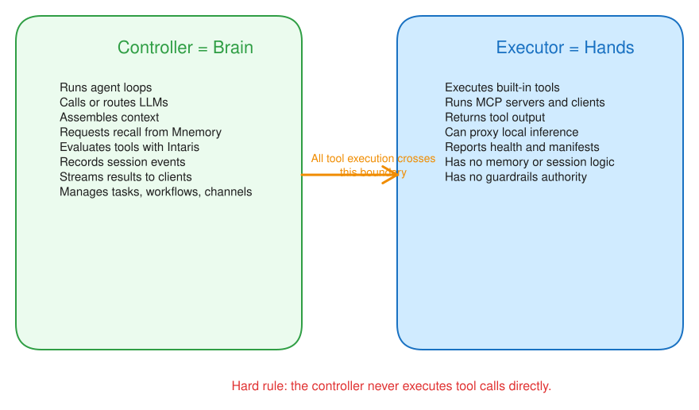
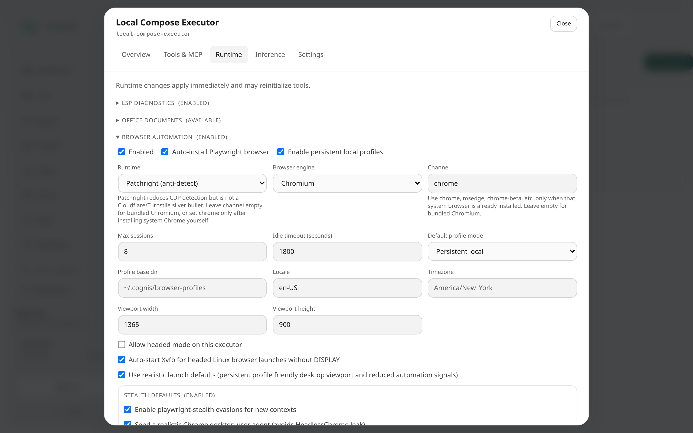
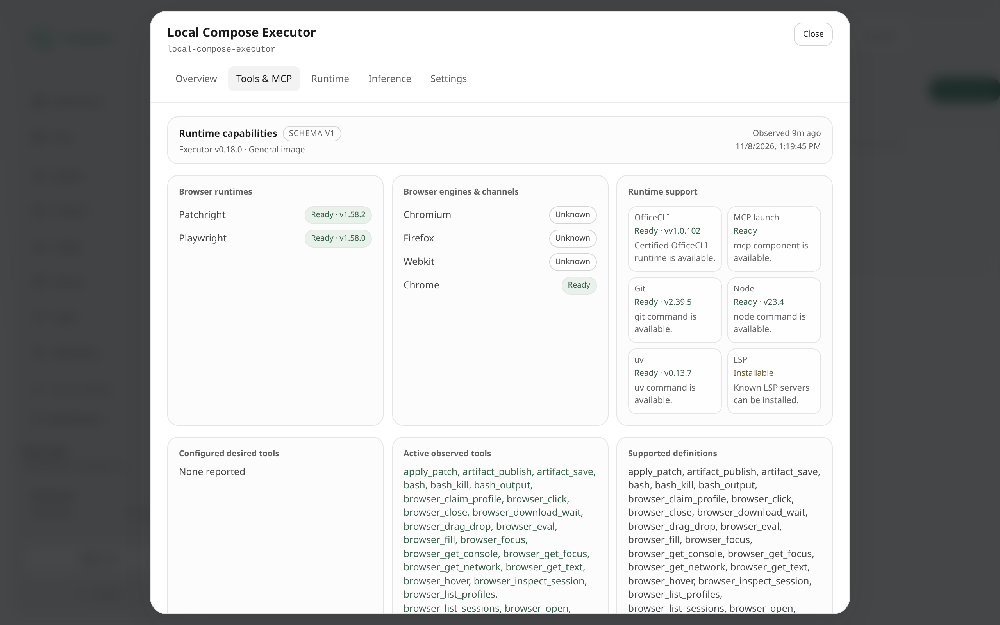

# Executors

Executors are the part of Cognis that perform tool execution. The controller decides what should happen; executors are the hands that actually run tools.

## Durable execution receipts

Upgraded WebSocket executors commit private execution receipts before invoking
tools and before returning terminal results. The journal lives under the
executor data directory at `receipts/<controller-and-executor-hash>/calls.sqlite3`.
Preserve that directory across process and container replacement; an ephemeral
container filesystem cannot provide process-replacement recovery.

Results can be fetched after an executor process restart. Acceptance without a
terminal result remains indeterminate: a receipt cannot prove whether an
external mutation finished immediately before a crash. Never delete the journal
as a recovery shortcut.

Agent run steps receive an explicit unknown-outcome result when a mutation cannot
be recovered. The agent must inspect the affected files or external state on the
same executor using read-only tools, then continue without repeating completed
effects or apply only a verified remaining change. Identical-call uncertainty
protection remains active; an unknown outcome is never reported as success.
Temporary disconnection and still-running calls continue waiting for recovery.
Deterministic workflow steps pause for explicit reconciliation because they have
no agent to inspect the effects.

Unacknowledged receipts are not evicted. After the controller acknowledges durable
canonical settlement, results are cached for up to fourteen days. Under admission
pressure, the oldest acknowledged payloads can be reclaimed earlier. Permanent
deduplication records remain and prevent re-execution; these records do not consume
the retained-call admission quota. Reclaimed results report
`terminal_result_unavailable`, never permission to replay.

The defaults are a 1 GiB payload admission budget and 100,000 retained calls,
with 2 MiB reserved for each unfinished call plus the proposed admission.
These are logical admission budgets, not hard SQLite file-size limits: accepted
results may be larger than their reservation, tombstones remain, and freed pages
are reused without shrinking the file. If unacknowledged evidence alone exhausts
a budget, new execution stops instead of discarding that evidence. Increasing a
limit provides headroom but does not settle unresolved calls.

Set `COGNIS_EXECUTOR_RECEIPT_MAX_BYTES` (integer bytes, minimum 2097152) and
`COGNIS_EXECUTOR_RECEIPT_MAX_CALLS` (positive integer) in the executor service
environment to override the defaults, then restart the executor. Invalid limits
fail startup. Admission errors and executor logs distinguish `capacity`, `sqlite`,
`filesystem`, and `identity_conflict`, with numeric usage/limit evidence for
capacity failures and a storage error code when available. This distinguishes
the journal quota from filesystem free space. Monitor
the executor data volume and investigate admission errors; result envelopes may
contain sensitive data and must not be copied into logs or public diagnostics.
Permissions are restricted to the executor user. Acknowledgement is a settlement
hint, not a claim of generic exactly-once external effects.

The executor journal owns reclamation and admission in one SQLite write
transaction. Controller acknowledgments still occur only after canonical result
settlement; neither reclamation nor capacity errors retry tool execution. This
uses the existing private journal format and requires no Cognis database migration.

Upgrade both controller and executor to enable durable receipts. Older executors
retain same-process reconnect recovery; their mutations cannot be safely
recovered across process replacement.



Executor browser settings and tools now appear in separate tabs.





## Why executors exist

This separation lets Cognis:

- keep orchestration logic in one place
- isolate tool execution
- connect to remote machines when tools need local access
- optionally route model inference through a matching executor

## Installing the executor package

The normal installation includes all built-in executor components:

```bash
pip install "cognis-executor[full]==0.17.1"
uvx --from 'cognis-executor[full]' cognis-executor
```

Homebrew is the recommended macOS installation. See the
[macOS executor distribution guide](macos-executor.md). The public tap
installs the executor from immutable macOS release assets.

The bare package is intentionally minimal. It includes filesystem, shell,
search, project-context, WebSocket, MCP transport, channel adapters, and LSP
support. Add only the optional components needed by a host: `browser`, `web`,
`documents`, or `inference`. The `mcp` and `channels` extras remain as
compatibility aliases. Their shared runtimes are part of `cognis-common`. The
`full` extra combines the normal optional component set.

For local in-process or subprocess execution, install both distributions. The
`full` extra is the normal full-capability installation:

```bash
pip install "cognis-controller" "cognis-executor[full]"
```

For development from this checkout, the workspace installs both distributions
with:

```bash
uv sync --all-extras
uv build --all-packages
```

There is no `local-executors` extra. A controller-only installation has no
local tool runner; persisted local executor rows are unavailable until the
executor package is installed and the process is running.

## Executor modes

Depending on configuration, Cognis can use:

- in-process executors for simple local setups
- subprocess executors for local isolation
- remote WebSocket executors for user-local or multi-machine deployments

For multi-user production setups, remote executors are the preferred model.

Remote executors and controllers negotiate chunked transfers for large artifacts
and other large RPC payloads. This prevents a large result from exceeding the
WebSocket message limit and disconnecting unrelated tools. Upgrade both sides to
enable this behavior; mixed-version connections retain the older wire format.
Chunking does not change artifact-storage limits or tool deadlines. Transfers
use temporary disk space on the receiving side and still materialize the complete
result for normal processing.

## What executors control

Executors define the effective tool pool available to agents. Agents inherit tools from their executor and can then further limit categories, individual tools, and permission policy.

Executors can also be used to:

- attach MCP servers
- expose only selected tool groups
- run LSP diagnostics for filesystem edit tools
- host Playwright-backed browser automation
- host channel adapters that need local services
- route provider calls to executor-side inference when supported

## Program runtime (PTC)

`python_execute`, `python_kernel_status`, and `python_kernel_reset` run on the
selected executor. Their availability is controlled by the executor's configured
identity and `config.program_runtime`:

- A configured executor with `labels.cognis_runtime_profile == "pod"` is
  eligible by default.
- `config.program_runtime.enabled: false` disables PTC even for a pod-profile
  executor.
- Every other profile—including a WebSocket executor that is not labelled
  `pod`, or an unknown executor type—requires
  `config.program_runtime.host_enabled: true`.

`host_enabled` is an explicit host-execution opt-in; it does not override
`enabled: false`. A WebSocket connection is not itself a pod identity, and a
profile label is a configuration assertion, not a sandbox. Verify the actual
execution boundary before applying the `pod` label. The kernel runs as the
executor's user: it can access that user's files, credentials, mounts, and
network, and launch processes permitted to that identity.

After configuration changes, inspect the selected executor's effective tool
inventory. If the PTC tools are absent, first check the executor identity,
profile label, and `config.program_runtime`; tool discovery cannot override
executor eligibility. The normal `ToolRouter` and Intaris policy still decide
whether an invocation or nested tool call is allowed.
Remote tool advertisements do not grant eligibility. The controller checks the
actual selected executor's current configuration before dispatch, including
after an executor switch or a per-call target selection. Missing configuration
fails closed; disabling PTC does not interrupt a program already running.

The pilot also requires a direct WebSocket or in-process connection to the
executing controller. Cross-controller-forwarded program execution is not
supported and fails closed before code dispatch; ordinary forwarded tools are
unchanged.

On the same executor, interactive kernels are scoped to the conversation (or
its session when no conversation ID exists). Python variables are volatile: an
executor restart, kernel loss, or idle reclamation can discard them. Idle
kernels are reaped after 30 minutes; each executor caps its live kernels at 64.
The executor's recovery ledger records state metadata, not a restorable Python heap.
`COGNIS_PTC_STATE_PATH` still selects the ledger file for a standalone runtime.
When the controller owns multiple in-process runtimes, that path is the base
file: each stable configured executor identity receives a sibling ledger named
with a SHA-256 identity suffix, so initialization and atomic writes stay within
that executor's records. The raw identity is not included in the filename.
The unsuffixed ledger is left untouched and is not imported because its records
do not identify an owning executor. Ledger files remain mode `0600` in
directories created as mode `0700`; this metadata does not persist or migrate
Python heap state.
Use `python_kernel_status` to inspect state and generation; it does not reveal
variables. Reset only an idle kernel with `python_kernel_reset` and its current
`expected_generation`. Before retrying after state loss or an uncertain result,
reconcile completed/uncertain child calls and external effects. Workflow program
steps instead use a fresh `StepRun` scope; each new run starts without prior
kernel variables. See the [interactive PTC guide](tools-and-skills.md#programmatic-tool-calling-ptc)
and [workflow program steps](workflows.md#program-steps-ptc).

## Where to manage executors

Open `Settings` and use the executors section to inspect:

- configured executors
- status and health
- desired vs applied config generation
- enabled tool groups
- individually enabled tools
- attached MCP servers

The monitor shows one card per executor with its platform, health, CPU and
memory utilization, optional GPU utilization, and reported capability indicators.
Unknown measurements are shown as unavailable, not zero. Charts retain up to
20 minutes of samples collected while this settings page is open; they are not
durable monitoring history.

Select a card to open its detail dialog. **Overview** contains resource details
and runtime diagnostics; **Tools & MCP** contains observed capabilities and tool
assignments; **Runtime** contains browser, LSP, Office, and channel settings;
**Inference** configures local inference; **Settings** edits identity, labels,
sharing, connection tokens, and removal.

Resource updates use a page-scoped subscription on the existing authenticated
WebSocket and the executor's existing resource reports. There is no periodic
executor-list HTTP polling. Reconnection refreshes the current inventory once;
stale labels continue to age locally when telemetry stops.

If browser automation is enabled on an executor, the same settings area also
lets you configure browser runtime behavior such as auto-install, engine,
headed-mode allowance, persistent local profiles, Xvfb fallback for headed
Linux launches, session limits, and idle timeout.

### Runtime states

WebSocket executors can report several runtime states:

- `active` - the current desired generation is fully applied
- `degraded` - the current desired generation is applied, but one or more assigned MCP servers failed and were omitted from the active tool set
- `reconfiguring` - Cognis is pushing a newer desired generation to the connected executor
- `stale` - a newer desired generation is stored in Cognis, but the executor has not applied it yet
- `blocked` - the executor is connected, but the last configure attempt failed in a non-recoverable way
- `offline` - no executor WebSocket connection is currently active

`desired` and `applied` are config generations, not simple reconnect counters. If they differ, the executor is behind the latest saved configuration.

### Inspecting and retrying runtime failures

On the dashboard, expand an executor issue with **Show details** to see MCP
initialization phases, error categories, timeout messages, and runtime warnings.
The same runtime diagnostics are available in Settings → Executors.

**Refresh status** reads the latest reported status; it does not restart anything.
Owners (or admins for shared executors) can use **Retry configuration** to request
runtime initialization again without editing settings or rotating the token.
This reinitializes all configured MCP servers and may briefly affect their tools.
It does not restart the executor service. For an offline executor, the request is
applied on reconnect. An outstanding configuration generation is reused rather
than superseded by repeated retries.

An `initialize` timeout includes launching a stdio server and completing its MCP
handshake. It does not by itself prove that the service behind the MCP server is
down. Check the server's startup dependencies and configured connection timeout
if retries continue to fail.

After the executor becomes usable, timed-out MCP servers get up to three
background retries, waiting 5, 15, and 30 seconds between attempts. Healthy MCP
servers and native tools remain available. Authorization failures are not retried.
Recovery publishes the discovered tools and clears the corresponding failure.
Retries stop on configuration changes or disconnection. Executors without the
targeted-retry RPC require a manual configuration retry.

### Disconnect and replay semantics

When active work enters executor recovery, the chat shows an unavailable notice
instead of waiting silently. A successful recovery adds an available notice.
Runtime admission waits up to 15 minutes for the same executor to become ready;
reconnecting alone is not enough if its configuration or tool inventory is still
unavailable. You can cancel while waiting.

If recovery times out, that turn stops. Send a new message after the executor is
ready. Each new conversation turn gets its own recovery budget; retries and
controller takeovers of the same turn retain the original deadline. These
notices describe active work, not background monitoring of idle executors.

Connection attempts use exponential backoff from 1 to 60 seconds while they
keep failing. An accepted registration resets that backoff, so a later
disconnect does not inherit delays from an earlier outage. Clean disconnects
reconnect immediately. This changes connection timing only, not tool replay.

Cognis may retry a small allowlist of read-only unary executor RPCs after an
ambiguous transport failure. Those retries reuse a stable logical call ID. The
executor keeps a bounded, short-lived in-memory cache of terminal results and
rejects reuse of the same ID with a different payload.

The cache does not contain stream chunks or mutating calls. Tool execution and
streaming inference are never replayed after an `accepted_unknown` or partial
outcome. Restarting the executor loses the unary result cache, so a controller
that cannot recover a cached result must continue to treat the prior outcome as
ambiguous rather than claiming that it did or did not execute.

See [High availability](high-availability.md) for
controller ownership, selector failover, and StatefulSet identity guidance.

## Choosing the right mode

- Use local executor modes for development and simple single-user setups.
- Use remote WebSocket executors when tools, channels, or model endpoints must stay on another machine.
- Disable local executor modes in shared production environments if the controller should not execute tools locally.

## Local Compose executors

The Local Compose deployment supports two WebSocket executor modes:

- **Compose sidecar executor**: `make local-compose-executor-up` starts the
  `cognis-executor` service. It reads the token file written by
  `make local-compose-seed`, connects to `ws://cognis:8080/api/executor/ws`,
  and keeps browser profiles/workspace state in the `cognis-executor-home`
  Docker volume.
- **Host executor**: after seeding, source
   `.local/cognis-compose/executor-token/host-executor.env` and run either
   `uv run cognis-executor` from a checkout or
   `uvx --from 'cognis-executor[full]' cognis-executor`. This is
  useful when tools need host filesystem access, host browser profiles, local
  credentials, or easier debugging.

The token files under `.local/cognis-compose/executor-token/` contain executor
credentials and must not be committed or shared. See
[Local Compose Deployment](local-compose.md) for commands.

## Common troubleshooting checks

- verify the executor is connected
- if `desired != applied`, wait for reconfigure or reconnect the executor
- confirm the required tools are enabled on the executor
- confirm the agent is bound to the expected executor or label selector
- confirm any required secrets or MCP servers are assigned correctly
- confirm browser automation is enabled if browser tools are expected

## LSP diagnostics

LSP diagnostics are executor-local, just like filesystem tools. Cognis now uses
the same LSP flow on all executor types:

- `in_process`
- `subprocess`
- `websocket`

`read` still warms matching language servers in the background. `write`,
`edit`, `patch`, and `multiedit` wait briefly for first-use diagnostics when
LSP is enabled, but diagnostics remain best-effort: the file operation still
succeeds if server startup or diagnostics collection times out.

The filesystem `patch` tool now accepts strict `apply_patch` syntax as well as
the supported unified diff update subset. Existing-file patch updates, deletes,
and moves still require a prior `read`; `Add File` does not.

Use `/lsp` in chat to inspect the current LSP state for the active user's
executors. The command reports normalized executor-local status:

- `ready` - LSP status was collected successfully
- `disabled` - executor config has LSP disabled
- `unsupported` - the connected executor is older and does not expose LSP status
- `unavailable` - executor is disconnected or status collection timed out

`/lsp` is read-only. It does not auto-install language servers or trigger any
network fetches.

Language servers are separate code-analysis processes, usually one per server
and project root. The configured concurrent-server limit counts both running
servers and servers still starting. Requests for the same starting server share
its initialization rather than reserving another slot; failed or cancelled
starts release their slot. This is a process-count limit, not a RAM budget:
large projects and multiple worktrees can still consume substantial memory.

### Python edit-time diagnostics

Automatic post-edit diagnostics for Python come from Ruff only by default.
Ruff answers in milliseconds and its findings (syntax, undefined names, unused
imports) are almost always real. Pyright's whole-program analysis is slow on
first open and noisy on projects that are not typed strictly, so it is not
part of the edit path unless opted in. Pyright is always used for explicit
`lsp` queries.

Set `lsp_python_type_diagnostics: true` in the executor config (Settings →
Executors → LSP Diagnostics → "Python type diagnostics") or
`COGNIS_LSP_PYTHON_TYPE_DIAGNOSTICS=1` to include pyright type errors in
post-edit diagnostics. Compare `cognis_lsp_edit_*` metrics with the switch on
and off before changing the default.

## LSP code navigation (`lsp` tool)

Besides automatic diagnostics, agents can query language servers directly
with the `lsp` tool. It is executor-local and exposed only where LSP is
enabled. Output is compact text (workspace-relative paths, 1-based
coordinates, deduplicated, sorted), never raw protocol JSON, and every call
is bounded by `limit` plus a byte budget with an explicit `truncated` marker.

| Operation | Returns | Prefer over `grep` when |
|---|---|---|
| `goToDefinition`, `typeDefinition`, `goToImplementation` | `path:line:col` list | the symbol is imported, re-exported, overloaded, or an interface |
| `findReferences` | grouped by file with the source line | assessing rename or signature-change impact for common names |
| `hover` | signature and first documentation paragraph | you need a type or docstring without opening the file |
| `documentSymbol` | indented outline with line spans and signatures | understanding a file before reading it |
| `workspaceSymbol` | `kind name  path:line` for a name query | finding where something is defined |
| `incomingCalls`, `outgoingCalls` | bounded call tree (depth, breadth, nodes, time) | answering "who calls this" or "what does this call" |
| `outline` | outline of a directory under a file and byte budget | getting the structure of a package |
| `capabilities` | which operations the file's servers support | deciding whether a query is worth issuing |
| `diagnostics` | cached diagnostics for a file, no wait | re-checking after several edits |

Per-server outcomes are reported explicitly: `ok`, `empty` (the server
answered with nothing), `unsupported` (not negotiated), `timeout`, `failed`,
or `partial` (limit reached or the server exited mid-traversal). `grep`,
`read`, and `glob` remain the fallback for text patterns, configuration, and
languages without a configured server.

Queries do not wait for diagnostics. A freshly spawned server is given a
bounded wait for its project-loading progress so the first query is not
answered from a partial program.

### Metrics

Executors have no metrics endpoint. LSP facts travel as bounded fields in
tool result metadata and are counted on the controller at the tool routing
boundary, then exposed on `/metrics`:

- `cognis_lsp_edit_diagnostics_total{status}`, `cognis_lsp_edit_injection_total{outcome}`,
  `cognis_lsp_edit_wait_total{status}`, `cognis_lsp_edit_diagnostics_by_severity_total{severity}`,
  `cognis_lsp_edit_injected_bytes` — automatic post-edit path
- `cognis_lsp_tool_operations_total{operation,status}`, `cognis_lsp_tool_duration_seconds{operation}`,
  `cognis_lsp_tool_output_bytes{operation}`, `cognis_lsp_tool_truncated_total{operation}`,
  `cognis_lsp_tool_hierarchy_edges` — deliberate `lsp` tool path

Label values are validated against fixed enums; paths, symbols, queries, URIs,
server identifiers, and error text never become labels.

Real-server smoke tests live in `tests/integration/test_lsp_real_servers.py`
(`-m lsp_real`). They use pyright, typescript-language-server, and gopls from
PATH or the LSP cache and skip per server when unavailable.
`tests/benchmarks/lsp_navigation/run_benchmark.py` measures compact output
versus raw protocol JSON and cold/warm latency for a fixed set of navigation
tasks on this repository; the last stored report sits next to it.

## Multi-executor agents (Stage 36)

An agent can be assigned more than one executor. The model is intentionally
asymmetric:

- **Primary executors** (configured via `execution.executor_id` or
  `execution.executor_selector`) are auto-eligible. The controller picks
  one usable primary the first time a conversation needs an executor and
  pins it as the conversation's `active_executor_id`.
- **Additional executors** (configured via
  `execution.additional_executors`) are reachable only when the agent
  asks for them explicitly: per-call via the `target_executor` parameter
  on a tool call, or session-wide via the `switch_executor` tool. The
  controller never picks them automatically.

During a long-running turn, executor eligibility is refreshed before model requests
and again before executor tool calls or switches. Reconnected assigned executors
can be used without starting another conversation. Refresh preserves assignments,
inventory and the active pin, and revalidates current ownership, sharing and policy.
If eligibility cannot be verified, it is reported as unknown and the executor call
is not dispatched.

Explicit primary bindings do not automatically change. Label-selector primaries
are different: if the active executor stays unavailable beyond reconnect grace,
a later admission may atomically fail over to another connected,
selector-matching primary. Failover never occurs in the middle of an accepted
operation and emits a durable system notice. Additional executors remain
explicit-only; an expired additional assignment may return to an eligible
primary.

If runtime tool discovery loses the executor connection during a restart, active
work waits for the same selected executor within the existing 900-second recovery
window, then rebuilds its tool inventory. Repeated disconnects do not reset this
deadline. Cancellation still stops the wait.

For task workflows, the binding is persisted at the task level. All steps
of a single task run on the same executor by default — even though each
step creates its own conversation, the task pin carries forward and the
controller never re-picks between steps. `switch_executor` or
`/executor` issued mid-workflow propagates to the task pin and is
inherited by every subsequent step.

### `switch_executor` tool

Call this tool alone. Before changing the active binding, the controller rebuilds
the target's authorized tool inventory. A failed or cancelled inventory read
leaves the binding and current inventory unchanged. A successful switch replaces
executor tools rather than combining inventories from different machines.

Available to the LLM whenever the agent has more than one assigned
executor. The schema is constrained to currently usable assigned
executor ids. On success it persists the new active to the
conversation row; on failure it leaves it unchanged.

### `/executor` slash command

```
/executor              Show the active executor + the agent's full pool
/executor <id>         Switch the conversation's active executor to <id>
```

Uses the same shared backend helper as `switch_executor` and produces
the same audit story regardless of who triggered the switch.

When the active executor is non-primary (i.e., chosen via
`switch_executor` or `/executor`), every LLM turn carries a hidden
reminder noting the routing target so the agent does not lose track. No
reminder is injected for primary actives.

## Browser automation

Browser automation is executor-native. The controller handles orchestration,
credentials, approvals, and retry policy, but the executor is the only
component that launches Playwright and performs page actions.

In `Settings -> Executors`, the browser section stores executor config like:

```json
{
  "browser": {
    "enabled": true,
    "auto_install": true,
    "headed_allowed": true,
    "persistent_profiles_enabled": true,
    "profile_mode_default": "persistent_local",
    "realistic_launch": true,
    "xvfb_auto": true,
    "engine": "chromium",
    "runtime": "patchright",
    "channel": "chrome",
    "max_sessions": 8,
    "idle_timeout_seconds": 1800,
    "navigation_timeout_seconds": 60,
    "wait_until": "domcontentloaded",
    "network_idle_after_dom_seconds": 3,
    "stealth_enabled": false,
    "realistic_user_agent": true,
    "default_timezone_id": "UTC",
    "default_accept_language": "en-US,en;q=0.9"
  }
}
```

The recommended human-like setup for a sticky local executor is:

- `profile_mode_default = "persistent_local"`
- `persistent_profiles_enabled = true`
- `realistic_launch = true`
- `stealth_enabled = false` for Patchright, which already includes evasions
- `xvfb_auto = true` for headed Linux executors without a real display

This recommended setup keeps cookies, local storage, and other profile state in a local browser
user data directory on that executor. It is best for sites that are hostile to
clean ephemeral contexts, but it is explicitly executor-local.

Browser fetches use short-lived ephemeral sessions and separate web settings:
`web.browser_fetch.session_idle_seconds`, `navigation_timeout_seconds`,
`wait_until`, and `network_idle_after_dom_seconds`. The default fetch navigation
waits for `domcontentloaded`, then does a short best-effort `networkidle` wait so
slow ad/analytics requests do not block extraction indefinitely. Explicit
`browser_open` sessions use the executor browser idle timeout, which defaults to
30 minutes.

## Office document tools

Office document tools are executor-native and backed by a certified OfficeCLI
binary. The executor only exposes `office_read`, `office_get`, `office_query`,
`office_validate`, `office_render`, `office_create`, and `office_patch` when
OfficeCLI is enabled and the resolved binary matches Cognis' pinned certified
version.

In `Settings -> Executors`, the Office Documents section stores executor config
like:

```json
{
  "officecli": {
    "enabled": true,
    "auto_install": true,
    "version": "v1.0.102",
    "binary_path": null,
    "cache_dir": null
  }
}
```

Environment overrides are also supported:

- `COGNIS_OFFICECLI_ENABLED`
- `COGNIS_OFFICECLI_AUTO_INSTALL`
- `COGNIS_OFFICECLI_VERSION`
- `COGNIS_OFFICECLI_BINARY_PATH`
- `COGNIS_OFFICECLI_CACHE_DIR`

`version` is intentionally a certified-version selector, not a floating
upstream selector. If it differs from Cognis' compatibility manifest, office
tools stay unavailable until Cognis is upgraded and the new OfficeCLI version has
passed compatibility tests. When `auto_install` is enabled, the executor fetches
only the pinned certified binary and verifies its SHA256 before exposing tools.

When direct HTTP fetch is blocked and browser fallback is enabled, Cognis now
tries a headed browser first whenever `web.browser_fetch.headed_fallback_enabled`
and `browser.headed_allowed` are both enabled. Headless browser fallback is used
when a headed browser is disabled or unavailable. Explicit `backend = "browser"`
follows the same preferred-browser rule, so bot-sensitive sites do not see a
lower-trust headless probe before a headed attempt.

### Stealth defaults

By default Cognis applies `playwright-stealth` evasions to every new browser
context (override per-evasion via the *Disable specific evasions* field in the
UI, or disable globally with `stealth_enabled = false`). When stealth is on the
context also gets:

- a Chrome desktop `User-Agent` derived from the running bundled Chromium build
  and host platform; configured browser channels retain the selected browser's
  native coherent UA (turn the bundled-browser override off with
  `realistic_user_agent = false`)
- `Accept-Language: en-US,en;q=0.9` (override via `default_accept_language`)
- `timezone_id = "UTC"` when no `timezone_id` is configured (override via
  `default_timezone_id`)

Honest disclaimer: stealth helps against the JavaScript-detection layer
(`navigator.webdriver`, plugin/codec lists, WebGL vendor, canvas, etc.) but
does **not** fix TLS/JA3 fingerprinting and is not a Cloudflare managed
challenge or Turnstile silver bullet. For hard sites, headed mode + Xvfb +
persistent profile + `channel = "chrome"` remains the most reliable setup.

### Behaviour layer (autoconsent, humanizer, fingerprint hardening)

Three additional behaviour-layer enhancements ship on top of stealth and are
runtime-agnostic — they apply to both `runtime = "playwright"` and
`runtime = "patchright"` without any extra configuration. Cookie-consent
auto-dismiss defaults ON because it unblocks page content. Humanization and
fingerprint hardening default ON when stealth is enabled and OFF when it is
disabled, with per-executor overrides.

**Cookie-consent auto-dismiss** (`auto_consent`). Cognis ships a curated
CMP-killer that auto-clicks the configured action on common cookie banners
(OneTrust, Cookiebot, Quantcast, Sourcepoint, Didomi, TrustArc, Iubenda,
Usercentrics, CookieYes, Borlabs, Osano, Klaro, Termly, Moove GDPR,
Complianz, CookieLawInfo) plus a multilingual heuristic fallback for unknown
banners. Defaults to `"accept"` (faster page render), including Patchright
executors where stealth stacking is disabled. Switch to `"reject"` for
privacy-first, or `"off"` to disable. Per-host opt-out via
`auto_consent_disabled_domains`. The script bundle is vendored at
`cognis/tools/executor/browser/assets/autoconsent.bundle.js`; bump
`cognis/tools/executor/browser/assets/VERSION.txt` and edit the JS file in
place when adding new selector rules. The heuristic fallback is deliberately
scoped to banner/dialog-like containers and avoids footer/legal/support
navigation links such as privacy, terms, cookie-policy, documentation, and
"learn more" links.

**Input humanizer** (`humanize_input`, `humanize_intensity`). `browser_click`,
`browser_fill`, and `browser_type` move the mouse along Bezier paths and
emit per-key delays sampled from a normal distribution, defeating naive
trajectory-based bot detection. Default intensity is `"low"` (~150 ms
overhead). Each call may override with an `intensity` argument: `off`, `low`,
`medium`, `high`. Set `humanize_input = false` on the executor to fall back
to the legacy direct `click()`/`fill()`/`type()` semantics.

**Fingerprint hardening** (`fingerprint_hardening`). Three small init
scripts:

- `audio_context`: adds tiny per-profile-deterministic noise to
  `AudioBuffer.getChannelData()` so audio fingerprint probes see a stable
  but non-baseline value
- `battery_api`: stubs `navigator.getBattery()` with a per-profile-stable
  plausible value (defeats the headless-Chrome flat-baseline tell)
- `viewport_jitter`: ±2% jitter on `window.innerWidth/innerHeight` for
  ephemeral sessions only (skipped on persistent profiles to preserve
  identity stability)

The seed is derived from the persistent profile id (or the runtime
generation for ephemeral sessions) so re-visits to the same site see a
consistent fingerprint. Disable individual scripts by adding
`audio_context`, `battery_api`, or `viewport_jitter` to the
*Disable specific evasions* field.

### Browser runtimes (Playwright vs Patchright)

Cognis ships two browser runtimes side by side. Pick one per executor:

| Runtime | When to use | Notes |
| --- | --- | --- |
| `playwright` (default) | Most sites. Combined with stealth, handles low- and mid-tier WAFs. | Bundled Chromium just works; set `channel = "chrome"` to use installed Chrome stable. |
| `patchright` | Sites that detect CDP `Runtime.enable` (Cloudflare bot fight, Datadome lite, Brotector). | Set `channel = "chrome"` (auto-set when you pick `patchright`). Stealth defaults to *off* because Patchright already covers the same evasions. |

Patchright is most effective with `runtime = "patchright"` + `channel =
"chrome"` + `profile_mode_default = "persistent_local"` + headed mode (with
`xvfb_auto = true` on Linux executors without a real display). It is **not** a
silver bullet for headless Cloudflare; the same operational disclaimer above
applies.

The default executor image bundles **Chromium** (Playwright build) and
**Chrome stable**. Firefox and WebKit are *not* pre-installed in the default
image; they auto-install on first use, or rebuild the image with:

```
docker build --build-arg COGNIS_EXECUTOR_BROWSERS="chromium chrome firefox webkit" -f Dockerfile.executor .
```

To pre-warm browsers on a fresh host without waiting for the first session,
run:

```
cognis-executor browser-install --all-defaults
# or, equivalently:
cognis-controller executor browser-install --all-defaults
```

This pre-installs Playwright's Chromium, Playwright's Chrome stable, and
Patchright's Chrome stable so first-session latency is instant. Add
`--runtime patchright --channel chrome` for a single combination.

Saved browser auth state can still be stored in Cognis as an encrypted
credential record. Use that when you need controller-owned, portable auth state
instead of sticky local browser identity.

### How agents should use profile mode

`browser_open` now supports:

- `profile_mode = "default"`
- `profile_mode = "ephemeral"`
- `profile_mode = "persistent_local"`

Recommended agent behavior:

- use `default` for most browser opens
- use `ephemeral` only when a fresh clean session is specifically needed
- use `persistent_local` for sticky local browser identity or when a site blocks fresh contexts
- call `browser_list_sessions` first when you want to resume an already-open browser session
- call `browser_list_profiles` when you want to reuse a persistent local profile but no live session is active

`profile_id` is optional when `persistent_local` is used. If omitted, Cognis
derives a stable site-scoped local profile automatically from the target URL.

`browser_open` also accepts an optional `browser_settings` object for behavior
overrides on newly created browser contexts:

```json
{
  "browser_settings": {
    "auto_consent": "off",
    "stealth_enabled": true,
    "fingerprint_hardening": true,
    "humanize_input": false
  }
}
```

Use `auto_consent = "off"` for fragile SSO/login shells where automatic cookie
clicks can corrupt the page. These settings are context-creation-only: reusing
an existing `session_id` with different settings fails clearly; use a new
session or close/reopen to change them.

### Session and profile lifecycle

Live browser sessions and persistent local profiles are different things:

- a **browser session** is the active Playwright context/page currently running on the executor
- a **persistent local profile** is the executor-local user data directory reused across sessions

Cognis now exposes both through browser tools:

- `browser_list_sessions` lists currently active sessions so the agent can resume one instead of opening a duplicate
- `browser_list_profiles` lists persistent local profiles available on that executor
- `browser_query` inspects matching page elements with rich metadata for debugging and exact targeting
- `browser_eval` runs arbitrary JSON-returning page-context JavaScript as a privileged debug/control tool
- `browser_get_console` and `browser_get_network` expose recent runtime diagnostics for the active browser session

Idle browser sessions are automatically closed after the executor's
`idle_timeout_seconds`, but persistent local profile directories remain on disk
for later reuse. `browser_list_sessions` shows only non-expired live sessions;
expired sessions are hidden and cleaned up by subsequent browser operations.

For difficult auth or MFA flows, prefer the low-level inspection/debug path:

1. `browser_snapshot` or `browser_query` to inspect actionable candidates
2. `browser_focus` and `browser_type` when real key events are more reliable than `browser_fill`
3. `browser_get_console` / `browser_get_network` to diagnose silent submit failures
4. `browser_submit_form` when clicking a button is not enough

### Headed Linux browsers and Xvfb

On Linux executors, a headed browser without a real `DISPLAY` needs a virtual
X server. When `xvfb_auto = true`, Cognis starts `Xvfb` automatically for
headed launches that need it.

`Xvfb` must already be installed on the executor host. Cognis does not install
OS packages for you.

## MCP stdio command format

For executor-hosted stdio MCP servers, `Command` is the executable only. Cognis does not run a shell.

Use:

- `Command`: `npx`
- `Arguments`:

```text
-y
@doist/todoist-ai
```

Do not paste the full shell command into `Command`. Values like `npx -y @doist/todoist-ai` are treated as a single executable path and will fail.

If an assigned MCP server fails or times out during `spawn`, `initialize`, or `tools/list`, Cognis keeps the executor connected and marks it as `degraded`. The failing MCP server is omitted from the active observed tool set until the configuration is fixed and reapplied.

For OAuth-protected HTTP MCP servers, the controller refreshes and injects the
access token before sending executor configuration. The executor never receives
refresh tokens or OAuth transaction state. If connection, list, or tool calls
return 401/403, Cognis reports a structured MCP authentication error and keeps
the executor process isolated from that provider failure.

## Running as a systemd service

Cognis ships with systemd unit templates in [`deploy/systemd/`](../../deploy/systemd/) for running the controller and executors as managed services on Linux.

### Environment variables

The executor CLI reads connection parameters from environment variables so that tokens never appear in `/proc/<pid>/cmdline`:

| Variable | Description |
|---|---|
| `COGNIS_CONTROLLER_URL` | WebSocket URL of the controller |
| `COGNIS_EXECUTOR_TOKEN` | JWT authentication token |
| `COGNIS_EXECUTOR_WORKDIR` | Default working directory for executor tool calls. Defaults to the executor user's home directory. |

CLI flags (`--controller-url`, `--token`, `--workdir`) still work and take precedence over environment variables.

When installed from PyPI, the recommended command is
`uvx --from 'cognis-executor[full]' cognis-executor`.

### System-level executor (template unit)

The template unit `cognis-executor@.service` runs one executor per dedicated Unix user. The instance name (`%i`) is the user and group.

```bash
# Install the template
sudo cp deploy/systemd/cognis-executor@.service /etc/systemd/system/
sudo systemctl daemon-reload

# Create env file for user "alice"
sudo tee /etc/cognis/executor-alice.env <<'EOF'
COGNIS_CONTROLLER_URL=wss://cognis.example.com/api/executor/ws
COGNIS_EXECUTOR_TOKEN=eyJ...
COGNIS_EXECUTOR_WORKDIR=/home/alice
EOF
sudo chmod 600 /etc/cognis/executor-alice.env
sudo chown alice:alice /etc/cognis/executor-alice.env

# Start
sudo systemctl enable --now cognis-executor@alice
```

Generate the token in **Settings > Executors > Generate token**. Executor tokens do not expire; generating a new token revokes older tokens for that executor.

### User-level executor (no root)

The user unit `cognis-executor.user.service` runs under your own systemd instance. No root access required.

```bash
mkdir -p ~/.config/systemd/user
cp deploy/systemd/cognis-executor.user.service \
   ~/.config/systemd/user/cognis-executor.service
systemctl --user daemon-reload

# Create env file
cat > ~/.cognis/executor.env <<'EOF'
COGNIS_CONTROLLER_URL=wss://cognis.example.com/api/executor/ws
COGNIS_EXECUTOR_TOKEN=eyJ...
COGNIS_EXECUTOR_WORKDIR=/home/your-user
EOF
chmod 600 ~/.cognis/executor.env

# Start
systemctl --user enable --now cognis-executor

# Keep running after logout
loginctl enable-linger $USER

# Read or follow the user-systemd journal
cognis-executor logs --lines 100
cognis-executor logs --follow
```

`cognis-executor logs -n 100 -f` is the short form for following the last 100
user-service log lines. The same command reads Homebrew service logs on macOS.

### Controller

A system-level controller unit (`cognis-controller.service`) is also provided. See [`deploy/systemd/README.md`](../../deploy/systemd/README.md) for full setup instructions.

### Running from a git checkout

The default `ExecStart` uses `uvx --from 'cognis-executor[full]' cognis-executor`
(PyPI). To run from a local git checkout, swap to `uv run cognis-executor` with
a `WorkingDirectory` for uv project resolution. The executor process still
switches to `COGNIS_EXECUTOR_WORKDIR` or the service user's home directory
before it accepts tool calls.

## Running as a Docker container

The published executor image is `ghcr.io/fpytloun/cognis-executor`.

| Tag | Use |
|---|---|
| `latest`, `general` | Recommended normal image. Includes Patchright with Chrome, document tools, MCP prerequisites, Git, `uvx`, `npx`, and common shell utilities. |
| `minimal` | Reduced system image for constrained deployments. It does not include browser, document, Git, Node, or `uvx` system tooling. |
| `development` | The general image plus preinstalled language servers, Ruff, Prettier, Clangd, and ShellCheck. |

Release tags follow the same pattern: `<version>`, `<version>-minimal`,
`<version>-general`, and `<version>-development`. Use `latest` or `general`
unless you intentionally accept missing system capabilities.

The general and development images preinstall Patchright with Google Chrome.
Set the executor browser runtime to `patchright` and the channel to `chrome`.
Image contents do not override an executor configuration that explicitly
selects another runtime.

Create a WebSocket executor in `Settings -> Executors` and generate a token before starting the container.

For a local controller without TLS, run the executor on the host network so `ws://localhost` is genuinely local to the executor process:

```bash
docker run -d \
  --name cognis-executor \
  --network host \
  -v cognis-executor-home:/home/cognis \
  -e COGNIS_CONTROLLER_URL=ws://localhost:8080/api/executor/ws \
  -e COGNIS_EXECUTOR_TOKEN=eyJ... \
  ghcr.io/fpytloun/cognis-executor:latest
```

For production or any non-local controller, use `wss://`:

```bash
docker run -d \
  --name cognis-executor \
  -v cognis-executor-home:/home/cognis \
  -e COGNIS_CONTROLLER_URL=wss://cognis.example.com/api/executor/ws \
  -e COGNIS_EXECUTOR_TOKEN=eyJ... \
  ghcr.io/fpytloun/cognis-executor:latest
```

The image starts through `tini`, so Kubernetes and Docker `SIGTERM` shutdowns are forwarded correctly and orphaned browser, LSP, MCP, and shell subprocesses are reaped.

### Persistent home directory

Mount `/home/cognis` as a volume when you want browser profiles, LSP caches, shell history, and workspace files to survive restarts:

```bash
docker volume create cognis-executor-home
```

The entrypoint initializes `.bashrc`, `.profile`, `.cognis/cache`, `.cache`, `.local/bin`, and `workspace` when the home directory is writable. If the container runs as root, it fixes the home-directory ownership and drops to the `cognis` user. If Kubernetes sets `runAsUser`, the entrypoint does not attempt to `chown`; the volume must already be writable by that UID or group.

### Optional runtime sudo

All variants contain the `sudo` command, but the `cognis` user has no sudo
grant by default. To enable an explicit root-equivalent runtime:

```bash
docker run \
  --user 0:0 \
  -e COGNIS_EXECUTOR_ENABLE_SUDO=1 \
  ...
  ghcr.io/fpytloun/cognis-executor:latest
```

Both settings are required. The entrypoint validates a temporary sudoers
grant and then drops to the `cognis` user. Setting the environment variable
without starting as root causes startup to fail.

CAUTION: A sudo-enabled executor can modify the complete container. Runtime
package installation also increases the writable layer and does not update the
published image. Use a derived image for persistent additions.

### Kubernetes security context

Use a persistent volume for `/home/cognis` and set a security context that makes it writable by the runtime user:

```yaml
securityContext:
  runAsNonRoot: true
  runAsUser: 1000
  runAsGroup: 1000
  fsGroup: 1000
  fsGroupChangePolicy: OnRootMismatch
```

For platforms that assign an arbitrary UID, keep `fsGroup` on a writable volume. The image includes `libnss-wrapper` so tools that need a passwd entry still work when the numeric UID is not present in `/etc/passwd`.

Minimal Kubernetes container example:

```yaml
containers:
  - name: executor
    image: ghcr.io/fpytloun/cognis-executor:latest
    env:
      - name: COGNIS_CONTROLLER_URL
        value: wss://cognis.example.com/api/executor/ws
      - name: COGNIS_EXECUTOR_TOKEN
        valueFrom:
          secretKeyRef:
            name: cognis-executor-token
            key: token
    volumeMounts:
      - name: home
        mountPath: /home/cognis
volumes:
  - name: home
    persistentVolumeClaim:
      claimName: cognis-executor-home
```

## Signal on executors

Signal direct mode is an example of why executor-hosted adapters exist.

When a Signal account uses `transport=direct_jsonrpc`, Cognis does not talk to an external REST bridge. Instead, the selected executor starts `signal-cli` directly as a subprocess.

### Minimum executor config for direct Signal

In `Settings -> Executors`, open the executor card and expand `Signal Direct Mode`. Cognis exposes a toggle for direct mode and a field for the `signal-cli` command/path. Under the hood it stores the following executor config:

```json
{
  "signal": {
    "direct_enabled": true,
    "command": "signal-cli"
  }
}
```

Use an absolute path for `command` when `signal-cli` is not on the default `PATH`, for example:

```json
{
  "signal": {
    "direct_enabled": true,
    "command": "/opt/homebrew/bin/signal-cli"
  }
}
```

### Signal executor checklist

Before assigning a Signal direct-mode account to an executor:

1. `signal-cli` is installed on the executor machine.
2. The Signal account is already linked or registered on that machine.
3. The executor is connected in Cognis.
4. The executor config has `signal.direct_enabled=true`.
5. If needed, the executor config points to the correct `signal-cli` binary path.

### Important behavior

- The `signal-cli` command is executor-scoped and therefore user-scoped through executor ownership.
- Channel accounts do not store the executable path.
- Signal account state remains local to the executor machine.
- Moving a direct-mode Signal account to another executor requires migrating the local `signal-cli` state first.
