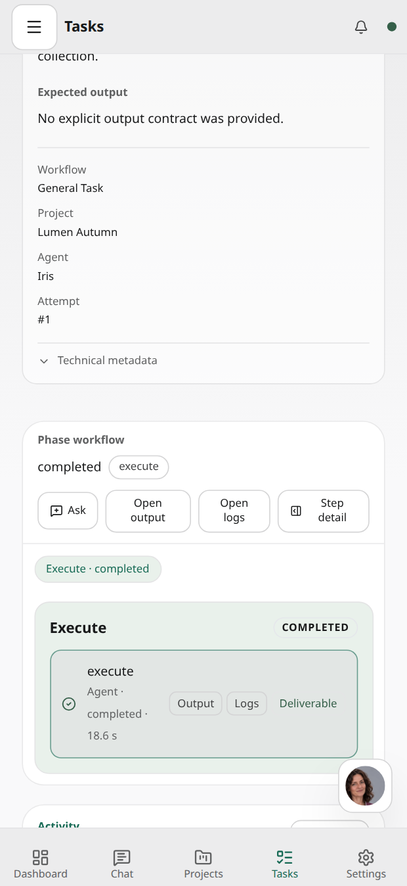
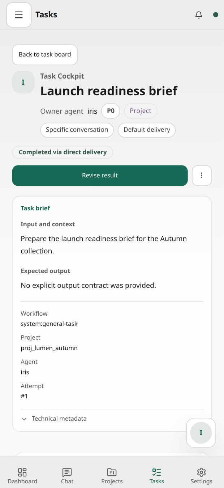

# Managing Tasks

Tasks are how Cognis tracks durable work that should run through a workflow instead of a single immediate chat turn.

## Outcomes in chat

Successful direct deliveries appear as normal messages or documents. The small
task footer shows the task title and attempt; select it to inspect the task
without leaving chat, or open the full task page from that view.

New failed and cancelled direct deliveries show a compact outcome card with the
step and reason, any partial result, and an expandable step list. Older chat
history keeps its original presentation. When the agent handles an outcome,
the clickable “Handling task” row identifies the task; the agent decides whether
to act, ask, report, or stay silent. External channels receive the agent's reply,
not this handling row.

## Infrastructure interruptions

Workflow tasks keep their assigned executor when it is offline. They return to
the queue with a short retry delay instead of holding execution capacity or
failing after fifteen minutes. The same task attempt resumes when the executor
and authoritative tool history are available.

After a controller restart, Cognis reconciles accepted tool calls before asking
the model to continue. A recorded result is recovered without running the tool
again. A mutation with an unknown outcome is never replayed automatically;
inspect its external effects before explicitly retrying it. Cancelling a task
remains distinct from controller shutdown.

Task delegation reserves its child session and turn before creation. Recovery
rejoins that child under its own configuration and tool scope; it does not launch
a replacement child under the parent's authority. Completed child results are
reused. Configuration/scope changes or older calls without an unambiguous child
reservation pause for explicit reconciliation instead of guessing. Completed
workflow steps are not rerun by automatic recovery. Automatic child continuations
also reserve their new turn before execution, so recovery retains the continuation
identity and retry count rather than returning to its first turn.

Delegation recovery uses the original arguments, not the shortened call preview.
Older previews are recovered only when their complete input can be verified
against the reserved call; truncated or changed inputs still require
reconciliation. Child sessions inherit their parent's activated allowances from
Intaris instead of redeclaring task allowances.

Permanent Intaris authentication failures also pause the task and retain its
recovery source. They are reported as Intaris dependency errors, not LLM errors,
and are not retried indefinitely. Service-token issuance tolerates subsecond
receiver clock lag by backdating only its issued-at claim by one second;
expiration is unchanged. This is a bounded mitigation, not a replacement for
synchronized clocks or a solution for arbitrary clock drift.

The following mobile browser views show a completed workflow with synthetic
task content; the workflow itself completed through the normal lifecycle.

## What tasks are for

Use `Tasks` when work should be:

- queued for later execution
- reviewed step by step
- paused for human approval
- routed back into a conversation when complete

The main chat agent can also inspect and manage tasks directly. That includes:

- creating or updating tasks from chat
- inspecting paused task state and step outputs
- resolving workflow gates
- answering paused step questions

Select the workflow explicitly when creating a task, or select a skill with a
saved decomposition. Leaving the workflow unset uses `system:general-task`.
The **General task** option does not trigger AI workflow selection or
implicitly materialize an attached skill's workflow. Explicit workflow and
skill selections remain available, including for schedules.

General-task completion requires `metadata.result_status` and `verification`.
Use `completed` for verified work, including a verified no-op or a completed
review that rejects the reviewed work. Verification must contain `checks_run`,
`results`, and `checks_not_run` arrays of nonblank strings; `results` must not
be empty. Empty check arrays explicitly mean none. Explain required checks not
run rather than presenting them as passing.

Use `blocked` when a concrete blocker leaves required work unfinished, and set
`outcome.status=failed` with the blocker and next action. Reporting a blocker
does not itself select failure routing. The existing failed-outcome gate allows
operator action in interactive tasks and fails autonomous tasks without an
interactive gate. These checks apply to new completion calls, including default,
legacy-default and composition-fallback general tasks; they do not rewrite saved
historical outputs or impose this contract on custom workflows.

## Task board

The task board gives you a kanban-style view of work by status. From there you can:

- create draft tasks
- inspect queued or running work
- open task details
- understand which items are blocked, active, or completed

Dashboard schedule-failure notifications also offer **Task details** for the
latest recorded task, plus **Retry task** when that task is failed and you can
mutate tasks. Retry asks for confirmation and starts a fresh run; completed
actions can execute again. It opens the new task for debugging and does not
change or re-enable the schedule. **View schedule** remains available.
Deleted or inaccessible tasks do not expose task actions.

Tasks created through the UI, API, or agent `create_task` tool can be saved as
drafts. Draft tasks are durable but are not enqueued or executed until you submit
them. Creating a queued or ready task still starts through the normal queue path,
so existing automation can continue to create runnable work directly.

On mobile the board shows a single column at a time and a segmented-control
selector (Draft / Queued / Running / Paused / Done) so each column fills the
viewport. Drag-and-drop is desktop only; on mobile, open the task detail and
use the state buttons to move work.

## Task detail view

The task detail page shows the full workflow run, including:

- workflow and agent assignment
- current status
- timing and duration
- step runs and attempts
- evaluator feedback
- dependencies
- final result or failure information

This view is the best place to understand why a task is waiting, revising, or failing.

Task steps honor provider-directed rate-limit waits just like chat. A deferred
step releases its worker, keeps its session and saved tool results, and resumes
after the retry delay without consuming workflow quality attempts. Automatic
recovery is bounded; if it is exhausted, the task retains the actual failure
cause and offers a gate or a manual recovery action. **Continue task** resumes
a paused task; **Retry task** resumes a failed task at its saved workflow
position. It does not clone the task or repeat already accepted steps.

When a step runs more than once, the displayed accumulated duration includes all
attempts. Latest-attempt timing remains available as secondary detail where the
API/UI needs to distinguish it from total step time.

### Step history

Step logs use the shared chat workspace, including the **Overview**, **Work**,
and **Session** inspector. Open delegated sessions from their cards or the work
tree, and use the back arrow in the header to return. The logs remain read-only;
managed conversations keep their explicit send, stop, and take-control actions.

When a step has multiple attempts, the picker below the step title selects an
earlier attempt without retrying or resuming execution. Attempts are numbered
oldest to newest, so the latest of five is **Attempt 5 of 5**. Each attempt keeps
its own status and
history. Session continuations created by compaction remain part of that
attempt's history; separate retry forks are not merged into one transcript.
Scroll upward or use **Load earlier history** to retrieve older messages.

## Revising work through feedback

Your primary agent can also revise your own completed task directly from chat.
It first uses `get_task` to inspect the current `attempt_number`, gates, and step
history, then calls `request_task_revision` with that `expected_attempt`, a clear
instruction, and the intended `target_step`. The target is required; an omitted
target is rejected before the attempt changes. This reopens the same task rather
than creating another task or implementation conversation. Notes, context, pause,
and resume are available through the same owner-authorized chat path. A dedicated
Task Control Chat remains optional and controls only its bound task.

These operations revalidate current owner, agent, session, and project authority.
Compaction preserves this authority through the current root session and the
chat's current agent binding, even when session history records an older agent.
The replaced session cannot continue controlling the task.
Delegated sessions and shared readers do not inherit owner control. Stale attempts
and revoked task-control bindings are rejected; ordinary gate/question handling
and cancellation rules still apply.

[Work Feedback](work-feedback.md) can send selected, immutable comment versions
back to a producing task. Review the affected step, downstream consequences,
current gates and questions, and update mode before confirming. A changed task
safety state invalidates that preview; it does not silently reuse the approval.

The receipt remains associated with the admitted task attempt. A later retry
does not overwrite its status or inherit child packet access. Completion and
agent dispositions do not automatically resolve the original discussion.

## Gates and step questions

Some workflows pause for human input. When that happens, Cognis records the pause and lets you respond from the task flow instead of losing the context in chat.

When a gate does not define any options, its actions are **Approve & continue**
and **Cancel task**. Gates with explicit options show only those options.

Step questions are stored as a question set: a paused step can ask one or more
questions, each with selectable options, multi-select when allowed, and an
optional custom answer. Web/API clients answer with structured per-question
answers. Plain-text channels such as Signal show the whole question set, but the
entire reply is forwarded as one free-form answer for the agent to interpret.

Answered question sets appear once in web chat. The card separates the
Markdown-rendered agent request from your answer. For multiple questions, use
the previous/next controls and the “Answer 1 / 3” indicator. Both areas fit the
longest content up to a bounded height, scroll independently when needed, and
keep the card height stable while paging.

Gate pauses include evaluated condition details when available: referenced
values, expected or threshold values, comparison operator, actual result,
pass/fail outcome, branch or action taken, and any evaluation error. These
details help operators understand why a workflow paused, skipped, or followed a
specific branch.

You can also steer a paused task from chat through the main agent. When you do that, Cognis keeps the same task/workflow state and carries any operator instruction into the resumed step.

## Delivery model

Choose the destination separately from how the outcome is handled:

| Destination | Default | Agent | Direct |
|---|---|---|---|
| Agent's main Cognis app chat | Yes | Yes | Yes |
| External channel conversation | Yes | Yes | Yes |
| In-app notification inbox (`in_app_notifications`) | No | No | Yes |

**Default** uses Direct for successful completion and Agent for non-success
outcomes, including failure, cancellation, and attention. This is the initial
choice for new tasks, schedules, and workflow defaults.
Explicit workflow notification overrides and opt-in silent completion still
take precedence; silent outcomes do not fan out.

**Agent** starts a handling turn in the destination conversation. The agent
uses the outcome, current situation, your general preferences, and optional
`on_finish_instructions` to decide what to do. It may inspect evidence, integrate
the result, perform an authorized repair, ask for a decision, report, or remain
silent when there is nothing useful to add. Scheduled tasks are not automatically
reduced to status announcements.

**Direct** presents the outcome without starting an agent turn. This
also applies to failure and cancellation. The notification identifies the task,
result or failure reason, partial-outcome risk, and where to inspect or follow up.
For success with a readable canonical deliverable, only that deliverable and
any additional attachments are presented—there is no duplicate “Task completed”
summary, goal, or result-ID wrapper. Otherwise a self-contained text notification
is retained. If no
external route is available, direct delivery falls back to the owner's app
notification inbox, not to an agent turn. Failed or uncertain sends remain under
the existing durable channel-delivery reconciliation rules.

Set optional `on_finish_instructions` when you want specific follow-through:

> On failure, inspect the failed step. Attempt one authorized low-risk repair,
> verify recovery, then retry only if no automatic retry is already pending.
> Report any unresolved blocker.

Finish instructions run on every Agent-handled outcome. With Default they run
only for non-success outcomes, not after successful Direct delivery. They are
unavailable with Direct. They do not grant permissions,
remove approval requirements, or create an independent retry engine. Omitted
CRUD fields preserve their values; set `on_finish_instructions` to `null` to
clear it. Schedule instructions are copied into each new task. The schedule edit
form keeps **Finish instructions** visible in Direct mode but disables editing;
select **Agent** for follow-through on any outcome, or **Default** for non-success
outcomes only.

An Agent handling turn can forward the original canonical document using
`attach_artifact` with its existing `dlv_…` reference. This presents the same
document and revision, without copying it or creating a new workflow output.
Current ownership and project access are still required.

API wire values are `auto` for Default, `default` for Agent, and `direct` for
Direct. The legacy `default` value is retained so saved tasks, schedules, and
workflow revisions keep their original Agent behavior after the label change.
Choose Default explicitly to switch an existing saved configuration to the hybrid.

Task and schedule forms, API CRUD, and agent task/schedule tools expose these
settings. Successful project-visible tasks using **Preferred channel** also notify
other project users who can run the agent. Read-only viewers are excluded.
Each eligible recipient uses their own preferred channel, with the Cognis app as
the fallback. Direct and successful Default outcomes send the result without a
turn; Agent starts a notification turn under that recipient's identity and
existing permissions.
Finish instructions run only in the owner's handling turn; fan-out does not
repeat the owner's follow-up actions for every recipient. Project-only
grants keep that turn in a private project-scoped conversation, without changing
the recipient's main-chat permissions.

Failure, cancellation, and requests for attention remain owner-only. Private
tasks, silent outcomes, and other delivery destinations do not fan out.
Recipient access and the preferred route are rechecked before delayed sends and
follow-up admission. Access to a project never grants access to another user's
channel. Per-recipient notification opt-in/out controls are not available yet.

Workflow completion alone is not evidence that the objective succeeded. Define
verification and partial/failure criteria in the workflow; Agent handling can
inspect that evidence, but does not manufacture it. Configure schedule retries
and finish instructions to avoid competing recovery attempts.

Task detail also presents authentication challenges. If attention data cannot
be refreshed, existing actions remain visible with a warning and a retry control
instead of silently disappearing.

## When to use tasks instead of chat

Prefer tasks when the work needs:

- multiple steps
- explicit review or evaluation
- persistence beyond the current turn
- dependency tracking
- later follow-up in the same conversation

If the same kind of task should run repeatedly, use `Schedules` to create those tasks automatically instead of creating them by hand each time.
