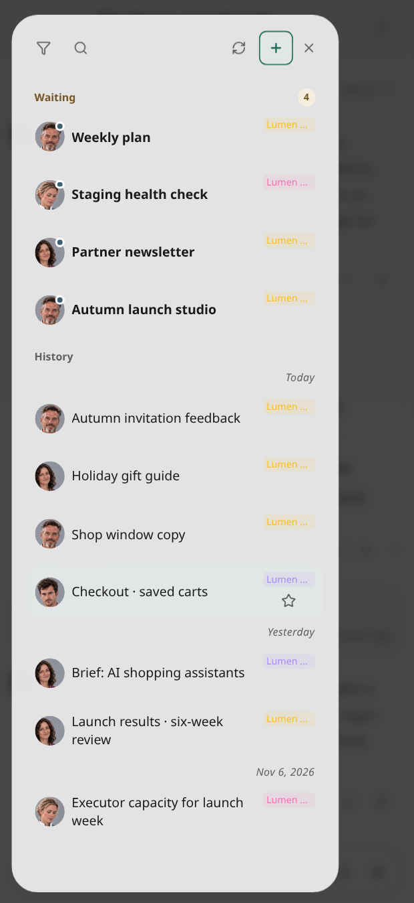
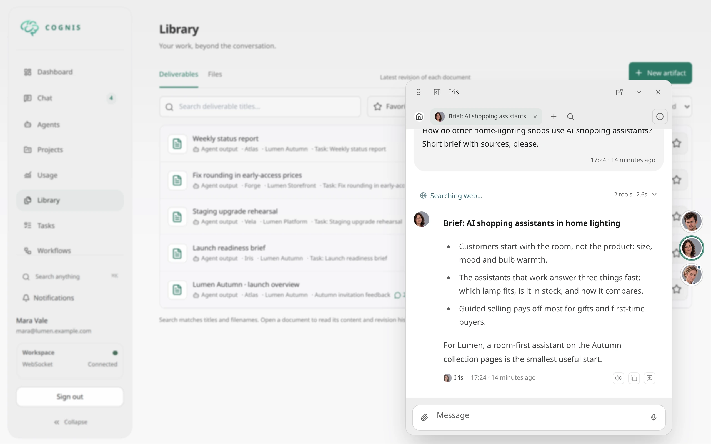

# Projects

Projects group related work so agents can understand which repository, source, workflow, task, or conversation they are operating inside.

Use projects when work has a durable context: a codebase, customer environment, research area, operations domain, or recurring workflow family.

## What a project contains

A project can track:

- name, description, and generated or uploaded avatar
- an independent library icon (including Cognis) and project color
- source hints such as repository paths, URLs, or external systems
- workflow bindings that define which workflows are appropriate for the project
- grants that share project access with other users
- project-aware tasks, schedules, and conversations

Source hints are context, not authority. Cognis uses them to help agents understand where work belongs and when a task touches a relevant path. Actual file, browser, shell, and network access still depends on the executor and tool permissions.

### Choose a project icon

In **Settings → Project icon**, search the full bundled Lucide library by name,
or browse with **Show more icons**. Select an icon, then **Save project**.
**Use default** restores the briefcase. Existing icon selections are preserved.
Icons use the project's color and remain line icons in monochrome display.
An uploaded or generated avatar still takes precedence in avatar display; the
icon is independent of that image. Custom SVG icons are not supported.

## Work from the project home

The main navigation's **Projects** entry returns to your last opened project and
tab on this browser, so you can switch between project work, Chat and Dashboard.
Use **All projects** in the project header to browse or create projects without
being redirected. This preference is per signed-in user. If the remembered
project was deleted or is no longer accessible, the project list opens instead.
Open conversation/task previews are not restored.

Use **Open project in separate window**, immediately left of **New chat in
project**, to keep the current project tab in its own window. The window hides
the main navigation and **All projects** link so you can focus on the project.
Project headers omit the description when none is set.

The main dashboard's **Projects** tab sits between Notifications and Providers.
It shows a horizontally scrollable avatar/name strip linked to project homes,
ordered by the latest readable conversation, task, deliverable, or artifact.
Project timestamps are a fallback when no readable activity exists; private work
does not change another member's ordering. The tab is hidden without projects.
With no saved client selection and no active notifications, Projects opens by
default. An available last-selected tab takes precedence on later visits.

Dashboard conversation and task rows share the Chat list's project display
preference (name, avatar, monochrome, or hidden), with indicators on the right
and titles kept separate. Clicking a badge toggles the dashboard-wide project
filter for both lists; click again to return to all projects.

Open a project to see its conversations, tasks, schedules, agents and recent
outputs. Selecting a conversation, task or schedule opens the dashboard's
existing workspace inside the project page. Deliverables and supported files
open in a preview. Close the preview to return to the same project tab.

Conversations and tasks use the same cards and activity lanes as the dashboard.
Scroll to load older items; **Load more** and retry controls are also available.
Agent filtering is applied on the server before pagination. A refresh after
closing a workspace retains the range you already loaded.
Live state changes refresh conversations, tasks, schedules and recent outputs
without closing the workspace or reloading the page. Conversations with running
child work remain in **Active now**, with a purple background-work indicator;
requests for your approval or input still take priority in **Waiting**.

The Conversations section contains topic chats, not task/step conversations,
channel history or agent-direct history, just like the main dashboard. Its
agent-icon strip contains only agents assigned to this project. Icons open the
existing direct chat in-place; an agent available only through this project
instead offers a new project chat so access does not escape its project scope.
Conversation and task sections stay bounded on phones as well as desktop:
scroll within the Recent list for more items, or use **Load more**.

A chat in a project is shared with the project by default: new chats created in
a project, and existing chats added to one, are visible to project members. Use
the **Shared** / **Private** switch next to the project chip to make a chat
private. Moving a private chat to another project keeps it private. The chat's
documents follow its project and visibility (see
[Content and sharing](content-and-sharing.md#project-documents)).

On mobile and in the installed PWA, open the conversation information sidebar
to access the header metadata: agent, profile, model, thinking mode, channel,
session ID, project and visibility. The same permissions apply there as on
desktop; shared readers cannot reassign another author's conversation.

If dashboard windows are enabled in your display preferences, projects use
them too. Each user and project has its own saved window layout. Phones use
full-screen modals. Use **Open full page** only when you want to leave the
project workspace.

## Pinned conversations

On tablets and desktops (768px and wider), use **Pin conversation** in a chat
header to keep it available while browsing the app. Conversation and agent-chat
windows opened on the main dashboard join the same pinned workspace automatically.
Tasks, schedules and attention windows remain dashboard-only.

Outside the main dashboard, pins appear as avatars along the right screen edge. Drag the
avatar or chat's grip vertically, or use **Alt+Up/Down** while focused in the dock.
With multiple agents, click the stack to reveal agent avatars, then select an
agent. The same stacked avatars animate apart. The most recent activity wins
ties within the existing attention/running/unread priority; new attention or unread
activity nudges the avatar inward without opening the chat.
Ordering uses message activity and new notification/turn events, not opening a
conversation, marking it read, or updating its metadata. Expanded avatars use a
compact 6px gap.

The first, icon-only **Home** tab always opens that agent's existing main
conversation. It has no close button and stays available after the final topic
tab closes. Closing a main-conversation window on the dashboard does not remove
Home. Use the **X beside Minimize** to unpin an agent and all its retained chat
windows, without deleting conversations or stopping work.

Use **+** to create a topic conversation. On a project page it belongs to that
project; elsewhere it inherits the selected chat's project. **Search** opens a
full-panel recent-conversation picker for the agent's web chats, excluding task
and channel conversations. It supports filtering, bookmarks, activity indicators,
and TODO progress when available. Selecting a result opens its tab. The tab strip
scrolls horizontally while search and create remain accessible.

The composer's **Chat settings** uses the same agent-profile controls as full
chat, including session-override indicators and busy/read-only restrictions.
Compact chats show only the settings icon. Full chat shows the profile label
when its composer is wide enough, collapsing to the icon at 639px or narrower
even inside a wide browser window.
Drafts are preserved when changing profiles. Use the full-conversation link
to navigate to the chat page.

Click outside the expanded chat, press **Escape**, or use **Minimize** to collapse
it. The outside click is consumed: it dismisses the chat without activating a
background control. Drafts are retained. Closing a tab unpins that conversation; it does not
delete the chat or stop an active turn.

The main dashboard presents retained topic chats as workspace windows instead of
the avatar stack. Minimizing a window keeps it pinned; closing a topic window
removes that topic tab but retains the agent's Home. Project dashboards have
independent windows: opening or closing one does not change global pins, and
global pins do not open project windows. The global dock remains visible there.
Dashboard window capacity limits minimize excess windows rather than remove pins.
On both main and project dashboards, clicking outside the windows minimizes all
visible windows, just like the tray's minimize-all button. The first click is
consumed without activating a background control. Use the tray to restore the
windows.

Drag toward the right edge or swipe right to tuck half of the collapsed avatars
off-screen. The panel's **Tuck pinned avatars / Untuck pinned avatars** control
toggles the saved preference in either direction. Hovering or expanding the dock
temporarily reveals the avatars; they tuck again after collapse and pointer exit.
Opening a chat never overwrites the saved tucked preference. Pulling left or
choosing **Untuck pinned avatars** keeps them fully on-screen.
The interactive avatar target extends to the screen edge;
short horizontal pulls work without needing to leave the viewport.
Each agent remembers its last selected chat tab across collapse, navigation and
reload. If that tab is closed, the agent falls back to Home.
Fast vertical releases add bounded, decelerating travel; slow dragging remains
precise. Keyboard movement still uses **Alt+Up/Down**. Reduced-motion preferences
disable animated travel and attention nudges.

In **Settings → Display**, **Collapse pinned agent avatars** defaults to enabled.
Disable it to keep all agents in a persistent block. The block has 2, 4, or 6 rows
depending on display height and scrolls surplus columns horizontally without a
visible scrollbar. Drag any agent avatar to move or tuck the whole block; there
is no separate grip. Overflow columns remain horizontally scrollable. The open
conversation's agent retains a circular highlight even after the pointer leaves;
keyboard and hover highlighting never outlines the wider edge hit area.

**Order pinned agents by activity** also defaults to enabled. Both presentations
then prioritize status and recent activity. Disable it to preserve stable pin
order while activity indicators and attention nudges continue updating.

Agent pins, tucked state, right-edge position and per-dashboard layouts are saved per account in this
browser, not synced between devices. Existing saved main-dashboard chat windows
are imported once; project layouts remain separate. Phones do not display the
dock or its pin control.

**New chat in project** and an agent's **New project chat** create a topic chat
assigned to this project, regardless of the agent's default project.
Other members' shared conversations remain read-only. **Continue in my chat**
creates your own project chat with a reference to the source conversation.
In dashboard and chat, these read-only conversations never enter **Waiting**:
the author's pending input is not an action for you. Ongoing shared activity can
still appear in **Active** as information. The unread dot is personal and clears
after you view the conversation; this does not mark it read for anyone else.
Shared tasks do not expose the author's control chat or private step logs.
Schedules still follow their existing owner-only access rules.

Resources show deliverables and artifacts side by side on wider screens and
stack them on phones. Deliverables include a short content excerpt when
available; image artifacts load thumbnail previews as they enter view.
Workflow outputs use the task-step reader, so authors can open them directly
without leaving the project.

Schedules reuse the main Schedules list and editor. Search, create, edit,
pause, enable, trigger and inspect run history inside the project. Opening a
run opens its task in the project workspace. Read-only users cannot mutate
schedules.

## Project knowledge and shared history

Project settings keep the library icon and uploaded avatar independently. An
uploaded avatar takes precedence; **Remove avatar** restores the chosen icon on
the project color. Icon foregrounds adapt for readable contrast. SVG uploads are
decoded as inert browser images and uploaded as transparent PNG pixels (up to
256px); raw SVG is not served by the avatar API.

The conversation display preference offers a name badge, avatar, monochrome icon,
or hidden. Monochrome always uses the library icon without project color or a
background. Clicking a badge or icon toggles the project filter without opening
the conversation. Name badges omit the folder symbol.

Project-visible chats shared by other members also appear in the Chat conversation
list. Use **Shared with me** in its filters to hide or show them. The main dashboard
remains your own conversations only. The compact read-only composer identifies
shared history when opened, without an extra list icon. Continuing in your own chat is offered only
when you can use its agent; displaying that agent's avatar does not grant agent
configuration or execution access.

Project badges appear in the right-hand indicator column,
leaving conversation titles unchanged. The read-only composer is a single-line
bar with a fork icon when continuation is permitted. In **Settings →
Display**, choose a name badge, project icon/avatar, or hide them. Each project
has a stable automatic accent color; override it with the color picker in project
settings or restore **Automatic**.

The bookmark outline appears only for the currently open conversation. Starred
conversations keep their filled star. A single tap opens an inactive conversation
without first revealing a hover-only bookmark control.

The **Knowledge** tab lets a project manager share knowledgebases they own.
Project members receive read/query access, not content-management permissions.
Open a knowledgebase to browse documents and search without leaving the project.
Removing an assignment or revoking project membership removes this derived access;
separate direct user or agent grants still apply.

An active agent assigned to the current project can retrieve its shared
knowledgebases without a separate agent assignment. This access is restricted
to that project context, not the agent's unrelated conversations.

Native tools expose the same assignments:

- `list_project_knowledgebases` lists metadata, with optional name filtering;
  `get_project` also returns a `knowledgebases` section.
- `assign_knowledgebase_to_project` requires ownership of the KB and project
  owner/manager access. Discover owned KB IDs with `knowledgebase_list_owned`;
  do not guess IDs from names.
- `unassign_knowledgebase_from_project` requires project owner/manager access
  or ownership of the KB. KB owners can withdraw their content after losing
  project membership. Removal never deletes the KB or independent grants.

Repeated or concurrent identical assignment/removal is safe. Native management
tools share the REST authorization owner, rather than creating direct KB grants.

`list_project_conversations` lists only shared conversation metadata in the
active project, with keyset pagination and an optional author-agent filter.
It requires the active agent to be assigned to that project and the caller to
have project-use access. Cursors are scoped to caller, project, agent and filter;
every page rechecks access.

Agents can call `search_conversations` with the active `project_id` to search
shared conversation titles and durable user/assistant messages. This is a bounded
lexical search: ten conversations per page and the latest 100 messages per
conversation. Follow `next_cursor` to scan more conversations and use
`read_conversation_messages` for older history. Other members' history is
read-only; private conversations, reasoning and tool results remain inaccessible.

## Project-aware tasks

When a task belongs to a project, Cognis can inject project context into workflow steps. This helps coding and research workflows avoid generic execution by telling the agent which project it is working for and which sources matter.

Project-aware tasks are useful for:

- coding tasks tied to one repository
- research tasks tied to one domain or source set
- recurring operations for the same environment
- workflows that should use project-specific defaults

## Workflow bindings

Project workflow bindings let you define which workflow templates are relevant for a project. This keeps task creation focused and reduces accidental use of an unrelated workflow.

Typical examples:

- bind a software-development workflow to a code project
- bind a research workflow to a monitoring or market-analysis project
- bind an operations workflow to an infrastructure project

## Conversations and schedules

Projects can also anchor conversations and schedules. A project conversation gives the agent project context during chat. A project schedule creates recurring tasks that already know which project they belong to.

This is the difference between asking an agent to “check the docs” and giving it a stable project context where “the docs” means a specific repository, source set, and workflow style.

## Sharing and grants

Project grants allow other users to work with a project without making them global administrators. Admin role does not bypass user-owned resource ownership; access comes from ownership or explicit grants.

When sharing a project, still review executor placement and tool access. A user may be allowed to see project metadata but should only run tools through executors they are allowed to use.

Artifacts and deliverables carry their own project. Documents written in shared project work join the project and are readable by members and by agents assigned to the project, independent of any executor. See [Content and sharing](content-and-sharing.md#project-documents).

## Native agent management

Agents with the project-management tool group can complete project setup without
browser access or an administrator login:

1. Use `get_project` to inspect agents, sources, workflows, avatar, membership,
   and knowledgebases.
   Owners see grant history; other readers see active grants.
2. Use `find_project_share_recipients` with a name (at least three characters) or
   an exact email. Resolve ambiguous matches explicitly; never guess an account.
3. The project owner can call `create_project_grant`, `update_project_grant`, and
   `revoke_project_grant`. Select `viewer`, `member`, or `manager` explicitly.
   Repeating an identical grant or revocation does not duplicate notifications.
4. Use `set_project_avatar` with `content_ref` from an accessible image artifact,
   including the `artifact_id` returned by `image_generate`. Generated IDs can
   also be used directly in the next generation's `references`. Use `clear=true`
   instead of a reference to remove the avatar.

Avatar assignment requires project management permission. It validates PNG,
JPEG, or WebP bytes (up to 20 MB and 16 megapixels) and creates a project-owned
snapshot. Members can view that snapshot, not the original private artifact.
Clearing the avatar does not delete the source image. Images created before
provenance registration was fixed remain subject to existing artifact sharing;
this change does not grant all agents access to every user-owned image.

`knowledgebase_list` discovers KBs available to the current agent, optionally
filtered by `query`. `knowledgebase_list_owned` in the KB-management group
discovers owned metadata for management; it does not grant retrieval access to
unassigned KBs. Neither operation changes project–KB bindings.

## Revisions and human evaluation

### Native project lifecycle operations

- `manage_schedules` supports `project_id` for create, update and list filtering.
  On update, omitting it preserves assignment; `null` removes it. Changing
  project, agent or workflow revalidates the effective combination. A schedule
  using an agent available only through a project cannot be moved out of it.
  Listing remains scoped to schedules owned by the caller.
- `set_conversation_project` accepts an optional `conversation_id` to move a
  different owned topic chat; omitted uses the current chat. Set `project_id=null`
  to remove assignment (`"none"` remains supported for existing callers).
  Adding an unassigned chat shares it with the project by default. Supply
  `visibility="private"` explicitly to keep it private. Visibility and attached
  document scope change atomically through the existing shared assignment owner.
  Main, channel, task, and managed conversations
  cannot be moved. Runtime context changes apply on the next turn.
- `update_task` accepts `project_id=null` to remove a draft/queued task assignment.
  Omission preserves it; existing agent/workflow access is checked on a move.
- `list_project_tasks` lists readable metadata, including other members' shared
  tasks, in the active project. It supports scoped keyset cursors and does not
  grant access to private task outputs or mutation of another member's work.
- `restore_project` restores an archived project for its owner.
  `leave_project` lets a non-owner leave, with `make_private=true` optionally
  privatizing their authored work before membership is revoked. Restoration does
  not restore previously revoked membership.

Projects work with task comments and revision flows. A human can comment on a task outcome, request a revision, and Cognis can route the workflow back to the most relevant step while preserving prior step history.

This is especially useful for project work because feedback often targets a specific deliverable, implementation detail, or research gap rather than the whole workflow.

## Practical advice

- Create a project before creating recurring tasks for a codebase or research area.
- Add source hints that help the agent reason, but do not rely on hints for access control.
- Bind only workflows that make sense for the project.
- Use task comments for review feedback instead of starting a new unrelated task.
- Keep executor permissions narrow; project context does not replace tool boundaries.
