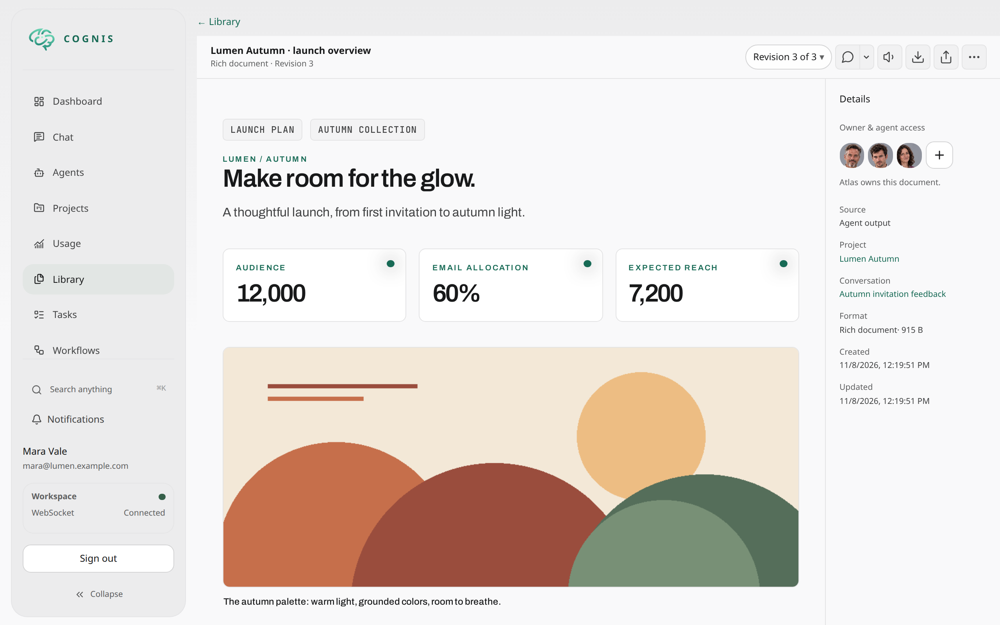
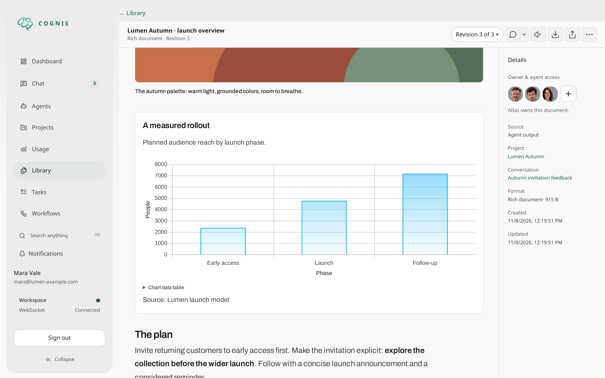
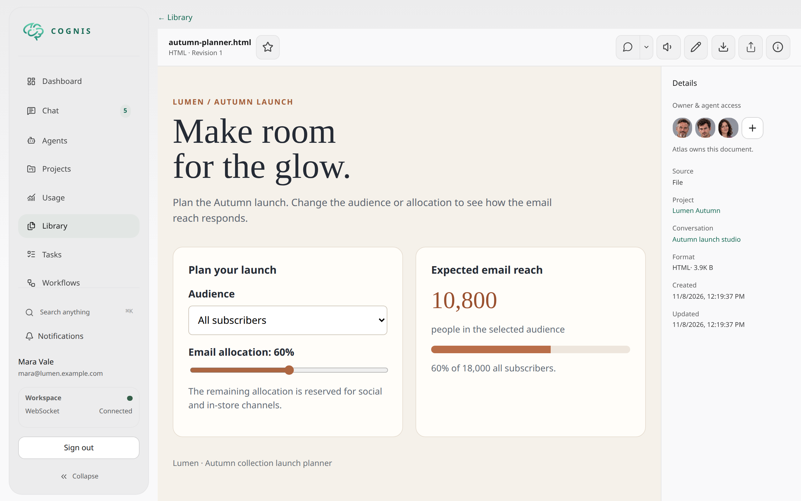

# Rich Deliverables

Rich deliverables are durable, structured Cognis outputs. They let an agent
author a deliberate presentation instead of flattening everything into a
Markdown response, while retaining an accessible Markdown fallback.

Use them for decision briefs, dashboards, research reports, comparisons,
incident summaries, timelines, and other outputs where hierarchy, evidence, or
visual structure improves understanding.







The figures are fictional planning assumptions, not observed performance.

## Reopening a conversation

Recently loaded deliverable bodies are reused synchronously when switching
away from a conversation and back. This is a bounded in-memory cache (up to
64 entries and 16 MiB, with a five-minute lifetime), not persisted chat content.
It is isolated by verified account, login epoch, and accessor conversation;
logout and account invalidation clear it. Task-specific loaders keep their own
authorization boundary.

Owned conversation history prepares authorized document bodies before admitting
the initial timeline or an older page, including task and managed-descendant
results. Admission and lineage metadata are read in groups; payload files load
concurrently after database leases end.

The 2 MiB document-data target selects a smaller canonical event window rather
than leaving over-budget cards to load separately. Its original history cursor
recovers older content without cutting composed items. One indivisible source
page may exceed the target. Preparation uses normal request cancellation and
storage timeouts, not a one-second deadline followed by card loading.

An underfilled viewport can fetch further ready pages within the existing
automatic-page bound. Storage failures reduce the candidate window when
possible; a failing indivisible page reports an error without advancing past it.
Automatic paging stops on errors and retains manual retry. Shared-reader
restrictions and denied-reference visibility are unchanged. Live synchronization
keeps its existing best-effort overlay; it never drops operations to fit a
backward-history page.

## Choosing the output format

Explicit user format requests and workflow output contracts take precedence.
Deliverables preserve results with short-, medium-, or long-term reference
value; assistant messages can be difficult to find and revisit later. A reusable
result belongs in a deliverable even when it is concise or visually simple.
Otherwise:

| Output | Default |
|---|---|
| Quick factual answer, clarification, acknowledgment, progress update, routine implementation status | Inline message |
| Completed research report, decision brief, option comparison, dashboard, digest, timeline, structured reference document | Rich deliverable |
| Requested standalone prose-only document, such as a letter or essay | Markdown deliverable |
| Requested downloadable file | Artifact/document tools; no Rich wrapper required |
| Internal handoff | Assigned return format unless a durable artifact is required |

Agents should choose Rich for qualifying outputs without waiting for a request
for Rich or a visual layout. Length, images, and charts are not prerequisites:
a concise comparison or evidence-backed report still qualifies. Being writable
in prose is not a reason to downgrade a report to Markdown. Conversely, a few
bullets or headings alone do not turn a quick answer into a deliverable.
Operational dashboards use `rich:dashboard`; daily Pulse presentations use
`rich:pulse`, following their registered contracts. Discover the tool if it is
not visible; explain unavailability or a failed write rather than claiming delivery.

## Delivering the outcome

The deliverable is the main user-facing outcome. It should contain everything
the reader needs, including conclusions, caveats, and next actions. Agents
should not repeat or summarize those results in an accompanying chat message.
After successful delivery, no additional message is needed unless the execution
contract requires one; in that case, use a brief acknowledgment without
duplicating content. Required workflow completion calls still apply.

## How they differ from artifacts and documents

| Capability | Best for | Primary representation |
|---|---|---|
| Artifact | A file, upload, generated image, PDF, or self-contained HTML page | Stored blob |
| Document tools | A portable PDF produced from Markdown/HTML | Generated PDF artifact |
| Rich deliverable | A structured, Cognis-native experience | Durable block payload plus Markdown fallback |

A rich deliverable is artifact-compatible as a `dlv_*` content reference, but
the downloadable virtual artifact is its fallback content. It is not the rich
payload JSON.

## Rendering targets

- **Web chat** renders the interactive rich layout directly in the
  conversation.
- **Open** uses the authenticated Cognis experience.
- **Share** defaults to a private link requiring existing Cognis access. The
  same picker serves artifacts and deliverables in chat, fullscreen, Work,
  and Library. Copying a private link never creates a public bearer token.
  Select an expiry and explicitly create a public link to allow anyone with
  that temporary URL to access the revision.
- **Channels** receive the accessible Markdown fallback rather than an
  interactive block tree.
- **PDF export** uses Cognis server-side rendering and caching. It is distinct
  from executor-side `document_generate`.
- **Single HTML export** is a self-contained offline publication. It uses the
  same content renderer as the hosted page, including Mermaid diagrams,
  responsive tables, charts, and typography. JavaScript must be enabled.
  Viewer download, copy, share, and close controls are omitted; table-of-contents
  navigation and content interactions remain available. It embeds authorized
  deliverable images as base64 data URLs and includes its styles and scripts in
  one file; unlike the live standalone page, it does not need Cognis assets or
  media routes to render. Missing referenced images cause an explicit failure
  rather than an incomplete download. The export is limited to 32 MiB.
- **Markdown export** downloads the stored Markdown fallback for rich and
  Markdown deliverables. It is not available for plain-text or HTML deliverables.

The download menu offers the available formats in embedded, full, and
standalone views. Share links can download the same formats while valid; the
downloaded files do not extend the life of a share token.

Public pages inherit the owner's current theme family. Signed-in readers use
their own account theme instead, even when someone else shared the document.
Single HTML exports embed the downloader's theme family for authenticated
downloads, or the owner's when downloaded through a public link.
Light/dark appearance is not copied from the owner:
external readers keep their local appearance choice or follow their device.

Chat, fullscreen, Work, and Library use the same content renderer, typography,
colors, and document actions. Hosts change placement and available space, not
the document's appearance or behavior.

Supplied chat and task results render their body and canonical styles together.
Task activity, inspector details, and expanded tool details load separately,
with visible loading and retry states rather than withholding the result.
Results whose content must still be fetched retain an explicit loading indicator.

Listen, download, and share are right-aligned icons. Listen opens
Reading and Podcast options for the current revision. The three-dot menu
contains copy, Add/Remove favorites, Library navigation, and host-specific actions such as collapse.
When history is available, the same themed revision picker remains visible outside
the menu in Library, chat fullscreen, attachment previews, and image viewers.
Switching a chat document revision keeps fullscreen open. Fullscreen adds Close; embedded documents add an expand
control. A floating side arrow opens Contents: a sticky sidebar in wide
document areas, or a right-side drawer on narrow screens.

Virtual deliverable preview URLs open the original deliverable viewer, not a
reconstructed Markdown file preview. Converting a signed preview link preserves
its exact expiry; Markdown downloads are unchanged. Installed-app previews have
a Close control that returns to app history when available, or to the app home
page for direct launches.

Authenticated owners can open an expired share through their private access.
The viewer labels this as an expired shared link; anonymous readers and other
users do not gain access. Public sharing offers 1, 7, 30, or 90 days,
or a custom date/time within the next 90 days. Creating a link does not revoke
earlier links. Forever is not supported. The signing secret is deployment-wide,
so selective revocation is not available through key rotation.

Long documents automatically expose a table of contents based on section
headings, including multiple headings within one Markdown block. An explicit
`metadata.toc: false` still disables it. Figure images can be activated with a
click or keyboard to open a borderless gallery preview. On desktop, click the
image to zoom around the pointer, move the pointer to pan, and click again to
reset. On touch screens, double-tap to zoom/reset, pinch to change zoom, and
drag to pan. The magnifying-glass control also toggles zoom for touch and
keyboard users. Escape, Close, or clicking/tapping the backdrop returns focus
to the figure. The preview uses the same
authorized image URL; it does not mint another share or download link.
Deliverables inside Cognis, including task outputs and fullscreen views, follow
your account appearance and have no separate theme control. External standalone
readers have a theme icon that cycles through light, dark, and system settings;
that browser-local preference never overrides in-app appearance.
A collapsed desktop contents sidebar reopens
from a small arrow beside the title; narrow screens retain the right-side
contents control and overlay drawer.

PDFs adapt the publication design to A4 portrait: bundled Archivo and
JetBrains Mono fonts, semantic status badges, a compact contents list with
page links, and three-column summary metrics. Short structured tables (up to
four rows) stay with their headings when they fit on a page; longer tables
repeat column headers across pages. Fonts are packaged locally, not fetched
from external services. PDF bookmarks and page numbers remain available.
PDF diagrams use the packaged, offline Chromium/Mermaid CLI runtime to
render up to three authored Mermaid diagrams to images per export. The source
remains legible when a diagram is invalid, exceeds the bounded render budget,
or a non-Docker installation has no CLI configured.
Native installations must provide `COGNIS_MERMAID_CLI` and
`PUPPETEER_EXECUTABLE_PATH` for PDF diagram support; web rendering uses
the bundled browser Mermaid module instead.

The standalone renderer scopes media access to the shared deliverable and
applies its own security policy. It is not a static HTML artifact and should
not be described as hosting.

## Writing a rich deliverable

Chat history includes ready-to-render data for recent owner-readable documents,
so opening a conversation does not require a second document request. Canonical
approved task results arrive with task details and render before activity is
loaded, including in dashboard task windows. Large chat documents and references
with separate access rules use the authorized document loader as a fallback.

Agents use the `write_deliverable` `rich` action. The action accepts one
canonical payload source. Cognis normalizes that payload and derives the
channel-safe Markdown fallback.

```text
write_deliverable(
  action="rich",
  payload={
    title: "Weekly delivery review",
    blocks: [...],
    sources: [...],
    metadata: {...}
  }
)
```

For a substantial payload that would be difficult to inspect or retry inline,
create an editable local JSON file with the available file-editing tool and
publish it as `application/json` with `artifact_publish`. Then pass its
immutable `art_*` ID:

```text
write_deliverable(
  action="rich",
  payload_artifact={ artifact_id: "art_<32 lowercase hex characters>" }
)
```

Do not combine `payload` and `payload_artifact`. Rich calls do not accept
`content`, `format`, `rich`, top-level `title`, `target`, or top-level
`outputs`. Put the title and optional outputs in the payload.

Before writing a Rich deliverable, call `validate_tool_call` with the complete
proposed `write_deliverable` arguments. Then call `write_deliverable` with
those exact unchanged arguments. Validation receipts are bound to the argument
shape, including the selected payload source.

The **Cognis Rich Deliverable** system skill guides agents toward appropriate
composition, hierarchy, evidence, and block selection. It is a writing and
presentation guide; it does not replace schema validation.

### Dashboard presentation

Use `action: "rich:dashboard"` for dense, technical operational views. The
action owns the presentation metadata and applies a wide canvas with compact
spacing. Do not set `metadata.presentation` in an authored payload.

Embedded chat hosts keep control of their width. Full and standalone views use
the wider bounded dashboard canvas.

The payload can include a top-level `title`. The stored deliverable title from
the host takes precedence when both values exist.

## Viewer shell

On supported desktop platforms, the document's three-dot menu includes **Open in
new window**. It opens that deliverable revision in an authenticated Library
reader without the app sidebar, mobile navigation, or Library back link. The
action is hidden on phones, touch devices, and unsupported PWA platforms.

Standalone and full-view rendering provide copy, download, and table-of-contents
controls. Signed-in standalone readers default to their verified account theme
and palette, including on public links. The viewer's light/dark/system control
overrides that default without changing account settings. Anonymous and offline
readers retain their independent reader preference or the operating system theme.
Public viewers include PDF, single HTML, and Markdown downloads for deliverables,
and the original file download for artifacts. Comment controls appear only when
the link allows comments.
A payload can optionally identify that shell
with `metadata.viewer_identity` when an authored label or semantic icon adds
meaning. Omitting it adds no identity chrome.

## Revisions

To edit or replace an existing deliverable, call `write_deliverable` with
`supersedes` set to the `dlv_` ID of its latest revision. The result is a new
deliverable and the next revision of the same document. It works for any
format and in both direct chat and task steps. A task can also revise a
deliverable written in chat, and chat can revise a task output.

- Only the latest revision can be superseded. When the target already has a
  newer revision, the tool rejects the call and returns
  `latest_deliverable_id`.
- Older revisions stay readable by their exact ID and through the revision
  history. Artifact search and listing return only the latest revision.
- Rewriting a deliverable inside the same task step still replaces the step
  draft. It does not create a new revision.

In the web app, the chat, the activity inspector, the Work view, and the task
output show a revision picker when a deliverable has more than one revision.
An older chat card stays in the history, collapsed and marked as superseded,
with a link to the latest revision.

## Choose the smallest useful format

- Use ordinary Markdown for prose that does not benefit from visual hierarchy.
- Use an artifact for a file the reader should download or retain.
- Use `document_generate` for a print-ready PDF.
- Use a rich deliverable when the reader benefits from structured navigation,
  comparison, evidence, metrics, or an interactive standalone view.

## Continue

- [Content, Artifacts, and Temporary Sharing](content-and-sharing.md)
- [Rich Deliverable Composition](rich-deliverable-composition.md)
- [Layout and narrative blocks](rich-deliverable-blocks-layout.md)
- [Data, evidence, and utility blocks](rich-deliverable-blocks-data.md)
