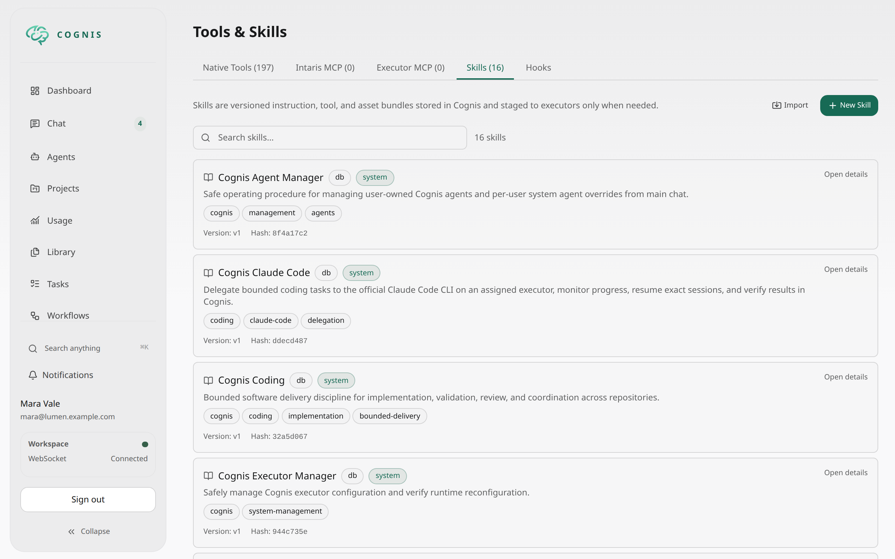

# Tools and Skills

The `Tools` workspace helps you understand what Cognis can execute and how those capabilities are exposed to agents.



## Tool registry

The tool registry lists available tools from multiple sources, including:

- built-in executor tools
- MCP tools
- skill-defined tools
- orchestration-related capabilities
- system utilities

Use the filters to narrow by category or source when you want to understand what is available before enabling it on an executor or agent.

Tool categories also drive workflow step tool profiles. A step profile can reduce which categories and capabilities are exposed by default for a specific step without changing the agent's underlying capability boundary.

Built-in, controller, and executor-native tools have declared classifications.
Their profile group and capabilities come from structured tool metadata, not
keywords in descriptions. Native definitions are audited at registration.
Only external MCP and executable skill tools use dynamic classification.

## Why the registry matters

The registry is a reference view, not the final permission model.

Whether an agent can actually use a tool depends on:

- which executor it resolves to
- which tools and MCP servers that executor exposes
- which skills are active on the agent
- which Intaris MCP servers are allowed directly on the agent
- which restrictions the agent applies on top
- whether Intaris allows, escalates, or denies the runtime call

For direct chat, tools in an explicitly assigned `tool_groups` collection that
belongs to the core `filesystem`, `shell`, `development`, or `web` groups are
normally visible under `system:direct-default` (soft). This does not override
other soft profiles or their intended defaults. Explicit exclusions, hard
profiles, and the effective authorization inventory still constrain exposure.
Long-tail MCP, administration, and skill tools remain deferred; discover them
with `search_tools`. A tool name mentioned in guidance is not itself callable
unless its schema is currently visible.

Controller discovery appends results to the conversation without promoting found
tools into the initial tool list. Use `describe_tool` for a discovered tool's schema
and `call_tool` to invoke it, unless it is already directly visible. The existing
discovery events retain handles across turns; every invocation still checks the
current permissions and step profile. Skill activation also appends instructions
and eligibility without changing direct schemas. Sessions that can load skills use
the fixed controller discovery surface from the first request, including Anthropic
and inference fallback candidates. Other Anthropic sessions may use native deferred
tool references. Permissions, model changes or external inventory changes can
intentionally change exposure.

The agent-loop turn owner owns rejected-tool repair state, retry budgeting, and
lifecycle events. Typed recovery state is keyed to the controller `turn_id` and
survives same-turn profile switches and compaction reentry; a new turn resets it.
The recovery planner is pure: it proposes safe bridge guidance from the
current authorized inventory instead of adding a direct tool schema. The retry passes through normal exposure
planning and `ToolRouter`/Intaris authorization; rejected arguments and
incomplete provider tool calls are discarded. Successful recovery records
discovery through the canonical `tool_discovery` lifecycle event so session
cache replay restores the handle consistently.

## Programmatic tool calling (PTC)

When enabled for the selected executor, `python_execute` runs a Python cell in
that executor's persistent IPython kernel. A call requires a clear `description`
and `code`; `inputs`, JSON Schemas, and tighter `limits` are optional.

The runtime supports direct WebSocket, in-process, and authenticated
cross-controller executor connections. Forwarded program RPC requires the
negotiated `program_rpc_v1` bridge capability; an unsupported peer is rejected
before Python code dispatch.

This is a first-call example using the actual tool arguments:

```json
{
  "description": "Count the supplied rows and return the count.",
  "code": "await cognis.emit({\"count\": len(inputs[\"rows\"])})",
  "inputs": {
    "rows": [1, 2, 3]
  },
  "input_schema": {
    "type": "object",
    "properties": {
      "rows": {
        "type": "array",
        "items": { "type": "integer" }
      }
    },
    "required": ["rows"],
    "additionalProperties": false
  },
  "output_schema": {
    "type": "object",
    "properties": {
      "count": { "type": "integer" }
    },
    "required": ["count"],
    "additionalProperties": false
  },
  "limits": {
    "wall_seconds": 30,
    "max_calls": 4,
    "concurrency": 2,
    "output_bytes": 16384
  }
}
```

`inputs` are passed separately from literal source, and an emitted value is
validated against `output_schema` when supplied. Use top-level `await` for
`cognis.emit(value)`. After the first call, include `expected_generation` from
the latest result or `python_kernel_status`; a missing or stale generation is
not a reason to guess and retry.

`python_execute` is non-bypassable and its required description is part of the
ordinary Intaris evaluation/approval context. Intaris may allow, escalate, or
deny the call under its normal policy; the tool does not grant itself approval.

The optional limits are clamped to executor bounds: `wall_seconds` defaults to
120 seconds and has a 300-second maximum; `max_calls` defaults to and is capped
at 50; `concurrency` defaults to and is capped at 4; and `output_bytes` defaults
to and is capped at 1 MiB. `max_calls` and `concurrency` bound nested calls; the
wall-time budget pauses while a nested call awaits approval. When the effective
plan contains any writable tool, nested calls are serialized in v1 even if a
higher concurrency was requested.

The executor generates `cognis.runtime_guide` from the exact effective plan for
each call. It lists the current aliases, schemas, limits, and discovery
availability. `await cognis.tools.search(query, limit=10)` searches that plan
(maximum limit 50), ranking exact tool IDs, names, and aliases before partial
names and description-only matches. `await cognis.tools.describe(tool_id)`
returns one descriptor. `cognis.tools.load(descriptor)` creates an async callable from a
descriptor in the plan; await that callable to invoke the tool. These helpers do
not add tools outside the current inventory or grant permission. A nested call
returns a bounded `ToolValue`: use `.data` only for declared structured output,
otherwise inspect `.text`, `.is_error`, `.truncated`, and any call or recovery
references. Runtime guidance is inserted only when the effective runtime
exposes `python_execute`; it is not a substitute for the live plan.

For a known tool, describe its canonical ID directly rather than assuming that
the first result of a broad description search is the intended tool:

```python
descriptor = await cognis.tools.describe("builtin:memory_search")
search = cognis.tools.load(descriptor)
value = await search(query="Python runtime read-only smoke check", limit=1)
await cognis.emit({"call_id": value.call_id, "is_error": value.is_error})
```

`load` is synchronous; await the returned tool callable. `cognis.load_tool` is
not part of this API. Discovery changes require an updated executor build and a
new kernel; deploying the controller does not update host executor installations.

Nested Cognis calls are drawn from the current effective plan and each uses the
normal `ToolRouter`/Intaris policy and approval flow. Writable tools are
eligible unless the session explicitly requires read-only access. Workflow
programs remain read-only and use their explicit canonical tool-ID allowlist.
Recursive, orchestration, management, and unsupported-source tools remain
excluded. The parent Python approval is not approval for any child: each child
mutation is evaluated and approved independently. A pending approval suspends
the same cell; do not issue a duplicate call.

If a child delivery outcome becomes uncertain, the program stops dispatching
additional governed child tools, even if Python catches the reported error.
Already dispatched siblings may still need reconciliation. The bridge bounds
concurrent reverse child calls to 64. On disconnect, accepted or unknown child
calls are never replayed and an unadoptable pending child/approval is
interrupted. Same-process accepted-call recovery may return a retained terminal
result; it does not resend a cell or child effect. The Python kernel is not a
sandbox: code can still directly use the selected executor user's filesystem,
credentials, mounts, network, and process access. Do not put secrets in
`inputs` or source.

On the same executor, interactive variables and helpers persist across cells in
the same conversation scope only while the kernel lives; they are not a durable
notebook or a recoverable heap. `python_kernel_status` reports `state`,
`kernel_generation`, and `state_lost_reason` when available, not variable
contents. A remote kernel heap can survive a controller/bridge disconnect even
when its active cell's child-RPC continuation cannot; a later cell can resume
only through a new live controller invocation. Executor process restart or
provider shutdown closes kernels, advances generation, and loses heap state;
variables are never serialized or restored. `python_kernel_reset` requires the
current `expected_generation` and discards an idle kernel, advancing its
generation. After state loss or an uncertain result, inspect status and
reconcile recorded tool calls and external effects before retrying; never replay
an interrupted cell blindly. Status and reset are separate executor tools, not
methods on the in-kernel `cognis` API.

In the chat timeline, Python executions appear under **Running code**, separately
from shell commands. One expandable card shows the description, highlighted
source, generation, output, final value, and linked tool activity. Flushed stdout
and stderr appear incrementally while the cell is running, through the same
bounded live-output and reconnect path as shell tools. For example, use
`print("progress", flush=True)` before a long `await`. Final output remains
available after completion and reload; protocol metadata is available separately
under **Raw execution data**. A child waiting for approval keeps the ordinary
approval action and is surfaced as waiting on the parent card; contiguous linked
child events are presented under the parent rather than duplicated as separate
top-level cards. This is a live activity view, not a notebook or variable
inspector. For workflow-program rules, see [Program steps](workflows.md#program-steps-ptc)
and the
[tool-system contract](../specs/06-tool-system.md#programmatic-tool-calling-ptc).

## Model-specific file editors

Cognis selects file editors from the authorized inventory before tool discovery:

- GPT-5, GPT-6, and Codex models use `apply_patch`.
- Anthropic models use `edit`, `multiedit`, and `write`.

The selected editors are directly visible without `search_tools`, including under
tool-slot pressure. An insufficient slot limit produces an error instead of
silently hiding the editing surface.

Discovery and indirect calls cannot restore incompatible editors. This policy
does not grant missing tools or bypass read-only restrictions. External MCP tools
with similar names retain their own authorization.

## Existing credentials as MCP bearer authentication

`manage_mcp.servers_create` and `servers_update` accept a narrow credential
binding in `auth_config`:

```json
{
  "type": "credential_bearer",
  "credential_ref": "$credential:<credential_id>.token",
  "credential_agent_id": "<consumer agent_id>"
}
```

Use discovered IDs. The binding requires an HTTPS HTTP MCP endpoint, no URL
userinfo and no manually supplied Authorization header. Only private WebSocket
executors owned by the credential owner are supported. In an opted-in owner-root
primary chat, the configuring agent may bind a different consumer agent owned by
the same user. Both agents must be active and independently hold the current
stored credential grant; configuration never creates or restores a grant. The
consumer needs no management tools. Configuration and management results
contain references or metadata, never the bearer value. The controller resolves
the value transiently into `Authorization: Bearer …` when configuring the assigned
executor. Static `$secret:NAME` headers and OAuth retain their existing paths.

The binding is restricted to its named consumer, not its configurator. To retain
access for multiple agents, create separate MCP server records referencing the
same credential and endpoint, and assign each record to the intended executor.
Discovery hides a binding from other
agents, and each call revalidates current durable grants, credential status,
executor assignment and credential generation. Missing or revoked credentials
fail closed. Credential rotation or changed destination/header configuration
requires executor reconfiguration; an old cached client cannot dispatch with a
newly authorized generation. Revocation does not recall already sent calls.
Executors must advertise the `credential-bearer-v1` protocol on their current
authenticated connection. Older executors receive no bearer and report
`mcp_credential_executor_upgrade_required`; upgrade/reconnect them before use.
This requirement is checked again before dispatch, including resumed sessions.

## Secure executor token provisioning

In an opted-in owner primary chat, `manage_executors.provision_token` accepts
`executor_id`, the `expected_updated_at` returned by `get`, and a stable
`operation_id` chosen once for that operation. It uses the existing executor JWT
signer and rotation/fencing path. No connected runtime is required.

The token version, encrypted agent-scoped credential and caller-agent grant
commit atomically. The result contains `token_ref`, `credential_id`, token version,
and persisted/fenced state, never a token value. An authorized executor tool can
consume the reference in its supported secure credential input to provision an
external Secret. Do not embed it in a shell command: shell arguments are not a
credential-resolution interface. Cognis does not add a Kubernetes provisioner.

If delivery is interrupted or uncertain, repeat the **same** operation ID and
original precondition to reconcile. A committed operation resumes pending
fencing without rotating again; a superseded, revoked or unauthorized operation
fails closed. A new operation ID rotates again and needs a fresh precondition.
This operation cannot issue shared, local or another user's executor tokens.
Manual token rotation in Settings remains unchanged.

### Management readback and newly assigned tools

Read-only management operations such as executor `get` and MCP
`assignments_get` can be repeated within the same turn to inspect changed
state. Mutating and unknown operations retain duplicate and uncertain-outcome
protection; a readback does not authorize replaying a mutation.

Executor reconfiguration and a chat's admitted tool inventory are separate.
After adding an MCP assignment, finish the current turn and start a new user
turn before discovering and calling newly added tools. Answering a pending
question or resuming the same turn does not refresh that inventory. Do not
guess a tool ID or bypass discovery when a new tool is not yet exposed.

## Skills

Skills are reusable instruction bundles stored in the database and exposed through the `Tools` workspace and skill APIs.

Today, the most visible skill workflow is:

- create or edit database-backed skills
- import skills from supported external formats such as `SKILL.md`
- export skills for sharing or version control
- organize skills with tags and global attachment behavior
- attach skills to agents so their instructions are available at runtime

Depending on the imported format and runtime configuration, a skill can also carry richer metadata such as templates, assets, or tool-related information. This guide focuses on the shipped workflow you can use directly from the current app.

In practice, a skill can expose capability in three distinct ways:

- **Instructions** for reasoning and operating procedure
- **Linked runtime tools** that point at existing builtin or MCP tools already present in the registry
- **Bundled executable skill tools** that ship inside the skill version itself

Skills may also store a **saved workflow decomposition**. That decomposition is treated as a skill-owned template, not as a persistent workflow definition by itself.

### Managing skills

In the UI you can:

- create and edit database-backed custom skills
- import skills from a URL, including `SKILL.md`-style sources
- export skills for sharing and version control
- organize skills with tags
- attach a skill to all agents by default
- bind linked runtime tools that should become available when the skill is attached or explicitly loaded
- review or save workflow decomposition on the skill itself

### How skills work at runtime

Skills use a hybrid lazy-loading model for token efficiency:

1. **Attached skills in the system prompt** -- only skills attached to the agent or to all agents are listed in the immutable prompt prefix, each with its ID, name, and description (capped at 1,024 characters). Skills whose instructions are auto-loaded are omitted from the list because their full instructions are already in context. Every other visible skill is summarized as one line with a count.
2. **Search via `skill_search`** -- the agent finds unlisted skills by name, description, and tags. Each result contains only the skill ID, name, and description. Like `skill_load`, `skill_search` is always directly callable; the agent never needs `search_tools` to reach it.
3. **On-demand loading via `skill_load`** -- the agent uses the `skill_load` tool to read full instructions when a skill is relevant to the current task. Instructions, prompt templates, and asset references are loaded into the mutable context, not the cached prefix. Saved workflow decomposition and tool summaries stay out of the model context.
4. **Deferred tool exposure** -- linked runtime tools and bundled executable skill tools are discoverable but treated as deferred. Attached skills start available by default; other skills expose their tools through the normal tool runtime after the agent loads the skill, without duplicating their schemas in the skill context.

Repeated `skill_load` calls return success with `status: "already_loaded"` and
`instructions_loaded: false` when the same instructions and templates are still
present in the model context, including automatic preloads. Asset preparation
still runs on the selected executor, and the result contains its current paths,
environment, readiness, and any errors. Changed instructions are supplied in full
with a notice that they replace the earlier version, not as a diff. If earlier
instructions are no longer in context after compaction, loading supplies them again.

This means:
- adding or removing skills does not invalidate the entire prompt cache
- the agent only pays token costs for skills it actually uses
- skill edits are visible on the next turn without restarting the session
- after `skill_load`, the loaded skill's linked runtime tools and bundled executable tools become eligible for subsequent model calls in the turn
- if a skill carries saved decomposition, tasks and schedules that use that skill materialize from the latest saved skill version

### Portable skill assets

`skill_load` automatically verifies and caches the current version's assets under
`COGNIS_DATA_DIR/skill_assets` (default `~/.cognis/skill_assets`) on the active
authorized executor. The returned manifest and loaded context include each
asset's `local_path`, executor ID, version ID, and SHA-256 hash. Relative bundle
directories are preserved. Matching cached files are reused; replacements are
atomic and versions have separate paths.
Asset preparation currently supports Linux and macOS executors. By default,
preparation errors leave instructions available with `preparation_warning` and
`asset_preparation.status: incomplete`; they do not establish runtime readiness.

Pass `require_assets_ready: true` when the next operation consumes bundled assets.
This requires verified paths and, for Python assets, a ready managed environment.
Incomplete preparation returns a structured error without activating the skill
as a successful load. Temporary executor delivery failures use the existing
same-executor recovery window, cancellation, and ownership fences; they do not
fall back to another executor. Re-preparing the version-pinned cache is safe
after an unknown prepare outcome. This never authorizes replaying a helper or
an uncertain external write.

Recovery keeps the task/conversation-owned durable deadline and the existing
turn/task cancellation owner. It holds no database transaction across executor
I/O or reconnect waits. Retries retain the selected skill version and revalidate
executor eligibility and the ownership fence at dispatch. A controller restart
may re-prepare an unfinished read-only step; completed step outputs remain
authoritative and uncertain mutations retain their no-replay contract.

Reload after publishing or replacing assets, switching executors, or losing
cached files. Load sends the authorized version directly, so it does not depend
on a configure-time executor snapshot or a restart. The separate
`skill_asset_materialize` tool is retired. Automatically injected instructions
without prepared paths still require `skill_load` before using asset-only helpers.

Publish required helper scripts, templates, and static resources as versioned
skill assets. Do not depend on scratch files, absolute executor paths, unbundled
neighboring resources, or prior session state. Document external dependencies,
discover runtime configuration at execution time, and never bundle secrets.
Verify publication → load → execution without the original workspace before
reporting a skill complete. A preparation failure is a runtime blocker, not
permission to use an old local copy or claim end-to-end success.

### Agent skill selection

In the agent editor, you can select which skills to attach to an agent. Only attached skills appear in the agent's prompt, and their tools are available immediately through the deferred tool-loading path. Attach the skills an agent uses regularly; leave occasional ones unattached so they stay reachable through `skill_search` without growing every prompt.

Attached-skill defaults now include linked runtime tools as well as bundled skill tools. This lets a skill bring an existing builtin or MCP tool surface into scope without duplicating that tool definition inside the skill.

Some shipped system agents also come with default attached skills. For example,
`system:implement` and `system:code-review` attach the built-in Cognis coding
skill by default. When a system agent allows overrides, its attached skill list
can be replaced per user through the normal agent editor.

Every visible skill can still be loaded by ID with `skill_load`; attachment changes what is advertised, not what is authorized.

#### Usage-based curation

Cognis counts, per agent and skill, how often the skill is loaded, when it was last loaded, and how many loads followed a `skill_search` result. Only identifiers, counters, and timestamps are stored. The agent editor uses these counters for two advisory hints:

- an attached skill that has not been loaded for 30 days suggests removal. Cognis does not store when a skill was attached, so the window also starts no earlier than the agent's last update and the start of usage counting;
- an unattached skill that the agent found through search and loaded three or more times suggests attaching it.

Nothing is detached or archived automatically. Agents see the same data in `skill_get` (`agent_usage`) and in the `manage_agents` skill assignment view (`skill_usage`). Skills attached to all agents and skills with auto-loaded instructions are not part of these suggestions.

### LLM skill management

Agents can manage skills through built-in tools:

- `skill_list` -- list available skills
- `skill_search` -- find skills by name, description, and tags
- `skill_load` -- load a skill's full instructions and related metadata
- `skill_get` -- get skill details for inspection or debugging
- `skill_versions` -- inspect version history
- `skill_write` -- create or update a skill (creates a new version)
- `skill_asset_write` -- add or replace a text/script asset on a skill
- `skill_asset_delete` -- remove an asset from a skill
- `skill_delete` -- delete a skill
- `skill_import_url` -- import a skill from a URL
- `skill_restore_version` -- restore a previous immutable version
- `skill_export` -- export a skill as SKILL.md, YAML, or a full Cognis package

All mutation tools are non-bypassable and evaluated by Intaris guardrails. When an agent creates, imports, or edits a skill (`skill_write`, `skill_import_url`, `skill_patch`, asset changes, or a version restore), Cognis attaches it to that agent if it is not attached yet. A delegated specialist acts for its persistent parent agent, so the parent receives the attachment. Other agents are never changed, existing assignments are kept as they are, and skills attached to all agents need no per-agent entry. Only the agent owner's own runs attach skills.

An asset upsert can reuse `existing_asset_id` under a different filename. Renames
copy verified bytes into a new immutable storage object; the original version
remains loadable and restorable. Same-name reuse retains the existing storage
object. Remove the old filename in the same patch when replacing rather than
adding an asset.

When a skill already has saved decomposition and its decomposition-driving inputs change, Cognis refreshes that decomposition before publishing the new current version. If the refresh fails, the update fails rather than leaving the latest saved version stale.

### Built-in Cognis skills

Cognis also ships global management skills for Cognis-native operations such as task and workflow management. These skills are intended for the main chat agent and are discoverable through the normal skill tools (`skill_search`, `skill_load`). They guide the agent to inspect state first, use the correct management tools, and avoid mutating protected resources such as system workflows.

Cognis also ships reusable execution guidance. `Cognis Coding` defines the
software delivery workflow: minimal changes without speculative fallbacks or
test scaffolding, behavior-level tests, and debuggable error handling.
`Cognis Frontend Engineering` adds product judgment, interaction completeness,
visual restraint, and cross-surface validation for product pages, web and
mobile apps, dashboards, and control centers. It reads a repository's
`DESIGN.md` explicitly, builds from the shared component vocabulary, and keeps
disclaimers and implementation language out of interface copy.

`Cognis Claude Code` (`cognis-claude-code`) delegates bounded coding tasks to
the official Claude Code CLI on an assigned executor. Load it on demand or
attach it to a coordinating agent. The executor needs an installed,
authenticated CLI and the repository; the skill does not install software or
configure authentication.

The coordinator supplies a scoped brief and an isolated worktree, launches a
background headless job, monitors its streamed output, and resumes follow-ups
by the exact native session ID. It reviews the diff and verifies results before
publishing through Cognis artifact/deliverable tools. Claude manages context
only inside its worker session; Cognis keeps its normal runtime and workflows.

Claude's native tools are not individually evaluated by Cognis/Intaris. Use
explicit Claude tool permissions and a suitably isolated executor; a worktree
is not a sandbox. The skill defaults to a read-only command and requires
task-scoped permissions for edits and tests, never permission bypass. Native
session persistence belongs to the selected executor and is not made portable
by this skill. Cognis skills, hooks, and tools are not automatically inherited
by the worker.

### Importing skills

Skills can be imported from:

- **Raw SKILL.md URLs** -- any HTTPS URL pointing to a SKILL.md file
- **GitHub blob URLs** -- automatically resolved to raw content
- **GitHub folder URLs** -- `SKILL.md` is inferred inside the folder
- **Cognis YAML** -- the native portable format
- **Cognis package** -- the full-fidelity portable format for skills with attached assets

Import security:

- HTTPS required for non-localhost URLs
- Private/reserved IP addresses are blocked (SSRF protection)
- Response size limits (10MB default)
- Redirect validation on every hop
- Provenance recorded (source URL, resolved URL, commit SHA, checksum)

### Executable skill tools

Skills can define tools with execution recipes. These bundled executable tools appear as first-class tools in the agent's effective tool set. When called, the executor stages required assets into a temporary workspace, executes the recipe, and cleans up afterward.

### Linked runtime tools

Skills can also point at existing runtime tools through `linked_tool_ids`. These are references to already-registered builtin or MCP tools. They are useful when a skill should expose a known tool surface without re-declaring a bundled executor-side tool recipe.

On explicit skill load, Cognis resolves links against the current registry and
stores canonical tool IDs in session activation state. Links may use a canonical
ID, the callable name, or a qualified MCP server name such as
`mcp:slack-example:conversations_search_messages`. Server-name aliases and bare
operation names must identify exactly one tool. Missing, ambiguous, denied, or
step-excluded links are reported in the activation notice rather than silently
treated as enabled. Loading a skill does not override tool permissions or hard
step restrictions.
Resolved links remain callable through `describe_tool` and `call_tool`, not newly
added direct schemas. Canonical events preserve instructions and eligibility after
cache loss. Loading or reloading a skill, including `/skill`, appends instructions
without deleting earlier exposed instructions; the latest state controls eligibility.

`describe_tool`, `validate_tool_call`, `call_tool`, and exact `search_tools`
lookups use the same reference resolution within their authorized inventory.
That inventory includes enabled controller helpers such as `validate_tool_call`,
not only executor tools. Discovery does not enable a disabled helper or add a
direct schema; `call_tool` preserves the helper's normal validation and execution
path, including session-local Rich authoring preflight requirements.
Exact discovery also returns a matching tool that is already visible. Natural
language searches remain relevance-ranked; a failed lookup is not evidence that
the underlying service is unavailable.

Use linked runtime tools when:

- the tool already exists in the registry
- the skill should surface that existing tool when attached or loaded
- you do not need to ship new executable code with the skill

Use bundled executable skill tools when:

- the skill needs to carry its own reusable command or script
- the behavior should travel with the skill version and asset package

Skills can also carry reusable workflow step material, including step tool-profile data. That means a skill can ship both runtime tool bindings and the recommended tool surface for the steps it contributes to composed workflows.

When Cognis decomposes a skill into workflow steps, it automatically tries to align step profiles and per-step tool overrides with the skill's linked and bundled tools. The saved decomposition is editable through the workflow editor UI, but saving in that mode writes back to the skill version rather than creating a standalone workflow row.

Skill assets are stored in Cognis itself (database metadata plus artifact storage)
and are never managed as editable controller filesystem state. Executors receive
versioned cached copies for asset-only helpers and temporary staged copies for
executable recipes.

### Python asset environments

`skill_load` and `/skill` transparently verify assets and prepare one shared Python
virtualenv per owner and skill on the selected executor. This remains a read-only
operation for the agent; no additional skill settings or preparation tool are needed.
All Python assets in the skill contribute requirements to this environment.

Use standard [PEP 723 inline script metadata](https://packaging.python.org/en/latest/specifications/inline-script-metadata/)
to declare dependencies directly in each script:

```python
# /// script
# requires-python = ">=3.12"
# dependencies = ["requests==2.32.3", "rich>=13,<14"]
# ///
```

Exact `==` versions pin direct dependencies, not the complete transitive dependency
graph. Requirements across scripts are resolved together; incompatible pins are
reported rather than assigned separate environments. Without a PEP 723 block,
Cognis infers third-party imports best-effort, excluding standard-library and
bundled Python modules. Import names do not always match package names; explicit
PEP 723 dependencies are authoritative and recommended. Optional and dynamic imports
cannot be inferred reliably.

Run assets with the returned `python_environment.python_path` and their `local_path`
on the named executor. Do not use system Python or make another ad-hoc virtualenv.
The executor uses `uv` when available, otherwise Python's `venv` and `pip`. It uses
its existing Python interpreter and does not download Python or install OS packages.
Dependency installation may access package indexes and execute package build code.

Each load verifies and repairs files, reuses a healthy environment without forced
upgrades, installs missing requirements, and recreates a broken managed environment.
Preparation is serialized, time-bounded, and safe to repeat. Published versions keep
separate asset files but share the skill environment, so incompatible historical
versions should not be run concurrently.

Preparation failures **do not block skill instructions**. The load result and
protected skill context include `preparation_warning` and, when available, an
incomplete `python_environment` with the concrete error. Assets might not be runnable.
The agent can correct missing OS dependencies, package declarations, or executor
problems through normal authorized tools, then reload the skill to retry. Never
claim runtime readiness solely because files were materialized.

Python `script` recipes use the same shared interpreter automatically. During a
rolling upgrade, older executors still return verified assets but no environment;
new controllers expose that as an incomplete-environment warning. New executors
preserve legacy recipe execution for old controller manifests lacking owner
scoping. That compatibility branch can be removed once every controller supplies
the owner-scoped manifest.

Supported recipe modes:

- `script` -- execute a staged asset script with arguments
- `command` -- run a declared command with templated arguments

The controller never executes skill recipes directly -- all execution goes through the executor.

## MCP servers versus tools

MCP servers are configured in settings and then attached to executors. Once attached, they contribute tools to the executor's effective tool set.

This means:

- tools are what the agent can call
- MCP servers are one way those tools become available
- skills are another way tools become available
- executors are the boundary where tools are actually exposed
- Intaris-managed remote MCP servers are a separate per-agent path in the agent editor

## Practical advice

- Start with the smallest useful executor tool set.
- Attach MCP servers only where they are needed.
- Use skills for reusable operating instructions and tool bundles instead of copying them into each agent definition.
- Import existing Claude Code skills from GitHub to bootstrap agent capabilities.
- Use the tool registry to verify naming, categories, and source before troubleshooting agent permissions.

## Image generation and editing

Use `image_generate` to create a new image from a prompt. It optionally accepts
an ordered `references` array of Cognis image or artifact IDs. Use the prompt to
state how each reference should influence the result.

OpenAI-style providers use the image edit endpoint for reference-guided
generation and explicit edits, uploading the original image bytes in order.
Text-only requests use the image generation endpoint. Gemini continues to use
its multimodal image path.

OpenAI `gpt-image-2.6-flare` and `gpt-image-2.6-sunburst` use these native
Image API endpoints for generation and reference/masked edits, not Chat
Completions or Responses. They use the existing image tool options and PNG
output; complexity, markup, SVG, and animation controls are not exposed by
these tools. Availability still requires an authorized configured API provider;
a bundled catalog entry does not grant access or change model routing.

Use `image_edit` to modify or combine existing images. Its required `images`
array is ordered and passed to the selected model as supplied. An optional
`mask_artifact_id` identifies the region for masked editing when the selected
model supports masks.

For both tools, publish executor-local images as Cognis artifacts first, then
pass their IDs. Models have different limits and editing capabilities; an
unsupported reference count or mask is returned as an error and is never
silently converted into a text-only generation request.
