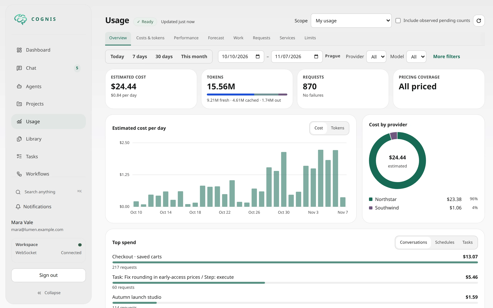
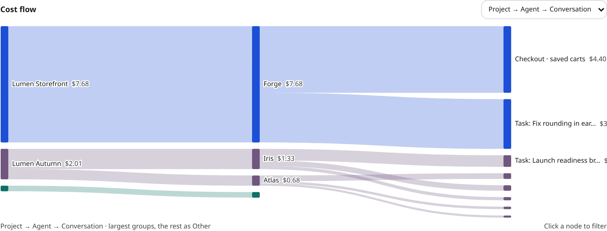

# Usage accounting storage and retention

Usage storage contains identifiers, token/native-unit observations, bounded
model parameters, timings, normalized error categories, and pricing references.
It does not store prompts, responses, payloads, credentials, unrestricted
headers, or raw exception messages.



The cost flow follows spend between two or three levels, for example from a
project to its agents and their conversations and tasks. Click a node to filter.



These examples use the fictional Lumen demo workspace with demo providers,
models and prices. They do not represent live inference, observed performance
or an invoice.

## Images, speech and video

Image generation/editing, batch and streaming speech recognition/synthesis, and
video generation/extension use the same accounting ledger as text inference.
Request logs and attempt details expose `media_usage`: typed numeric quantities
with units and reported/derived/partial provenance. The UI displays images,
audio minutes, characters and video seconds. Modality tokens remain separate
from overlapping total tokens; they are not billed a second time.

Native rates use the provider/model catalog or configured overrides. Missing
rates or quantities remain unpriced or partial, never a zero-cost estimate.
Provider-reported monetary evidence uses the separate `provider_reported`
currency/basis band and is preserved when catalog prices change.

Video budget reservations are not charges. Late cost/duration evidence corrects
the original attempt idempotently; job reads and polls are not new billable
attempts. Attribution keeps the trusted launch origin rather than the reader.
Conversation-only media work contributes to the authorized chat Usage summary
without creating a synthetic physical session. Work without an agent remains
in the existing Cognis system breakdown.

## API clients and logical request logs

`traffic_origin` distinguishes controller inference (`cognis`), authenticated
inference HTTP requests (`api`), and ambiguous legacy observations (`unknown`).
Provider `source` is independent. `auth_type` is `api_key`, `user_jwt`, `service`,
`browser_session`, `unknown`, or null for internal inference.

The trusted `client_id` is an API-key record ID, companion service name, or the
`user_jwt`/`browser_session` client class. `key_id` is a record identifier, never
credential bytes. Sharing one key/JWT does not create distinct authenticated
apps. Caller labels and app names do not change accounting identity or authority.

Analytics `/api/v1/usage/query` and `/facets` accept `traffic_origins`,
`auth_types`, `client_ids` and `key_ids` filters. New grouping/facet dimensions
are `traffic_origin`, `auth_type`, `client` and `key`. Existing views and cost
quality rules still apply.

`POST /api/v1/usage/requests` retains physical-attempt paging by default.
Set `pagination_unit: "request"` to page unique logical requests newest first:

```json
{
  "scope": {"mode": "personal"},
  "start": "2026-11-04T00:00:00Z",
  "end": "2026-11-05T00:00:00Z",
  "pagination_unit": "request",
  "filters": {"traffic_origins": ["api"], "auth_types": ["api_key"]},
  "limit": 100
}
```

The response is `{meta, pagination_unit, items, next_cursor}`. Each request
contains `request_id`, `selection_ref`, start/completion timestamps,
`traffic_origin`, `auth_type`, private `client_id`/`key_id`, `service_id`,
`requested_model`, `provider_ids`, `resolved_models`, `request_path`, `streaming`,
`http_status_code`, `finish_reason`, `state`, normalized error fields, logical
`timing`, `latency_seconds`, `ttft_seconds`, `tokens`, `usage_quality`, `costs`,
`unpriced_attempts`, `attempt_count`, `retry_count` and `fallback_count`.
Private fields also include `user_agent`, `app_name`, `app_version` and
`client_labels`. Unknown historical metadata is null.

Client/key/provider/model/state/error/time filtering applies before header
paging. `http_status_codes` filters the actual client response. Provider/model
filters select a request if one matching attempt exists, but request token/cost
totals include all retained attempts, including failed retries. Unknown usage is
not silently zero; quality and unpriced counts accompany known subtotals.
Requests without observed dispatch have zero observed attempts, not a synthetic
provider attempt. A missing server final leaves logical outcome unknown.

`POST /api/v1/usage/requests/detail` takes `scope`, `start`, `end`,
`pricing_basis`, a required list item's `selection_ref`, and optional
`limit`/`cursor`. It returns `{meta, request, attempts, next_cursor}`. The attempt
trail uses existing detail contracts and bounded paging. Time windows remain
limited to 90 days and pages to 500 items. Hydration is bounded to 10,000
retained attempts per request page; narrow the page if that budget is exceeded.
Cursor registration fences prevent newly inserted headers entering later pages.
Observations can still finalize while browsing; refresh to inspect new retries.

All routes recheck personal/project/admin authority. Encrypted references only
narrow fresh authorization. Project views use reduced models: no raw request ID,
client/key IDs, app metadata, user agent or client labels; client/key filters,
grouping and facets are forbidden there. Private selectors stay in POST bodies.
Unauthenticated HTTP failures are not attributed to a personal usage log.

### Safe metadata

Only these headers are considered:

| Header | Bound |
| --- | --- |
| `User-Agent` | Remove controls, collapse whitespace, retain at most 256 printable ASCII characters |
| `X-Cognis-Inference-App-Name` | Optional 1–64-character app identifier |
| `X-Cognis-Inference-App-Version` | Optional 1–64-character version token |
| `X-Cognis-Inference-Operation` | Existing operation allowlist |
| `X-Cognis-Inference-{Operation-Id,Session-Id,Task-Id,Client-Request-Id}` | Existing 160-character identifier validation |

App identifiers use ASCII letters/digits and `_.+-`, beginning with a letter or
digit. Private HTTP metadata plus labels is capped at 2 KiB within the existing
8-KiB observation envelope; oversized optional labels are omitted before dispatch.
Only the three exact inference routes are retained, never query strings.
Finish reasons are normalized to `stop`, `length`, `tool_calls`,
`function_call`, `content_filter` or `other`. Errors are fixed safe templates.
SSE errors can legitimately have HTTP 200 and logical state `failed`.
TTFT means first meaningful generation, not a header/keepalive byte.

There is no IP collection, including hashes or forwarded IPs, and no arbitrary
header capture. Never place credentials or sensitive content in allowlisted
client metadata; the values remain untrusted display/correlation labels.

### Upgrade and privacy

Stop old accounting workers before upgrading; do not run mixed dimension
writers. Run the normal migration command:

```bash
uv run python -m cognis database upgrade
```

Idempotent startup bootstrap applies the same schema. Starting the upgraded
controller (`uv run python -m cognis serve`) automatically queues bounded,
resumable whole-owner/UTC-day traffic backfills and generation rebuilds.
No separate full-table startup backfill is required. Usage may report
`building` until old generations are replaced; retention is paused for them.
Canonical observation payloads and their digests are not rewritten.

Operators can inspect unfinished scopes:

```sql
SELECT owner_key, bucket_day, traffic_version, ready, building_generation,
       build_job_id, retention_paused
FROM usage_projection_state
WHERE traffic_version < 2 OR ready = false;
```

For an explicitly selected owner/day, the existing maintenance service supports
`await maintenance.request_rebuild(scope)`, where `scope` is a
`UsageMaintenanceScope` built from that query's owner/day. Inspect
`await maintenance.status(job.job_id)`; resume a failed/interrupted job only
after diagnosis with `await maintenance.resume(job.job_id)`.

Legacy API-key record IDs are recovered only from trusted API-key attribution.
Other ambiguous history remains `unknown`. Old archives cannot recover deleted
client identities or HTTP metadata. Archives retain coarse origin/auth only:
client/key dimensions and request metadata expire with detail, including zero
or superseded projection rows. Client/key historical queries spanning expired
detail are explicitly unsupported rather than returning misleading totals.
Reverse schema migration preserves canonical facts but invalidates disposable
projections; a reverse rollout requires rebuilding with compatible observation
decoders. Do not deploy an older decoder over newly captured envelopes.

## Enable or disable analytics

**Settings → System → Usage → Usage analytics** is enabled by default.
Changing `usage.enabled` requires a controller restart. The running controller's
health response reports its active `usage_analytics_enabled` state, not a saved
change that is still waiting for a restart.

When disabled, Cognis starts no usage writer, projector, maintenance, pricing
publisher or analytics query service. Usage API routes, analytics navigation,
project usage and the chat Usage tab are unavailable. Normal inference continues
without a usage observer. Existing accounting history is preserved and becomes
available again after re-enabling the setting and restarting.

This setting does not remove usage fields from provider responses or disable
operational metrics, security audit records or context-window management.

## Collection and coverage

Inference offers immutable observations to a bounded memory queue. Acceptance
is not SQL durability. The canonical writer persists facts and an outbox;
a separate low-priority projector calculates valuations and rollups.
Neither inference nor a slow client waits for a telemetry SQL transaction.

Queue overflow, rejected metadata, capture failures, failed writers, and coverage
epochs remain observable. A crash can lose accepted but uncommitted observations.
An open or missing epoch does not prove complete accounting. Missing counts
remain unknown; they are not converted into reported zero.

Quota history reuses existing fenced provider refreshes and allowlisted header
observations. It adds no provider requests. Remaining credits, utilization and
limits are gauges, not spend counters. Re-reading the same old header observation
does not refresh its original timestamp or duplicate its history.

## Pricing

Prices are immutable definitions with provider/model identity, currency, cost
basis, effective/recorded timestamps and explicit billing-unit rules. A background
publisher resolves the same normalized catalog/provider/configured metadata as
dispatch, publishes through `UsageMaintenanceService.publish_price()`, and exposes
only committed pins through a bounded immutable memory snapshot. Startup,
configuration commits and actual HA reconnects trigger warming; there is no
periodic metadata refresh. Configuration saves invalidate before rewarming.

Capture integration must use the shared `usage_pricing_fingerprint()` and a
synchronous `UsagePricingLookup` at physical-target resolution. Provider, actual model,
metadata/configuration fingerprint and effective service tier must match.
Cold, evicted, unsupported or mismatched entries remain unpriced. Unsupported
native pricing rules are not flattened into a standard price. No client label,
inference SQL lookup or writer-time state chooses historical prices.

The publisher examines at most 512 providers/models per warm and the cache holds
at most 512 pins. Its diagnostics expose unsupported/truncated sources, worker
health and publication failures. These bounds can leave less common models
unpriced; they do not authorize fabricated zero costs.

The shared fingerprint additionally requires a configured `models` list of at
most 256 entries. Oversized or unsupported source shapes remain unpriced, without
scanning or truncating that source during dispatch.

### Price sources

Estimates are API-equivalent token prices. In order of precedence:

1. Prices set on a model in provider settings.
2. The bundled LiteLLM catalog snapshot,
   `cognis/providers/llm/data/litellm_model_prices.json`, loaded from disk at
   startup over the catalog shipped with the pinned LiteLLM package.

Cognis never downloads prices at runtime. Refresh the snapshot as an explicit,
reviewed release step and commit the result:

```sh
uv run python scripts/update_model_prices.py
```

The snapshot records its source, fetch time and SHA-256. ChatGPT/Codex
subscription models take only the price fields of the matching OpenAI API model,
so subscription usage is estimated at the API price; their capabilities and limits
still come from the Codex catalog.

Batch, flex, priority and ultrafast rates and zero-priced extras do not block a
token-priced model. Extras the estimate does not meter (for example search or
longer cache retention) are ignored, as in LiteLLM. Unrecognized tiered rules and
models without any token rate stay unpriced instead of being reported as zero.

### Service tiers

Automatically published rules apply only to their declared service tier.
An explicitly supplied native `default` tier normalizes to `standard` through the
same shared helper in snapshot identity and valuation. A request that sends no
`service_tier` or `speed` parameter is billed at the model's default tier, so it
is priced at that tier. Explicit null, `unknown`, `auto` and unrecognized tiers
remain unpriced in both historical and current valuation. A null tariff is not a
wildcard for priority/flex or any concrete tier.
Archive repricing uses the same applicability owner, including zero-unit strata;
unknown archived valuations remain null with their unpriced contribution counts.
Native strict "above N"
context boundaries begin at N+1 tokens. Corrected compiler revisions receive new
immutable identities rather than rewriting previous definitions.

One model's metadata-resolution failure is counted separately and does not
prevent publication of unrelated successfully committed prices. Diagnostics
expose the failure count and content-free error category; failed models remain
unpriced.

Historical snapshots and explicit immutable backfill bindings are distinct from
current-price estimates. Missing prices or uncertain units produce unpriced or
partial values. Native extras without proven billing rules cannot make a quote
complete. Currency and cost basis cannot silently change within one price domain.

Archives retain exact costs and compatible billing-unit strata. Repricing an
archive is supported only for compatible flat rules whose precision preserves
per-attempt rounding. Context thresholds, unsupported rule versions, incompatible
currency/basis, or insufficient unit evidence stop the job explicitly rather than
inventing a current estimate. Retained detail can still be repriced individually.

## Sessions and requests

`POST /api/v1/usage/query` accepts
`filters.conversation_tree: {"id": "<conversation ID>", "inclusion": "direct" | "inclusive"}`
for `overview`, `trend` and `ranking`. It uses the same authorized execution
membership and ambiguity checks as the sidebar summary. `direct` includes the
conversation's own executions and continuations; `inclusive` also follows
delegated sessions and validated managed child conversations. Other filters
intersect this membership. Unsupported explorer filters fail explicitly.

Use `bucket: "hour", view: "trend"` for a cost-over-time chart and a second
query with `view: "ranking", group_by: "session", metric: "cost"` for the top
sessions (`group_by: "conversation"` is also supported). UTC bucket boundaries,
the normal time window, retention and 1,000-stratum budgets still apply.
Totals equal sidebar captured spend when the window contains the same retained
history and no additional filters narrow it; sidebar summaries are lifetime
totals and may include archived spend unavailable to hourly breakdowns.
Ambiguous membership returns `total: null` with unavailable projection metadata,
not a partial tree total.

Session group `label` and session/request item `session_label` use the current
authorized conversation title. Delegates sharing their parent's conversation
append ` · <agent name>` when that agent name is readable. Unavailable or
unreadable titles are null, including in accounting-admin queries: accounting
visibility does not grant content access. Agent groups use authorized display names.

Verified Cognis sessions keep cumulative physical-session totals. Proxy sessions
use a separate namespace containing the authorized subject, trusted nullable
client identity, and unverified client session label. A verified Cognis binding
wins; companion labels do not fabricate sessions.

Proxy totals describe retained detail, not lifetime usage. Expiry removes only
the selected contributions. An old session start date does not expire a
late-finalized request. Actual retained requests remain discoverable even when
their optional client/server statistics are missing.

## Analytics navigation and incomplete costs

Unpriced contribution counts come from the complete selected population, including
contributions without a known tariff or currency. They are not inferred from one
currency's cost band. Cost rankings order **known priced subtotals**, including
known components of partially priced attempts. The response declares
`ranking_measure: "known_priced_subtotal"`; inspect each group's `unpriced_attempts`,
`partially_priced_attempts`, `unallocatable_cost_attempts` and cost-band quality.
Unknown-cost groups sort last, not as proven zero-cost groups. Mixed currency or
cost-basis strata still reject cost ranking; narrow filters before comparing them.
Neither the ordering nor a known subtotal is a complete spend or invoice claim.

### Tasks, schedules and conversations

`POST /api/v1/usage/query` supports `view: "ranking"` with `group_by: "task"`,
`"schedule"` or `"conversation"`. Task ranking includes all attributed tasks by
default; `filters.task_origin: "one_off"` excludes scheduled tasks.
`filters.task_origin: "scheduled"` selects tasks linked to schedule fires, and
`filters.schedule_ids` narrows to selected schedules. Schedule ranking rolls up
linked tasks and excludes unlinked/non-scheduled usage. Repeated fires referencing
the same task do not duplicate its contribution; conflicting schedule links are
unallocated. A scheduler-origin task with a missing fire link is not one-off.

Group `key` is the stable ID. Group `label` is the authorized current task title,
schedule name, conversation title or owned agent name. Missing/deleted metadata
and inaccessible labels return null; usage-admin authority does not grant access
to private titles. Schedule labels follow owner-only schedule visibility.

Use `bucket: "day"` for windows up to **730 days**, including resource rankings;
`bucket: "hour"` is limited to **90 days**. These resource rankings use retained
detail summaries, not archived data. Detail retention is **disabled by default**,
so retained history can cover the full 730-day window. If retention is enabled
and the requested window crosses an authorized detail-expiry cutoff, the API
returns HTTP 422 with code `resource_detail_expired` and message
`Task, schedule and conversation breakdowns are not available before <cutoff>`.
Narrow the window to retained history; the API never silently returns only its
retained fraction. Existing query population budgets still apply; an over-budget
query fails explicitly rather than silently truncating.

New task executions capture task/step accounting bindings, including delegated
children. This binding does not grant parent task tools or permissions. Compaction
records its conversation/agent; title generation keeps its existing attribution.
Old observations without task IDs are not speculatively backfilled. Deleting fire
or task metadata can remove historical schedule linkage.

The fixed cost-breakdown operation instead returns **Known priced subtotal**
for user, agent, provider, and model together. It includes known components of
partially priced attempts, keeps currency and cost-basis bands separate, and
exposes partial, unpriced, and unallocatable attempt counts. This is not a
complete spend or invoice claim.

Conversation `direct` accounting covers all retained own conversation history,
including compaction, reset, renew, and undo, without delegated, hook, or managed
children. `inclusive` adds authorized descendants to that same history.
A focused `execution` selector pins only that execution and its compaction
rotations, with the same anchor for either inclusion choice. Legacy conversation
`self` already includes same-conversation children: do not label it as excluding
children. Unknown or malformed accounting remains unavailable rather than zero.

Private proxy filters and opaque drill references stay out of URLs. Same-tab
reload and Back use SvelteKit's session-scoped app-layout snapshots, not durable localStorage.
The layout retains them while authentication and per-user device data prepare;
analytics requests still wait for fresh online authority. A restored fallback is
bound to its current history entry and cannot populate a different navigation.
Restoration still checks the current actor, scope and query before sending a
request, and the API revalidates current project authority and reference expiry.
Missing or rejected state fails closed; it does not retry a broader query or
renew a selection automatically. Open a fresh authorized session listing to
select retained detail again.

## Retention settings

These typed Cognis settings apply to the next maintenance operation:

| Setting | Default | Meaning |
| --- | --- | --- |
| `usage.retention_enabled` | `false` | Explicitly activate archive and history cleanup |
| `usage.detail_retention_days` | `30` | Minimum age of terminal/closed detail; cannot be shorter than replay admission |
| `usage.quota_history_retention_days` | `365` | Age of quota gauges |
| `usage.bookkeeping_retention_days` | `30` | Age of completed outboxes and resolved maintenance history |

Review the settings mutation with `preview=true`. For data impact, an authorized
usage operation can call `preview_retention()` for a whole owner/UTC-day. Its
candidate counts are page-limited, not total counts or deletion promises.
Retained actual-request queries and previews still require ownership/grants;
administrator status is not cross-user usage access.

Activation is not automatic. A settings commit wakes workers; each destructive
page reads and share-locks the persisted policy until commit. Disabling retention
therefore waits for an already-committing page and prevents subsequent pages
from using an old enabled cache. PostgreSQL commit/reconnect notifications and
actual next-expiry timers drive catch-up; there is no idle polling loop.

Pending or unprojected observations, incomplete spans, inconsistent receipts,
paused archives, and unsupported evidence are preserved for repair. These
exceptions mean there is no hard erasure deadline. Failed/paused jobs are not
discarded merely because their bookkeeping age is old.

Successful archival retains canonical UTC-day accounting and cumulative Cognis
totals, but retires raw attempt/request correlation and disposable per-request
bookkeeping. Archives never retain proxy labels or hashes. Rebuilds combine
archives with retained facts under generation fences; they neither double-add
them nor invent hourly data for expired detail.

## Operational ownership

Stop inference admission and settle active streams/cancellation before closing
the usage runtime. Keep SQL and notification facilities alive until the writer
drain completes. Final coverage persistence is bounded even when SQL is
unavailable. Durable pending outbox/jobs resume at the next startup or reconnect.

If writer rollback outlives its shutdown join budget, the task remains owned and
`shutdown_pending`/`writer_failed` stay inspectable. Final coverage persistence
does not overlap that unfinished canonical transaction. A later close call can
join cleanup and record gapped coverage; shutdown does not falsely report a
completed writer.
Pending shutdown stays visible after the writer task finishes until final
coverage is recorded, so a later runtime close can still complete the join.

The projector keeps its 0.5s page deadline. When that deadline expires after
selecting durable pending work, the transaction rolls back and the runner retries
at most twice, after 50ms and 200ms, without holding a database session. Page sizes
adapt down from four rows to two and then one. No observation or external wake is
required for these retries. Exhaustion pauses visibly until a new external
recovery signal; schema/validation failures pause immediately. This is bounded
pending-work recovery, not periodic aggregate refresh or idle polling.

The application constructs one usage query service for REST and tools. Its cursor
signing key is domain-separated from the existing shared Cognis secrets key, so
controllers with the same configured key can validate each other's cursors without
introducing another secret or exposing the key.

Application composition, API/tool authorization, and provider-path completeness
are separate acceptance boundaries. The storage foundation does not by itself
prove that every SDK retry, media operation, executor or companion path is
instrumented; consult the capture acceptance evidence.

Priority pricing requires canonical service-tier evidence and an applicable
declared pricing contract. A tier present only in `effective_parameters` is not
sufficient applicability evidence. Missing evidence remains unpriced; successful
injection or price lookup alone does not prove financial or all-provider-path
coverage.
