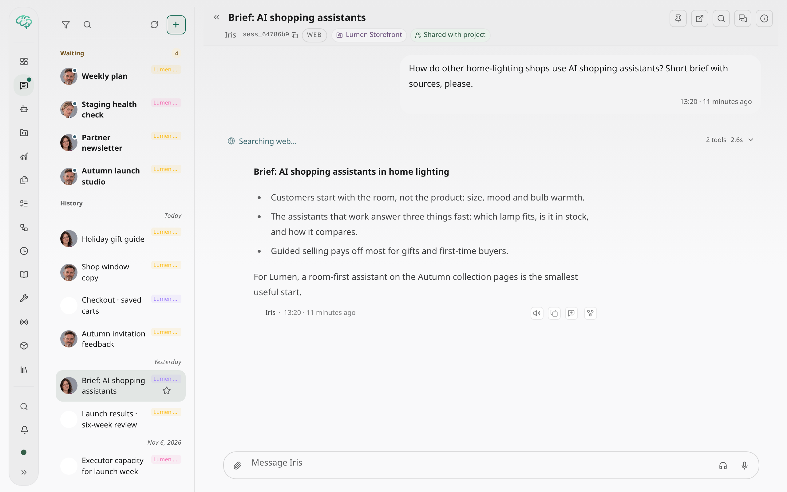
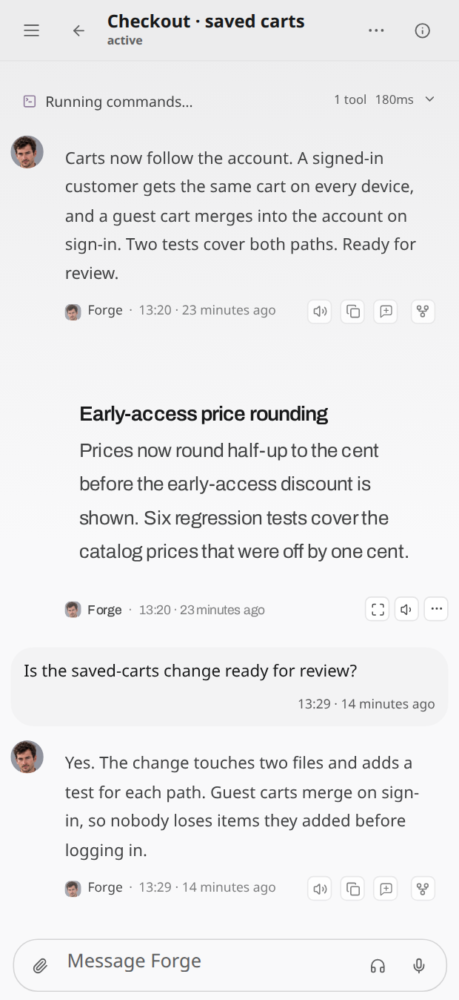

# Using Chat

The chat workspace is where you talk to an agent, watch responses stream in real time, and follow tool usage or delegated work without leaving the conversation.

The example uses seeded demo history; no web requests were made.

## Starting a conversation

The main menu shows a colored dot when collapsed and an exact numeric badge
when expanded (including the mobile menu). Zero counts are hidden:

- **Chat:** active topic conversations with unread activity or unresolved attention,
  counted once each. Rose takes priority over amber, then blue, using the same
  attention rules as conversation rows.
  Channels, workflow/task chats, managed conversations, and sticky agent-direct
  chats are excluded, matching the default Dashboard topic scope.
  Eligibility uses the same
  Waiting predicate as the sidebar: a pending actionable request, or unread
  activity in a conversation that is not currently running (including attached
  background work). Session outcomes alone affect color, not eligibility.
- **Dashboard:** unresolved, non-dismissed operational issues and unread inbox
  notifications, including companion-service outage notices.
- **Schedules:** schedules with unresolved latest-run failures, including
  schedules automatically disabled after repeated failures. Recovery or
  dismissal clears the indicator; historical failed runs are not counted.
- **Tasks:** paused tasks waiting for input, approval, or manual resumption.

Counts are available throughout the workspace, independent of list pagination.
Expired authentication challenges are not actionable and cannot keep a yellow
badge or Waiting entry alive. New challenges store a deadline; legacy challenges
without one use their original timeout (default three minutes, at most ten).
Startup reconciliation retires expired requests without submitting an OTP or
retrying the original tool. Unread messages remain independently visible.
Chat and Dashboard load topic Waiting separately from recent history, including old
unread topics. You do not need to scroll through
history to discover them. Reading a conversation clears unread-only Waiting;
an unresolved actionable request remains visible. Explicit Chat channel/agent
filters can explicitly request channel Waiting; channels never contribute to
the main-menu topic badge. Dashboard project/search filters narrow its topic set;
the main-menu count remains workspace-wide within topics.
They refresh after relevant live events, reconnect, focus, and periodically
while visible. A temporary connection failure retains the last successful count.

The Chat sidebar and its complete Waiting list refresh independently. A failure
in one does not prevent the other from recovering. Refresh bursts are coalesced;
rate-limit and service-unavailable responses pause refreshes instead of starting
an immediate full reload. After bounded automatic recovery, use **Retry** in the
Waiting status or refresh conversation history to try again. Waiting's Retry
refreshes only Waiting and preserves its last successful snapshot until success.
Temporary executor-status failures do not block unread or attention updates.
Last-known activity is retained until a complete activity lookup succeeds.
Compact and pinned chat work summaries use a narrow work projection rather than
loading conversation history. A reconnect or restored page requests prompt
reconciliation while respecting rate limits and any refresh already in flight.
An accepted live sidebar update cannot be overwritten by an older device-cache read.
Transient Waiting refresh failures are silent in Chat and Dashboard. Only after
a full minute of continuous failure does a quiet **Waiting updates are delayed**
status appear, without an alert or toast. A successful refresh clears it.

Open `Chat`, create a new conversation, and select an agent.
Web conversations can exist before they have an active session; Cognis creates the root session when you send the first real message.

When guardrails are enabled, that first message also bootstraps Intaris intention
generation. Conversation titles do not depend on this operation.

Cognis generates a useful automatic title from bounded, recorded user messages
through the `auxiliary_generation` route, including with guardrails **None** and
analytics off. Generation is optional background work and never blocks a user
turn. Checks run in bounded batches every 30 seconds; a backlog can take multiple
passes. Failed or interrupted model attempts retry after a five-minute cooldown,
including after controller restart, without another message.

Only an empty title whose source is still unset can be initialized. Manual and
supplied titles, channel/task/managed titles, agent-direct chats, and every
existing generated title are preserved. Titles are generated once, not refreshed
on each turn or rotation. Intaris titles may remain read-only suggestions but no
longer initialize the visible title. Title inference has its own auxiliary cost,
independent of the guardrails and analytics controls.

## Review feedback before sending

Open **Feedback** on a document, attachment, preview, message or recorded file
change. Selection tools depend on the source: text, rich-document items, image
regions, PDF pages and recorded diff lines or hunks. HTML observations use a
reviewed screenshot. An observation is evidence, not proof of correctness.

A saved comment is **ready to include**, not included. Saving never sends an
agent turn. The composer shows ready feedback even with the sidebar closed. Choose
**Review feedback**, select exact comment versions, inspect their source
revisions and parent context, then choose **Include with next message**. Guest
comments require an explicit review acknowledgement.

The composer shows what the next send includes. Inspect or exclude that packet
without deleting its source comments. Later edits, replies and new comments do
not silently join it. Changed or expired selections require another review.

Feedback inside a conversation stays in that conversation, including fullscreen
previews and documents produced elsewhere. It is never redirected to the
producer. Text, attachments, mode and feedback are admitted as **one normal
turn**. Feedback-only sends are allowed. Feedback does not implicitly answer a
pending question or approval. Exclude it before running an actual slash command;
one-message Plan/Build prefixes still select the normal message mode.

Once sending starts, the reviewed packet is immutable. After response loss,
**Check delivery** reconciles the original outbox transaction and creation key,
rather than creating another feedback turn. Delivery and execution status are
separate. Retained input, attachments and mode remain available during recovery.

## What the chat UI shows

Fenced `mermaid` blocks render as interactive diagrams in user and completed
assistant messages. Drag to pan, scroll or pinch to zoom. The controls at the
top right open fullscreen, fit the diagram to its box, zoom in or out, and copy
the Mermaid source. Focus a diagram to use arrow keys to pan, `+`/`-` to zoom,
and `0` to fit; `Escape` closes fullscreen. Invalid diagrams retain their source.

Cancelling or failing a turn does not undo a user message already recorded in
history. Once its canonical persistence is confirmed, its temporary local copy
does not reappear at the end of the chat, even outside the loaded history window.
Input without that confirmation remains available for recovery.

Recoverable model failures use bounded automatic retries. Errors that happen
before provider recovery starts still receive the turn's retry allowance.
Exhausting automatic retries does not remove the ability to retry manually:
the red recovery bar shows the saved error cause and **Retry failed turn**.
Assistant progress messages before the failure do not hide this action.

The recovery bar belongs only to the latest unresolved request. It disappears
when a retry starts, the request recovers, or you send a newer message. Reload,
reconnect, and scrolling through history do not make an old failure actionable
again. Historical error details remain available in the timeline.

An accepted or queued message can still fail or be cancelled before processing
starts. Chat retains its text and marks it **Failed** or **Cancelled** when the
server confirms that outcome, including
after reopening cached history. It does not resend the message automatically.
Where a later recorded message proves a safe boundary, the failed input appears
before it instead of trailing newer work. Otherwise, Chat preserves the input
without guessing its position from timestamps.

Depending on what the agent is doing, the conversation can display:

- streaming assistant responses
- reasoning or progress blocks
- tool call indicators and results
- delegation status cards for background work
- queued messages when you send another message during an active turn
- reconnection status for the WebSocket session

Previously viewed conversations can show cached content immediately. Dashboard
and pinned chats reconcile silently without inserting a refresh row above the
messages. Refresh failures still offer recovery. Live invalidations received
during a load retain a trailing refresh.

Dashboard windows, pinned chats, and task logs share the same workspace and
message presentation. Their inspector provides **Overview**, **Work**, and
**Session** tabs and adapts to the available window width. Delegation and managed
conversation cards use the same navigation as the work tree. The back arrow returns
to the parent view; the link also supports opening the parent conversation in a
new tab. **Work → Artifacts** includes images and files attached to assistant
messages as well as explicitly published artifacts. Repeated references to the
same artifact appear once; user-uploaded inputs are not work outputs.
Read-only task and child logs do not expose the normal chat composer.
Managed conversation views show a stable spinner labelled **running** on the
right of the bottom turn summary, not dots in the transcript. Other read-only
session logs retain their transcript-tail progress indicator.
In a subsession, **Ongoing work** sits above the bottom **Agent work** area rather
than above the transcript. The parent link and **Actions** toggle stay visible;
clicking **Parent conversation** restores that conversation in the current view.
Modified clicks still open the canonical parent URL in a new tab or window.
expand **Actions** to stop a turn, send an instruction, continue, or take control.
Actions start collapsed, and collapsing them preserves a typed instruction for
the current conversation. The compact header shows the title above the inline
agent avatar and name, with only Search and Info on the right. Search uses the
normal chat search bar for the loaded subsession history; load earlier history
to include older messages. The back arrow returns to the parent.

Full chat, dashboard windows, and pinned chats share one composer for each
conversation: text, attachments, and message mode stay in sync. Opening an empty
view does not change the draft. Sending from any view clears only the submitted
input in the other views; newer edits remain. Other browser windows adopt saved
draft changes when they have no pending local edit. Conflicting concurrent edits
are retained instead of overwriting one another.
An untouched empty composer does not conflict with local input. Saving or sending
can replace an unconsumed draft with no text, attachments, included feedback or
selected mode; meaningful competing input and previously sent drafts remain
protected.

If browser storage stops responding after the app resumes, account coordination
times out rather than leaving later chat loads waiting indefinitely. The app
revokes the local identity and returns to login for verification; retained local
data is not deleted. Session verification also has a deadline while reading the
server response, so a stalled response does not block all subsequent attempts.

Settings → Offline data → Loading diagnostics includes bounded send-phase
durations for local outbox locking, attachments, server admission and local receipt
persistence. It records durations and outcomes, not message text.

New response text fades in briefly as chunks arrive, without an artificial
typing delay. Incomplete image and link syntax is withheld until it can be
rendered; the completed response always uses the original Markdown.

Chat preferences also apply to pinned chats and native tray chats, including
when the tray opens before the full chat. Changes made in another window refresh
automatically or when the chat window returns to the foreground.
**Keep assistant messages separate** prevents assistant text from folding into
activity groups; it does not ungroup tool or thinking activity. **Group tool calls**
controls grouping itself. Hidden internal calls still show failures.
**Automatically recap web chats** controls server-side generation, not the
visibility of existing recap cards. **Enter to send** does not override
Shift+Enter, input-method composition, or the software keyboard's newline behavior.

The current tool group's label has a left-to-right brightness sweep. It remains
active through thinking and between tool cycles within the same turn, rather
than stopping after every tool result. It stops when activity moves to another
group or a visible response, or the runtime reports completion, waiting, or
cancellation. These animations respect the system's reduced-motion setting.

“Sending” means the client has not yet received admission confirmation. A
server-admitted message stops showing that label even while the agent is still
working. Its local, live-runtime, and saved-history representations share one
message identity, so acknowledgement does not create a second bubble.

“Preparing input” means the model is still generating a tool call; the tool has
not executed. Streamed tool preparation is bounded per generation to 600 seconds
from its first progress event and 262,144 total input characters. A limit breach
uses the normal bounded model-error recovery policy. Large changes should be
split into smaller calls.

When a generation fails or is cancelled, its abandoned preparation indicators
are removed from the active overlay. This does not create tool results or change
previously completed calls.

## Runtime selection

`/model`, `/thinking`, and `/fast` select session overrides for the next message.
`/profile` selects an agent profile and clears those overrides.
Session details and `/info` show the selected values separately from the last model call.

### Streaming replies

Chat motion uses a 1.6-second group-activity sweep, a one-time 280ms small rise
for new live messages, 320ms fades for newly arriving prose words, 180ms
height-and-opacity disclosure, and 240ms color-only state handoffs. History
loads and regrouping do not replay message entrances. Code is not word-animated,
and system reduced-motion preferences disable movement.
Tool-group colors identify the activity category even after completion or
failure. Status remains in the existing details and delivery badges; sent
messages do not display a persistent success dot.

Live replies preview Markdown as it arrives: a clear bold opener or code fence
can be formatted before its closing syntax arrives. Preview-only syntax never
changes the saved text; code contents and escaped punctuation remain literal.
Typing dots mean that this message is receiving text, not that the whole turn is
still working. They stop while native tool input is being prepared; the message
stays visible, and later text can resume under the same identity.

### Switching away from an unavailable provider

The yellow rate-limit wait bar and the current red model-failure card can show
a subtle **Switch to provider** link. If several providers offer the exact same
model, the action becomes a dropdown. Cognis only lists providers you can use,
excluding known active retry waits and fresh reports of exhausted quota.
Unknown capacity is not a guarantee that the next request will succeed.

The action uses `/model provider/model` and keeps the model unchanged. A waiting
provider retry is expedited automatically. If the turn has already failed,
send a message to continue with the newly selected provider. Historical failure
cards do not offer switching once another turn has superseded them.

Thinking selections have distinct meanings:

| Command | Meaning |
|---|---|
| `/thinking clear` | Remove the session override and inherit the profile or agent configuration |
| `/thinking reset` or `/thinking inherit` | Same as `clear` |
| `/thinking default` | Use the provider/model default, without an inherited effort hint |
| `/thinking none` or `/thinking off` | Disable thinking, if the model supports it |
| `/thinking high` | Use the selected supported effort |

`off` now means disabled thinking, not inheritance. Use `clear` for inheritance.
For adaptive Claude models, provider default sends adaptive thinking without an effort hint.
Models with mandatory thinking do not offer `none`.
`/thinking` shows the session selection separately from the effective effort and its source.
If model metadata is unavailable, explicit effort changes fail without changing the saved selection.
Clearing an override does not require model metadata.

Agent and profile forms use the same states: **Inherit**, **Provider default**,
**Disabled**, and the supported effort levels. Profile inheritance uses the agent configuration.
Provider default stops effort inheritance even if a lower layer specifies `low`.

Fast mode also distinguishes **Inherit**, **Enabled**, and **Disabled**.
`/fast clear` removes the session override. `default`, `reset`, and `inherit` are aliases for `clear`.
`/fast off` suppresses inherited acceleration parameters; it does not enable inheritance.
The command resolves the next request's provider and model, not the last completed request.
Disabled and Inherit remain available if capability discovery fails.

Fast mode support depends on the provider transport as well as the model.
Native Claude API fast mode currently supports Opus 5 and Opus 4.8.
It uses `speed: "fast"` and the fast-mode beta header.
Codex uses the accelerated service tier from its registry.
Model support does not confirm account eligibility. Premium pricing can apply.
Claude rate-limit or eligibility errors remain errors; Cognis does not silently downgrade Claude fast requests.
Existing Codex tier-rejection recovery can retry at normal priority.
The selected fast-mode setting describes a request, not proof of accelerated execution.
Anthropic's response `usage.speed` reports the actual speed (`fast` or `standard`) independently.

### Provider model registry drift

In Settings → Providers, select **Discover** to compare configured models with a fresh registry snapshot.
Discovery can use a bundled catalog or supply partial metadata. It does not change saved configuration.
If connection fields have changed, save or discard those changes before discovery.
Changing the connection invalidates the comparison.

Each model shows differing supplied fields, with configured and registry values.
Expand **Registry drift** to reset one field or all discovered fields for that model.
The model editor provides the same comparison.
These actions change only the draft. Save the provider to apply the changes, or discard the draft.
Fields absent from discovery remain unchanged.
A model absent from discovery is not automatically obsolete and is never automatically removed.
Differences can be intentional administrator overrides, including explicit disabled capabilities.

Cognis stores these selections in its database. They survive controller restarts
and compaction. A session reset or renewal clears the overrides.

Chat command retries return the original selection result without applying the
change again. Timeline feedback can arrive later if Intaris is unavailable.

## Attachment previews and saving

The preview icon opens supported attachments inside a fullscreen app viewer.
The top toolbar stays available while the document scrolls. Use **Close** to
return to chat. PDF previews provide **Previous**, **Next**, zoom, and **Fit
width** controls; every page is accessible without opening the system PDF viewer.
HTML remains sandboxed. Images use the fullscreen image viewer.

Download controls save the original file, not the preview. On desktop and
non-Apple mobile browsers they download a named file. On iPhone and iPad, the
first tap prepares the file; tap **Save/share** when it is ready, then choose
**Save to Files** in the native share sheet. This second tap is required to
preserve the browser's user-activation permission after loading the file.
If the browser cannot share a file, Cognis shows an error rather than navigating
away from chat. Directly opened signed URLs retain their existing browser behavior.
In the native macOS app, downloads open a **Save** sheet so you can choose the
filename and destination without leaving the app.

## Queued messages

If you send a message while the agent is still processing the previous turn,
Cognis queues the new message instead of interrupting the active turn. The chat
workspace shows each pending queued message before it runs.

Queued messages are compact by default so a long follow-up cannot take over the
chat viewport while the active turn is still running. Each queued row shows a
single-line preview, status, and the main controls; open the details view when
you need to review the full text.

From the queued-message panel you can:

- expand a queued row to review the exact message text waiting to run
- edit the queued text when the row offers Edit
- delete a queued message to cancel it

Messages admitted as trusted evidence are bound to their exact text and
attachments, even while queued. These rows do not offer Edit; delete the queued
message and send a replacement instead.

At the next safe execution boundary, Cognis takes eligible queued messages
together in order. This also happens before the next chat turn's first model
call. Stop cancels the active turn but preserves queued messages; you do not
need to stop each queued message to make the remaining batch available.
Managed agent requests that require separate turns remain separate.

Queued attachment changes are handled by deleting the queued message and sending
a replacement, because attachments are already uploaded and referenced by the
time a message enters the queue. If you keep a queued message with attachments,
Cognis preserves the prepared attachment context and uses it when the queued
turn runs later.

## Approvals and escalations

If Intaris escalates a tool call, the chat UI shows an approval prompt. From there you can approve or deny the requested action.

An Intaris admission conflict returns a tool error with its conflict code, not
a failed agent turn. Cognis retries transient admission races once. If the
session changes after approval, the old approval expires and Cognis requests
approval again for the same action. No conflict authorizes tool execution.

If Intaris rejects approval because of a read-only ceiling or mandatory denial,
Cognis closes the approval as denied and explains the policy restriction.
The agent continues with the denial instead of waiting for the approval timeout.
Legacy Intaris string details are mapped only for recognized codes and known
resolution messages; unrecognized text gets a generic rejection without
exposing upstream content or assuming approval authority.

This is how Cognis keeps risky or sensitive actions visible to the user instead of silently executing them.

## Markdown, links, and tool output

Assistant responses render Markdown as they stream. Plain `http://` and
`https://` URLs are clickable even when the agent did not format them as
Markdown links. URLs inside inline code or fenced code blocks stay as literal
text.

Tool results preserve raw output for copying. Filesystem `read` results use
syntax highlighting when Cognis can infer a language from the file path, while
JSON-shaped outputs keep the dedicated JSON rendering.

## Delegation and background work

Some work is better handled through delegated or structured execution instead of one immediate chat turn. When that happens, Cognis can show:

- a delegation card
- intermediate progress
- final completion or failure updates

The main conversation stays responsive while the sub-session or workflow continues.
Delegation calls show **Queued** without a running timer until their child session
starts. Queued calls are not yet sessions in the work tree or **Ongoing work**.
Consecutive delegation calls can run concurrently within the configured limit,
including after an earlier todo update has completed.
The **Ongoing work** drawer lists tasks, managed conversations, delegated
sub-sessions, and background commands. Long titles stay on one line and scroll
horizontally without a scrollbar, like todo text. The expanded drawer scrolls
vertically when needed, keeping todos and work cards separate.
Tap a task or session title to open it.
Tap a command title to expand its command, working directory, executor, process,
runtime, status, and latest output tail. **Refresh details** fetches a new
snapshot; **Open source session** opens the command's originating session.
Command output is a bounded tail, not the full historical log. Details are
available to the conversation author while the assigned executor retains the
job, including shortly after it finishes. A preview server left running after
an agent turn still counts as background work and keeps the purple indicator on.

Completed delegated work keeps its recoverable output with the sub-session. If a
sub-session produced several assistant messages, Cognis keeps them in order and
labels them as separate sections so the full report is not lost when a later
cleanup or final status message arrives.

Delegation cards in the parent conversation intentionally show compact metadata
only: the delegated title or task label, target/used agent, status, duration or
progress, and the child session link. The full delegated prompt is stored as the
initial user message inside the child session so the parent timeline stays
readable without losing auditability.

A child timeline shows that child's messages and runtime state. The parent's
latest admitted message remains in the parent timeline, including while it is
waiting for a session. In an open conversation, the chat runtime owns the turn
indicator; refreshing sidebar metadata cannot restart a settled indicator or
clear a newer active turn.

When background work finishes, Cognis classifies the follow-up before the agent
responds:

- results that still belong to the active work thread can be integrated back
  into that thread naturally
- scheduled briefs, pauses, and unrelated completions are shown as separate
  updates instead of pretending an older chat topic is still active

## Session management and compaction

Between turns, Cognis projects older recoverable tool results toward the steady
context target. The trigger and requested savings use the session's compatible
provider/model token calibration, including tool-schema overhead. Within-turn
burst and hard limits remain separate and unchanged. Protected instructions or
unrecoverable evidence can prevent reaching the steady target; projection does
not discard them merely to meet it.

Automatic compaction follows model-facing projection, not an independent 85%
threshold. A prompt above steady can continue if it fits the effective hard
boundary. A zero-turn compaction attempt is reported as skipped.
See [Context management](context-management.md) for the budgets, projection
modes, evidence rules, and worked examples.

Long conversations may be compacted so the active context stays usable. When that happens, the timeline can show a compaction card and Cognis continues from the new active session with the compacted summary included in context.

Delegated sub-sessions keep their compaction cards in their own history, not at
the end of the parent conversation. Reopening a managed conversation shows its
cached history while newer events are loading.

Cognis stops execution if required history is unavailable or incomplete. A
profile switch must retain the current turn and its recorded switch boundary.
Cache invalidation must not silently turn an existing conversation into an
empty prompt. Retry the turn after the event store is available again.

Retry reuses your original saved instruction without adding a duplicate user
message. Cognis verifies the saved retry link back to that instruction; if the
link or original instruction is missing, it still stops rather than guessing.

Forks read the complete source history and confirm all required writes before
returning success. Interrupted copies are not usable as complete conversation
history, including after a controller restart. If a fork fails, recreate it from
the original conversation; do not use a partially created fork as a recovery
shortcut. Intentional fork activity filtering and compaction summaries still
apply.

The fork icon beside an assistant message asks for confirmation before creating
a separate conversation. The original conversation keeps running; forking does
not transfer or duplicate its execution. Newly forked history retains the
original message times, including after reload.

Use `/compact` to compact the current conversation manually. Manual compaction
runs immediately and rotates to the new active session before the next user
message is recorded.

Use `/recap` in a web or channel chat to add a brief recent-work recap. It uses
up to 30 conversation messages combined: user messages (including updates
sent mid-turn) and the last assistant reply per turn. An existing session
compaction summary is used as background when available. Tool outputs are not
included in the recap model's conversation input; they only provide
deterministic activity counts and links.
Deliverables, artifacts, and file changes cover the same recent window. Unlike
compaction, a recap is a timeline card only: it does not enter the agent's
context or rotate the session. Its work evidence opens existing detail views.
In web chat, **Automatically recap web chats** is enabled by default and can be
disabled in chat preferences. Explicit opt-outs are preserved. Automatic recaps run
quietly after five idle minutes only when new activity since the last published
recap contains completed, meaningful work. They are limited to one published
recap per 30 minutes and do not run in tasks or channels or send notifications.
Automatic recaps wait while associated managed conversations, delegated sessions,
tasks, or background commands are still running or queued. Background work is
checked both before generation and before publication; an unavailable background
status defers the recap rather than treating unfinished work as complete.
Recently due recaps are recovered after controller restarts for up to two hours;
older conversations are not backfilled, and enabling the preference does not
recap conversations that were already idle.

Use `/handoff` or `/handoff <subject or instruction>` to prepare a self-contained
brief for another conversation or agent. Unlike the lightweight recap, it uses
the current agent/profile model and effective context, including retained tool
results and compaction context. It does not recover history already lost through
compaction. You can run it mid-turn: the source keeps running, while the brief
uses committed history at a fixed cutoff and treats unfinished actions as pending.
No tools are executed and no new session is created for generation.

The handoff card appears immediately with **Preparing handoff…**, then updates
live to the collapsed result or a visible error. These states are saved as
lifecycle events in the source session and survive reload. **Copy handoff**
copies the complete Markdown.

**New conversation from handoff** offers only a profile picker, defaulting to
the source conversation's profile. The agent and project stay the same. The new
composer contains a normal unsent draft, without legacy-recovery confirmation.
Review and send it yourself; creating the conversation never sends it.
After successful creation, the source card replaces its create action with
**Open conversation**. This link is persisted and remains available after reload;
opening or cancelling the picker does not create a link.

Long-lived ambient chats, such as web direct chats with an agent and external
channel conversations, can also checkpoint after an idle gap. By default, if the
active session has been idle for 6 hours and has at least 20 uncompacted events,
Cognis compacts and rotates the active session before handling the next user
message. The conversation itself remains continuous; only the active session
context is refreshed. Normal web topic conversations are not idle-checkpointed.

Admins can tune or disable this behavior with
`session.long_lived_chat_idle_compaction_seconds` (`0` disables idle checkpoint
compaction) and `session.long_lived_chat_idle_compaction_min_events`.

Use `/undo` to remove the last normal user turn and everything the assistant produced after it from the visible timeline. Cognis keeps the underlying Intaris session history for auditability, rebases the same conversation onto a new active session, and reloads the current chat in place without changing the URL or creating a sidebar row. Use `/redo` before sending another normal message to restore the undone session. Sending a new normal message after `/undo` starts a divergent branch and clears redo.

## Long-running turns

Cognis keeps a safety watchdog on long-running turns. If a direct chat turn hits
that watchdog, Cognis records a visible system notice and may automatically
continue the same work once it is safe to do so. The continuation reminder tells
the agent to verify that the work still matches the original request, update
todos when appropriate, summarize the interrupted state briefly, and continue
only if more action is needed.

This is a recovery path, not an infinite retry loop. Continuations are bounded by
the controller's safety budget so repeated timeouts still stop instead of
running away.

## First-run readiness

Admins may see setup guidance until:

- Mnemory is reachable
- Intaris is reachable
- at least one LLM provider is configured
- at least one agent exists

## Recovery and diagnostics

If stale activity or misplaced messages survive reopening chat, use **Force
refresh** beside **Download chat diagnostics** in the session's diagnostic
section. It rebuilds history from the server and removes cached activity on this
device. Queued messages, unsent drafts and recoverable input are kept; nothing is
resent automatically. Wait for **History refreshed.** If refresh fails, your
input remains available and you can try again.

Previously confirmed inputs do not reappear at the end when the refreshed
history window excludes older messages. Inputs without confirmation are kept.

If something looks wrong, check the system section for:

- provider health
- readiness diagnostics
- configuration summary
- database and key information

If the WebSocket connection drops, the UI will attempt to reconnect and recover missed events.

## Install as an app (PWA)

Cognis ships as a Progressive Web App. On desktop browsers (Chrome/Edge/Safari) and Android, you can install it for a dedicated window, app-icon launch, and an offline shell:

- **Chrome / Edge (any platform)**: a one-time install banner appears inside the app. You can also use the browser's address-bar install button, or menu -> "Install Cognis".
- **iOS Safari**: tap the Share icon, then "Add to Home Screen". Cognis detects this environment and shows a one-time hint with the instructions.
- **Android Chrome**: tap menu -> "Install app" or wait for the in-app install banner.

When installed:

- The app launches in a standalone window with no browser chrome, respecting the safe-area insets on iPhone notches.
- The app shell (HTML, JS, CSS) is cached so the UI loads even when the network is unavailable. Conversations still require a live WebSocket connection.
- Updates are applied automatically. When a new version is available, a small banner appears at the top of the screen with a "Reload" action.

## Mobile-specific behavior

- Primary navigation on mobile is a bottom tab bar (Chat / Tasks / Agents / Settings). Inside a chat conversation the bar hides so the composer owns the bottom safe-area.
- Tapping the hamburger button in the header opens a right-side sheet drawer with the full navigation. The sheet supports swipe-down-to-dismiss.
- The composer uses 16 px text on mobile so iOS Safari does not zoom the viewport when you focus it.
- The bottom tab bar, composer, and floating action bars respect the `safe-area-inset-bottom` so they sit above the Home Indicator on iPhones.

### Tasks on mobile

- The Task board uses a column picker (Draft / Queued / Running / Paused / Done) so one column fills the viewport at a time, instead of horizontal-scrolling a 1200px kanban. Tap the column chip to switch.
- Multi-select still works: tap once to select, tap again to deselect. The bulk action bar wraps and floats above the bottom tab bar.
- Drag-and-drop between columns is desktop only. On mobile, open the task detail and use the state buttons (Submit, Pause, Cancel) to move work through the queue.

### Workflows on mobile

- The workflow list stacks above the editor; tap a workflow to open it.
- Each step has up / down arrow buttons for reorder. HTML5 drag-and-drop is still available on desktop but is a no-op on iOS Safari, so the arrows are the canonical touch-friendly control.
- A sticky action bar at the bottom of the screen keeps Save one tap away, even at the end of a long step editor. More actions (New, Duplicate, Export YAML, Delete) are behind the "Actions" button on the same bar.
- Tooltips (the `?` help icons) reveal on tap — hover-only tooltips are gone.

### Settings on mobile

- The 9-tab section strip becomes a horizontally scrollable pill row instead of wrapping to three lines.
- On the Executors tab, the per-executor "Individual tools" picker is now a searchable Sheet (tap "Configure" on the executor card) so you can find and toggle a tool without scanning a grid of 30+ chips.

## Diagnosing device-specific history ordering

If one device shows old messages or activity after recent history, open the
conversation information panel (**ⓘ**), select **Session**, expand
**Show context & runtime details**, and select **Download chat diagnostics**
at the bottom while the problem is visible. The filename includes the conversation
identifier so captures from different conversations are easy to distinguish.
In the native macOS app, this opens a save dialog so you can choose the file
location. In a browser or installed PWA, it uses the browser's download handling.

The JSON file records that device's frontend build, projection version, item
identities, source references, and sort keys. Canonical history, local fallbacks,
runtime items, and visible ordering are listed separately. It excludes message
text, tool arguments and results, compaction summaries, and credentials.

Exporting does not refresh, clear, or modify the conversation or its cache. The
file remains on your device unless you share it. It still contains private
conversation and session IDs; share it only with someone investigating the issue.
