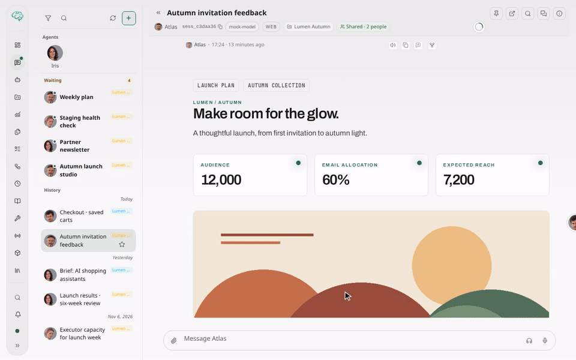
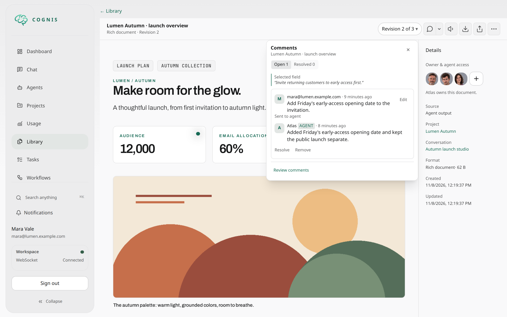
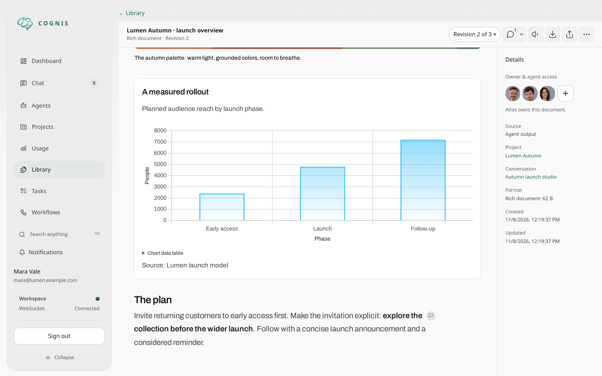

# Work Feedback

Work Feedback keeps review comments separate from instructions to run work.
Saving a comment, draft, attachment, or screenshot does not start an agent.

In Work → Files, select a file and wait for its retained history. Click a diff
line or select code to highlight its exact old/new range, then use the small
comment-plus icon beside it. Combined file history is not comment authority.
Switching events keeps their drafts and uncertain comment saves separate.

Activating feedback does not expand Work or change the source layout. You can
still expand the inspector explicitly.

## Comment on the source

These fictional examples show source-bound comments and replies produced by
local mock execution, not a live model. The comment remains on its source
revision; the revision picker can open other versions.

The split comment control is the same in chat, Work and document viewers.
The bubble button enables or disables commenting without opening a panel or
changing source layout. Its dropdown contains **Show comments**, **Resume draft**
when needed, and optional area/drawing tools supported by that source.
The mobile chat header keeps Navigation at the far left and Info rightmost. Its
three-dot menu, immediately before Info, contains commenting, Show comments,
Resume draft when available, Search and pinning. Opening a separate window
remains a desktop action.
The same bordered comment control sits next to **Filters** in Work. It shares
chat's comment-mode state, so mobile users need not close Work to enable it.

In chat, showing the comments (the Comments icon or the comments chip by the
input) turns on comment mode, so blocks, tables, images and documents in the
chat get the same picker as documents; closing the comments ends it.
Normal text selection in a finalized assistant message also offers a subtle
**Add comment** icon without comment mode. Each assistant message also
has an icon for commenting on the complete message. Work diff lines provide the
same passive shortcut. These shortcuts do not enable element selection or drawing.

Artifact and deliverable viewers, including inline deliverables, have one
**Comments** button. It opens the comment list and turns on commenting; pressing
it again closes both. Its badge counts comments that need you: not sent yet,
answered by the agent, or not delivered. On wide screens the list docks in the
document sidebar as a tab next to Details instead of covering the document; on
phones it opens as a tall sheet. **Comment on document** in the list starts a
comment on the whole document. Document comments keep their own document source
rather than becoming transcript comments. Text selection works normally; images
and non-text PDF regions support area selection automatically. On touch screens,
long-press a non-text region before dragging so ordinary scrolling remains available.

Chat text comments capture the complete assistant message through its latest
proven contributor event, including earlier segments. This explicitly uses
`chat-item-as-of-event-v1`; integrations without that opt-in retain single-event
behavior. Later segments or replacements do not change the captured source.
Older single-event feedback remains pinned to its original event, including when
that event contains only one segment.
If complete retained evidence cannot be proven within the replay limits,
commenting is unavailable rather than silently using partial text.

Chat text selection requires a proven Markdown-to-source mapping. Text inside
a table cell is mapped to its own cell (a row with an escaped pipe is not).
Fenced code, raw HTML and indentation-stripped containers currently do not
provide those precise chat-text anchors; the UI does not substitute a
whole-message comment for an unmapped selection.

- Text selection uses the browser's normal drag selection, keyboard selection
  and touch handles. A click or Enter alone never selects a paragraph or block.
- **Rich table ranges** use row-edge, column-header and cell-corner grips directly
  in Commenting mode, without a Cell/Row/Table palette. Drag a grip or use arrows
  and Shift to extend it; Escape clears the selection. Desktop hover/focus reveals
  grips, and touch exposes reachable grips without enlarging rows. Cell text
  selection and double-tapping remain native; a row grip selects a row.
  Exact selected cells are highlighted before adding a comment. Sorting preserves
  authored membership; summaries use authored row numbers and column letters.
  Missing or ambiguous membership is rejected rather than widening the target;
  whole columns require every authored row. A Markdown table inside a section
  remains section content, not an authored rich-table grid.
- The dropdown offers explicit area/drawing tools when automatic selection is
  insufficient. Additional shape and numeric position/size controls are under
  **Annotation options**. Changing tools does not reload the PDF or its text layer.
- Choose **Add comment**, enter your comment, then choose **Send**. This saves
  the comment; it does not send instructions to an agent. **Cancel** preserves
  your draft for **Resume draft**.

The contextual composer floats beside the target or above/below it. On narrow
screens it uses a bounded bottom surface above the keyboard. Work diff comments
instead open directly after the selected line, or the last line of a range,
inside the diff scroller. Whole-file comments open below the file header.
The editor stays within the visible width during horizontal scrolling, and its
Cancel/Send buttons use the same sizes as the sharing dialog.
Diff highlights are clipped to the diff viewport;
line comment markers stay in the gutter during horizontal scrolling.
Line ranges must belong to one complete hunk. Saving verifies the exact hunk,
side, line numbers and source text together, including multi-line quotes.
Links back to a target appear only in comment lists, where the source may be
off screen. Closing, Escape and Viewing preserve the draft. Clear the comment
text before cancelling if you no longer need that draft.
Inline controls stay inside the app's safe viewport, above mobile navigation
and outside keyboard occlusion. Standalone public views do not reserve app
navigation that is not present.

Saved targets have subtle highlights and nearby comment markers. Activating a
marker opens its discussion for replies and resolution. Dense groups share one
marker rather than a stack of floating cards. Markers do not reserve a source
gutter outside Work; Work uses its existing line-number gutter. **Show comments**
opens one bounded window, or a bottom sheet on mobile.
In chat it lists pending comments from chat, Work and documents prepared for
that conversation. Reply/edit inputs survive closing within the same authorized source.
Click a comment's author or body to reveal its source annotation. Agent answers
also show the original comment and its source target, with a link to the original
document revision. If that comment is no longer readable, the answer remains
visible without disclosing the unavailable comment.
Overlapping DOM text highlights are painted once beneath the original glyphs.
Rectangle-only and unsupported-browser targets use non-filling outlines.
A deliberate new target takes precedence over a saved preview until the target
is accepted or cleared; it does not delete or rewrite the saved discussion.

Text anchors require provable canonical source mappings. If formatted text or
PDF extraction cannot prove a precise range, the UI says so and offers a source
text or explicit area alternative. It never silently selects the entire block.
HTML selections remain untrusted observations of the rendered preview.
Local development permits those previews as Blob frames; the preview's opaque
sandbox, network policy and untrusted-observation checks are unchanged.

## Review and send

Document listings in Library, Work, Recent Work, project resources, task outputs
and chat show **N open** beside documents with unresolved comments. This count
includes comments on earlier revisions and excludes removed threads; replies do
not add another count. It is private to the document owner, even when the document
is shared. Counts refresh after saving, resolving, reopening or removing a comment,
and when returning to the app. A dash means the count could not be refreshed.

1. Open feedback for a work document or file diff. The source identifies an
   exact revision, not whichever revision becomes latest later.
2. Add comments. Text selections and visual annotations retain their source
   context. Personal drafts and staging remain private.
3. Each comment shows its status: **Not sent**, **Sent** (the agent is on it),
   **Answered** or **Resolved**. Every comment that was not sent yet starts
   ticked, guest comments included; untick what should stay out. Selecting a
   guest comment is the owner's review of it; the agent still receives it marked
   as unverified guest input. Editing a comment later does not change an already
   submitted selection.
4. The send bar at the bottom of the list shows the suggested destination.
   **+ Note** adds an optional note. **Send N comments** prepares and sends in
   one step. Only a task revision stops first to show its consequences and asks
   for confirmation.
5. Only this explicit action admits work. A short notice confirms the send with
   **Open conversation**; the rows change to Sent.

The agent answers or resolves every comment it receives. Answered comments
offer **Resolve**, and **Resolve N answered** closes them all at once.

Inside a chat, ready comments appear as a chip in the message input row, like an
attachment. Clicking **+N** adds them all to the next message. The chip and its
arrow open the chat's **Comments** panel, where each comment has a checkbox for
the next message; clicking again closes it. Once added, the chip shows the count
and × removes them all from the message. If the reviewed selection expires or a
comment changes, Cognis re-reviews it automatically before the message is sent.
Included feedback travels with the normal message and its attachments in one
admission, and the sent message lists the included comments. Comments already sent from another
place, such as the Library, are not offered again until they are edited.
**Send to a new conversation instead…** hands the selected comments and exact source
references to a new conversation after explicit destination/instruction confirmation.
Ordinary inclusion stays in the current chat and creates a separate turn; it is
not absorbed into a turn already running.

Outside chat, the **Send to** dropdown lists every destination with one suggested
default. The selected destination's explanation appears below it. The agent
determines the requested outcome from your comments and optional send message.

| Document | Suggested destination |
|---|---|
| Made in a chat | That chat |
| Already discussed or revised in a chat | That follow-up chat |
| Made by a task, opened from the task | Revise the task from its producing step |
| Made by a task, opened elsewhere (Library, links) | A new conversation with the producing agent |

**Another chat…** opens a searchable list of your active chats across agents, so
comments can go to any conversation, for example your main agent.

After a standalone send is accepted, a short notice confirms it and the send bar
is ready for the next comments. **Open conversation** opens the admitted chat,
using a chat window in the native app. Document details show the source chat's agent avatar
and live activity, including background work and questions waiting for an
answer. Accepted work continues independently; its immutable packet and results
remain in History. An uncertain send keeps its original request: use its retry
or delivery check before sending anything else.

Saving a comment or reply in a chat durably prepares it for that author's chat
composer, including when the feedback sidebar is closed. It is not included or
sent automatically. An edit with explicit chat context prepares the new version
and requires fresh inclusion and review; previously submitted packets remain
immutable. Standalone, guest, and contextless edits do not infer a destination.

Task revision can reopen a workflow step and invalidate downstream work. Its
preview includes the affected state. A changed gate, question, notification, or
task generation requires another review instead of silently reusing approval.

## What the agent receives

Sent comments arrive with the message or task revision itself; the agent does not
need a tool call to read them. The comments context lists each source once with
its title, format, revision and reference (`art_…`, `dlv_…`, a chat message, or a
changed file), so the agent can open it with its normal tools. Each comment shows
its author, body and exact target: quoted text with surrounding context and line
numbers, table rows and columns, file-change lines, a PDF page, an HTML element,
or the bounds of image and page marks in pixels and as a share of the source.
Comments remain untrusted user input. The feedback packet tools remain available
for exact anchors and dispositions but are optional.

## Agent replies

Sending comments does not resolve them. The receiving agent answers each comment
with `comment_reply`: a reply to the author (what changed, or why not), a
resolution, or both. The answer appears under the comment with an **Agent** mark,
in chat, on the document, and for guests on links that allow comments. If a turn
or task step ends with unanswered comments, the agent gets exactly one reminder
listing them; anything still unanswered afterwards simply stays open. You can
reply under any comment from **Show comments** or on the document.

Agent comment replies also appear in the assistant response, outside collapsed
tool activity. **Show comments** retains sent discussions, including resolved
threads, when the conversation is opened on another client. An open list refreshes
when an agent answers, when the window regains focus, and periodically while visible.
The comment notice supplies both the exact submission ID and manifest hash required
by packet-reading tools; neither identifier should be guessed or recomputed.

For a turn receiving comments, the runtime supplies the comment tools directly
in the model's callable tools before its first response. No tool search or
comment-read call is required. The optional packet read/record tools use the
same controller routing and still require that exact execution's packet access.

## Delivery, work, and discussion

The receipt reports delivery separately from execution:

- **Pending**: admission has not been confirmed.
- **Accepted**: the packet has a canonical turn or task-attempt association.
- **Rejected**: admission was definitively refused.
- **Uncertain**: reconcile the original operation before trying another send.

**Check delivery** observes the existing operation; it does not dispatch it
again. Queued, working, waiting for input, completed, failed, and cancelled
describe the associated execution. **Unavailable** means its state cannot be
proved. Newer activity in a conversation or task does not replace that evidence.

Comments keep their own open/resolved state. Sending feedback or completing work
does not resolve a discussion. Agent dispositions describe how selected comment
versions were handled; they do not edit the comments or resolve their threads.

## Results

The agent follows your comments and optional send message, just as in chat:
questions get answers, requested edits become new revisions when authorized, and
requested independent outputs become separate results. There is no Result choice.
Sending comments alone does not request a source revision.

Source revision remains limited to one exact selected document, its producing
agent, lineage and current head. The server derives the source from saved comment
anchors, not the current viewer, unselected comments or comment wording.
Native-message, diff, mixed-source and multiple-document packets do not grant
source-revision authority. Normal ownership, content and tool permissions still
apply. Original revisions and their sharing rules remain intact.

New UI reviews use `follow_request`, also the default when an API preflight omits
`update_mode`. Explicit API modes and already-frozen packets retain their existing
`revise_source`, `answer_only` or `separate_result` restrictions. Immutable retries
never change a packet's mode. Starting a new review uses `follow_request` rather
than carrying over a saved mode. These legacy values remain supported while
persisted packets and API clients use them.

Result links describe the actual persisted outcome, not an agent's claimed
relationship. Canonical artifact and deliverable writes record their feedback
association in the successful database transaction. A failed write cannot leave
a successful result association, and replay cannot claim an unrelated document.

History can link a source, packet, exact child execution, and resulting revision.
Current access rules still apply. Hidden threads and private moderation reasons
are not disclosed to ordinary source readers.

## Delegated work

Packet access is execution-scoped. Conversation membership, a shared session,
task ancestry, and copied packet IDs do not grant it.

An agent can explicitly select packets with `feedback_submissions`, containing
`submission_id` and `manifest_hash`, when it creates supported delegated,
managed-conversation, or task work. The canonical child owner commits the grant
with that exact child admission, before execution or exposure. Omitting the field
does not inherit access. Later turns and task retries need their own admission;
they cannot reuse an earlier execution's grant.

Child-recording operations confirm persisted admission proof. They cannot grant
access retrospectively from generic ancestry. When a conversation has multiple
linked child turns, select its exact turn rather than following “latest.”

## Sharing and captures

The document's **Share document** dialog separates two kinds of access:

- **Share with people** grants an existing active Cognis user access to the whole
  artifact or deliverable, including future revisions. **Can view** is the default;
  **Can comment** explicitly enables comments. Removing a direct grant removes it
  from every revision. Existing project access is independent. These grants do not
  share the producing conversation or task, grant agent runtime access, or permit
  resharing, moderation, editing or dispatching work. A private link alone grants
  nothing.
- **Public links** creates links that work without signing in and remain pinned
  to the selected revision. Select an expiration and optionally enable
  **Allow comments** for a viewer link. Download links do not enable commenting.
  **Existing public links** has explicit copy icons and revoke controls.
  Copying a managed link returns the same token without rotating it, extending
  its expiration or reviving it. Original tokens for older comment links cannot
  be recovered; those links remain valid until expiration or explicit revocation.
  Older direct signed links cannot be enumerated or individually revoked.
  Formats without managed viewer support use direct signed links with automatic
  expiration; those links cannot be individually revoked.

An unconfirmed permission change must be reconciled with **Reload access** or
**Reload links** before another mutation. It is never retried automatically.
Commenting menus do not contain another sharing dialog.

Agent tools `artifact_publish`, `write_deliverable`, and `artifact_get_url` accept
`allow_comments: true`. The default remains false. A successful request returns
`comment_url`, `comment_share_id`, `comment_link_expires_at`, and
`comment_link_status: "ready"`. Link generation requires the authenticated caller
and the producing agent; a read grant alone is not disclosure authority.
`artifact_get_url` defaults to viewer mode when comments are requested and
rejects an explicit download mode. These calls are evaluated as mutations;
ordinary URL generation remains usable in plan mode.

Publication commits its artifact or deliverable before optional share creation.
A failed or unconfirmed link returns separate status/error metadata and leaves
the published content intact. Check existing links before retrying; never
republish content to retry a share. Shares use the existing exact-revision
authorization and expiration checks, not a new persistence or retry mechanism.
No database transaction spans share creation. Turn cancellation still propagates
to the scheduler; cancellation or a lost response can require reconciliation.

Comment shares pin the selected document revision and content digest. They do
not follow future revisions. A share is a bounded commenting capability, not
owner authentication, document-editing permission, or permission to dispatch.
Guest labels identify a commenting session; they are not verified identities.

Public operations use the share capability and guest-session headers. The
standalone document bootstrap contains only an escaped, bounded share token,
not private destination or workflow metadata. Raw HTML remains sandboxed.

Captures record **observed pixels** supplied by the user. They are untrusted
evidence, not authoritative document content. PNG/WebP uploads are limited to
8 MiB, 16 million pixels, and 16,384 pixels on either axis; the service decodes
and re-encodes them privately. Pending captures do not create comments or start
work. Explicitly attach a ready capture to a comment.
