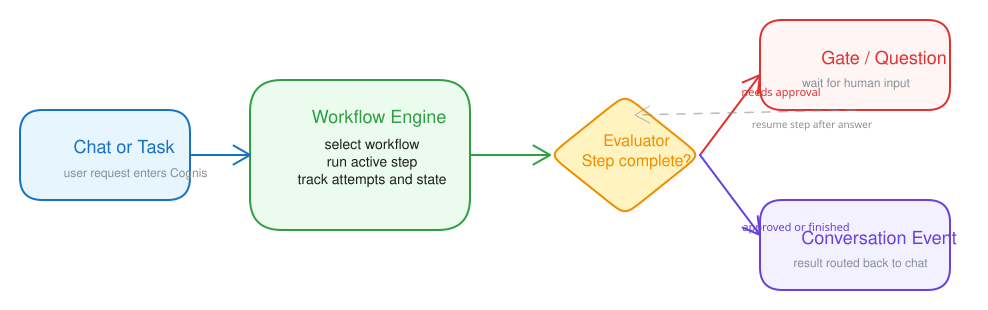

# Workflows

Workflows define how Cognis runs multi-step work. They are reusable templates that tasks and agents can use when a request should be broken into explicit stages instead of one direct response.



## Where workflows appear

- `Workflows` in the main navigation opens the workflow editor.
- `Tasks` use workflows to execute queued or background work.
- `Schedules` use workflows to create recurring background work.
- Agent settings can choose default workflows or limit which workflows an agent may use.

Owners can inspect their project-bound workflow definitions by exact ID and
find them in the unscoped administrative workflow list, even outside a project
chat. This does not make those workflows available for execution outside their
bound projects. Project-scoped lists retain their existing filtering.

## What a workflow contains

Deterministic conditions can inspect a prior run's canonical outcome through
`steps.<name>.outcome.status` and `.reason`. For example, a failed-outcome route
with `action: continue` can hand off to a condition selecting a failed `complete`
step rather than treating a blocker as successful completion. Step lifecycle
`status` is separate from the business outcome. Old stored outputs without an
outcome do not provide that evidence; do not infer success from a missing field.

Deterministic tool-call steps declare their pinned workflow scope to Intaris
before execution, without creating synthetic user messages. Declaration failures
stop the step before dispatch. Persisted owner-created tasks and schedules can
supply owner-configured scope; legacy records with no origin remain non-granting.
See the [declaration contract](../specs/workflow-step-declaration-v1.md) for
rollout requirements, provenance revocation and argument-projection limits.

Each workflow defines:

- workflow identity and description
- ordered steps
- step type and prompts
- optional step tool profiles
- step deliverables authored via `write_deliverable`
- optional evaluation or revision behavior
- loop and gate behavior
- optional agent overrides per step
- optional primary-session continuation with `input.reuse_session_from`

The workflow editor is designed for operators and advanced users. Most end users can start with existing workflows and only change them when they need a more structured execution path.

## Common workflow patterns

For a deterministic `skill_load` whose assets are consumed by later steps, add
`require_assets_ready: true` to its `tool_call.args` and keep `fail_on_error: true`
(the default). The engine waits through transient preparation failures on the
same executor and rejects an incomplete required runtime before rendering
successful-path outputs. Instruction-only loads retain their default partial
success behavior. Existing workflow definitions must explicitly opt in:

```yaml
tool_call:
  tool: skill_load
  args:
    skill_id: "{{ vars.skill_id }}"
    require_assets_ready: true
```

- `direct` style flows for simple work
- plan -> execute -> review flows for larger tasks
- gated steps that pause for human approval
- deterministic condition routes that revise a step from structured review metadata

Explicit gate options support `continue`, `cancel`, `fail`, and
`revise(step_name)`; a revision target must name an earlier step. The legacy
`revise:step_name` spelling is also accepted. An unsupported saved action or
target pauses the task for reconciliation rather than advancing it.

## Program steps (PTC)

Use a `program` step only for a bounded, predictable read/filter/aggregate stage
whose structured result is much smaller than its inputs. The step runs without
an LLM turn through the ordinary `python_execute` controller-tool path:

```yaml
- name: aggregate
  type: program
  program:
    language: python
    description: Count the input rows and return the total.
    code: |
      await cognis.emit({"count": len(inputs["rows"])})
    inputs:
      rows: [1, 2, 3]
    input_schema:
      type: object
      properties:
        rows:
          type: array
      required: [rows]
      additionalProperties: false
    output_schema:
      type: object
      properties:
        count:
          type: integer
      required: [count]
      additionalProperties: false
    tools: []
    limits:
      wall_seconds: 30
      max_calls: 4
      concurrency: 2
      output_bytes: 16384
```

The source is literal workflow configuration: it is never Jinja-rendered.
Workflow values belong in `inputs`, which are rendered separately and validated
against `input_schema`; the one emitted JSON object becomes
`steps.aggregate.outputs` after `output_schema` validation. `tools` is a
required allowlist of canonical tool IDs (`[]` is valid when the calculation
needs no nested tools). Only active tools marked read-only and not in the
model-backed memory/knowledgebase categories are accepted in this workflow
integration. Per-program `limits` may tighten but never raise the executor's
configured ceilings.
Do not pass credentials or other secrets as inputs; program code can inspect
every value it receives.

Program code is an untrusted candidate until an owner reviews and accepts its
pinned workflow configuration through the owner-configured workflow/task path.
An agent-composed workflow cannot execute or schedule its program step before
that acceptance. Nested tools still use their normal authorization and approval
rules; approval suspends the same call and must not be duplicated. A restarted
or uncertain execution is never blindly replayed and must be reconciled first.

Python itself is not sandboxed by the tool allowlist: code can use whatever
filesystem, network, and process capabilities the executor exposes. Use native
tools and ordinary workflow steps for writes, approval-sensitive actions, and
adaptive judgment. PTC guidance appears only when the effective runtime exposes
`python_execute`; composer callers must explicitly enable program candidates.
This backend slice preserves program fields in workflow JSON/model serialization
and agent-managed create/update operations. It does not add program-step controls
to the browser editor; avoid editing a program workflow there until its import/
export path has explicit program round-trip support.

### Internal packets and final Daily Brief output

A required collector deliverable is a durable step output, not the final task
presentation. In an unconditional linear workflow, the last required `run`
producer owns the task-level Daily Brief Pulse contract. Earlier required run
steps can deliver Markdown evidence packets without Pulse receipts. An explicit
outcome route with `action: continue` preserves this ownership: it takes the
same implicit next step as success. Conditional
or routed workflows retain strict validation when final-output ownership cannot
be proved.

A trailing `complete` also preserves ownership when it is unconditional,
successful, silent, and has neither content nor an explicit notification.
Its `outputs` remain step metadata, even when nonempty; the final artifact and
task content still come from the last required run. Other terminal shapes
remain strict. `require_deliverable` on a non-run node does not make it a
producer.

Task `write_deliverable` validation returns content-free `output_contract`
diagnostics (task/step/agent IDs, step index, producer, scope, reason and phase)
alongside the existing validation-state fingerprint. The same metadata is
logged; no prompt, tool arguments or result content is logged.

Delivery does not mean complete source coverage. A collector can deliver a
partial or blocked evidence packet. The consuming step must independently gate
coverage and must not perform vault or invoice mutations when material evidence
is missing. Use packet-only step inputs (`last`), not `full` history, across
agents that must not share raw source history. Deliverables never transfer tool
permissions or credentials.

An existing invalid final deliverable produces `deliverable_invalid`, not
`deliverable_missing`. After todos become terminal, validation and corrected
publication remain available until the final artifact satisfies its contract.

## Step tool profiles

Run steps can optionally define a step tool profile.

- A profile narrows the tool surface for that step.
- It works on top of the agent's existing tool access. It does not grant new capabilities.
- `soft` mode changes the step's default tool exposure but still lets the agent discover additional allowed tools through tool search.
- `hard` mode also limits what tool search can discover for that step.

Profiles are expressed as a matrix:

- rows are tool groups such as `filesystem`, `web`, `memory`, `shell`, or `browser`
- columns are capabilities: `read`, `write`, `privileged`, `destructive`

You can start from a shipped preset such as `Direct default`, `General task`, `Research`, `Coding`, or `Review`, then add an inline matrix and explicit include/exclude overrides for the specific step.

Direct chat uses the same step-profile mechanism under the hood through the shipped `system:direct-default` preset, even though the execution path stays inline instead of materializing a full workflow run.

## Creating a workflow

Open `Workflows` and either:

- create a new workflow from scratch
- duplicate an existing workflow
- import workflow YAML into the editor

You can then define metadata, edit steps, preview the pipeline diagram, and save the workflow.

On mobile, a sticky action bar at the bottom of the screen keeps `Save` one tap away even at the end of a long step editor. Other actions (New, Duplicate, Export YAML, Delete) are behind the `Actions` button on the same bar. Each step has up/down arrows for reorder, and every `?` help icon opens on tap.

The main chat agent can also manage workflows directly when you want to stay in conversation instead of using the editor. In that case, the agent should inspect the existing workflow first, keep changes minimal, and avoid mutating workflows that are already referenced by active tasks.

## YAML import and export

The workflow editor supports YAML import and export so you can:

- review a workflow definition outside the UI
- keep workflow definitions in version control
- copy a workflow between environments

The workflow model and agent-managed create/update tools retain program code as
a literal source field. Inputs and outputs remain separate typed JSON objects;
serialization does not interpolate them into source. The browser editor's YAML
import/export flow is unchanged and is not covered by this backend change.

## Workflow execution in tasks

When a task runs with a workflow, Cognis records:

- the active step
- step attempts and deliverable versions
- evaluator decisions
- pauses for gates or questions
- gate condition evaluation details, including values, operators, outcomes, and branch/action taken
- final completion or failure state

Step logs show newly written deliverables at their place in the timeline, with
subsequent progress below them. Older task histories without document timeline
events retain the output below the logs.

When a step retries or a task re-enters revision, the previous result is collapsed
and marked stale until a replacement is written. You can expand it to read it.
Paused, failed, and cancelled revisions keep the stale marker with their actual
state; they do not restore the previous output as current. Writing a replacement
makes that document current even before the step finishes. Document revision
numbers describe document history, not task attempts. If a branching workflow
does not establish which output is the task result, the task view reports unknown
ownership rather than selecting an unrelated document.

Clarification questions from tasks and child executions first reach the responsible
conversation agent. It can answer from context and your preferences, or ask you
rather than guess. Scheduled/API task destinations do not imply decision authority.
Unanswered mediation falls back to you; approvals and auth requests remain user-only.

Deterministic steps expose structured outputs and execution details in **Output**:
tool arguments use the recorded redacted audit, while conditions show the expression,
boolean result, and selected route. New deterministic tool executions also record
tool calls and results in **Logs**. Historical runs without these events retain
their recorded output details; they are not re-executed to populate logs.

Deterministic templates support the `length` and `default` Jinja filters.
For an optional output, use
`{{ steps.operate.outputs.notify | default(false) == true }}`.
`default(false)` replaces a missing value, not an existing false, null, or string
value. Conditions must still evaluate to a boolean; other filters, object
methods, and Python attribute access remain unavailable.

Model-only instruction and skill-activation payloads are excluded from
`result.metadata`. A deterministic `skill_load` step can return prepared asset
manifests and Python environment paths without putting the full skill instructions
into the template context. Model loading retains those instructions; workflow
rendering limits are unchanged.

Deterministic tool results expose **reference-only attachments**. The same
projection is used for `result.attachments`, persisted step attachments, and
`steps.<name>.attachments`, including historical outputs read after recovery.
Artifact IDs, filenames, MIME types, sizes, and revision metadata remain available.
Existing URL-only, lazy tool-artifact, and deliverable references retain their
identity; a reference does not grant access to its content.

Inline `content_b64` is no longer available in deterministic attachment templates,
even for small files. Transfer receipts, upload/download capabilities, local source
paths, and signed URLs accompanying an artifact ID are not copied into these
attachment projections. Missing or malformed references and unmaterialized binary
attachments fail the step rather than disappearing silently. Renderer limits
remain unchanged. Ordinary model attachments and canonical tool evidence are
unaffected.

For a large local file, use a side-effect-authorized `artifact_publish` step and
project only `{"artifact_id": "{{ result.metadata.artifact_id }}"}` into its
outputs. That metadata ID is supplied by the controller only after successful
inline or staged publication. Pass the ID to later tools using the existing
`$artifact:<id>.*` value references; normal access checks still apply. Request a
fresh URL through the artifact tools when needed, instead of persisting an
expiring artifact attachment URL.

Publication can finish before rendering or step persistence fails. Do not replay
an interrupted side-effecting publish blindly: reconcile its artifact and step
evidence first. Recovery reuses persisted step output, or reports an ambiguous
write outcome without redispatching it. This does not add an inline-publication
exactly-once guarantee or change artifact revision compare-and-swap behavior.

From a task's logs, **View session** opens a delegate's logs. **Back** returns to
the parent session, including when the task is opened in the dashboard modal.

Step timing is accumulated across attempts so diagrams and task details show the
total time spent on a step, not only the latest retry. Latest-attempt duration can
still appear as secondary metadata when a view needs that distinction.

Like direct chat turns, workflow steps are protected by a long-running turn
watchdog. A watchdog interruption is recorded as a visible system/log notice and
may be continued automatically within the controller's retry budget. The resumed
step is reminded to verify alignment with the original task, update todos when
appropriate, summarize the interrupted state, and continue only if needed and
safe.

### Deliverables by default

Workflow steps use deliverables by default.

- A **deliverable** is the typed artifact a step writes with `write_deliverable`.
- Deliverables are used for evaluator review, downstream step context, task detail UI, and final workflow output.
- A workflow can produce many step deliverables, but only one final deliverable is externally delivered for the run.
- Free-text assistant messages during workflow execution are reasoning or progress, not the canonical artifact.
- Deliverable IDs (`dlv_*`) are artifact-compatible virtual refs for tools that
  read, save, or download content, without copying the deliverable into artifact
  storage.

This makes deliverables useful for more than just the final user-facing message. They are the stable artifacts that let multi-step workflows stay inspectable and evaluable.

Exception: `system:direct` keeps the normal chat behavior, so direct chat replies still come from the assistant message instead of `write_deliverable`.

Task results are delivered back into the conversation flow, with the chosen final deliverable treated as the canonical workflow result.

## Tips

- Start simple. Only add evaluation loops or gates when the work truly needs them.
- Prefer short, explicit step instructions over long multi-purpose prompts.
- Keep one primary session across related steps. Use isolated agent overrides for independent reviews.
- Prefer deterministic metadata and condition routing when a reviewer returns a structured decision.
- Use the task detail view to learn how a workflow behaves before making it more complex.
